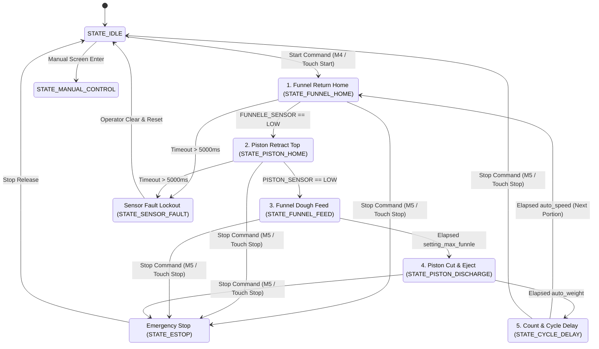

# Bakery Portioning Cycle Finite State Machine (FSM) Specification

This document specifies the Finite State Machine (FSM), sequential phases, actuator timing, interlocks, and sensor timeout protection governing the automatic dough dividing cycle.

---

## 1. FSM State Transition Flowchart

---

## 2. Phase-by-Phase Execution Analysis

### Phase 1: Funnel Return to Home (`STATE_FUNNEL_HOME`)
- **Action:** Retracts the dough hopper to its calibrated baseline zero position.
- **Actuator Outputs:**
  - `PISTON_MOTOR = OFF`
  - `INVERTER_FORWARD = OFF`
  - `INVERTER_REVERSE = ON`
  - `FUNNELE_MOTOR = ON`
- **UI Progress:** Bar value set to 25% (`ui_AutomaticMode_Bar2`).
- **Exit Condition:** `digitalRead(FUNNELE_SENSOR) == LOW`.
- **Safety Watchdog:** Maximum duration 5000ms (`SENSOR_MOTION_TIMEOUT_MS`). On expiration without sensor confirmation, system transitions immediately to `STATE_SENSOR_FAULT`.
- **Phase Transition Pause:** `funneleStop()` followed by 500ms stabilization delay.

### Phase 2: Piston Retract to Top Limit (`STATE_PISTON_HOME`)
- **Action:** Retracts the cutting piston to top dead center, opening the portioning chamber.
- **Actuator Outputs:**
  - `FUNNELE_MOTOR = OFF`
  - `INVERTER_FORWARD = OFF`
  - `INVERTER_REVERSE = ON`
  - `PISTON_MOTOR = ON`
- **UI Progress:** Bar value set to 59%.
- **Exit Condition:** `digitalRead(PISTON_SENSOR) == LOW`.
- **Safety Watchdog:** Maximum duration 5000ms.
- **Phase Transition Pause:** `pistonStop()` followed by 10ms settling delay.

### Phase 3: Funnel Forward Dough Feed (`STATE_FUNNEL_FEED`)
- **Action:** Drives the hopper forward to inject bulk dough into the open chamber.
- **Actuator Outputs:**
  - `PISTON_MOTOR = OFF`
  - `INVERTER_REVERSE = OFF`
  - `INVERTER_FORWARD = ON`
  - `FUNNELE_MOTOR = ON`
- **UI Progress:** Bar value advances to 75% - 85%.
- **Exit Condition:** Elapsed time exceeds `storage.get_setting_max_funnle()`.
- **Phase Transition Pause:** `funneleStop()` followed by 10ms settling delay.

### Phase 4: Piston Compression, Cut & Discharge (`STATE_PISTON_DISCHARGE`)
- **Action:** Advances the piston downward, shearing off the dough volume and ejecting the portion.
- **Actuator Outputs:**
  - `FUNNELE_MOTOR = OFF`
  - `INVERTER_REVERSE = OFF`
  - `INVERTER_FORWARD = ON`
  - `PISTON_MOTOR = ON`
- **UI Progress:** Bar value reaches 100%.
- **Exit Condition:** Elapsed time exceeds `storage.getAutoWeight()`.
- **Phase Transition Pause:** `pistonStop()`.

### Phase 5: Accounting, Acoustic Notification & Cadence Delay (`STATE_CYCLE_DELAY`)
- **Action:** All actuators de-energized.
- **Portion Accounting:**
  - Increments cumulative portion tally: `newval = storage.getChoneCounter() + 1`.
  - Commits `chone_counter` to NVS non-volatile storage.
  - Updates UI labels on Automatic screen and Menu screen.
- **Acoustic Feedback:** If `activeCounterSound` is enabled, triggers an asynchronous notification to `buzzer_task`.
- **Cadence Delay:** System pauses for duration `storage.getAutoSpeed()` before restarting Phase 1.

---

## 3. Motion Interlock Matrix

| Active Actuator | Strictly Forbidden Actuators | Protection Rationale |
|---|---|---|
| `INVERTER_FORWARD` | `INVERTER_REVERSE` | Prevents VFD short-circuit and DC bus overcurrent |
| `INVERTER_REVERSE` | `INVERTER_FORWARD` | Prevents VFD short-circuit and DC bus overcurrent |
| `PISTON_MOTOR` | `FUNNELE_MOTOR` (in opposing directions) | Prevents transformer and driver stage overload |
| `pistonDown()` | Funnel in mechanical interference envelope | Prevents collision between cutting blade and hopper |
