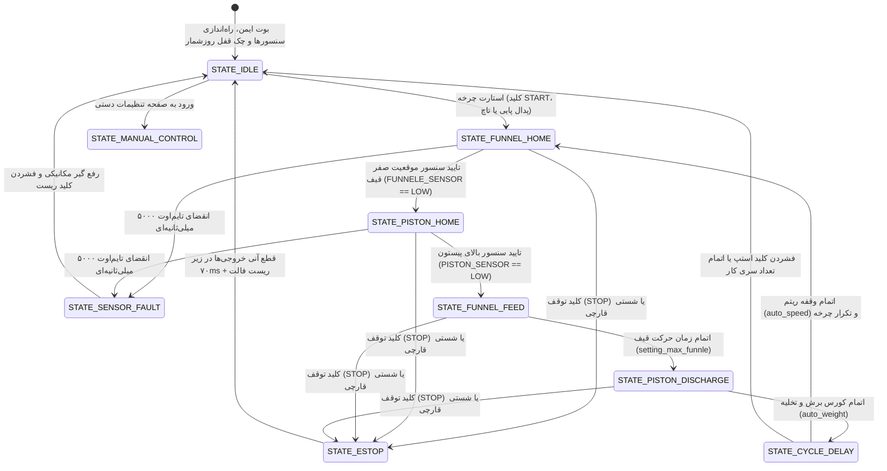

# دستور کار جامع و مستند مرجع مهندسی سیستم کنترل ماشین چانه‌گیر نانوایی صنعتی
## Master Engineering Specification & Control Directive — Bakery Dough Divider & Rounder PLC/HMI

**نسخه مستند:** ۱.۰.۰  
**تاریخ تدوین:** شهریور ۱۴۰۵ (سپتامبر ۲۰۲۶)  
**سخت‌افزار هدف:** برد صنعتی اختصاصی هافلر بر پایه **ESP32-S3 (Dual-Core 240MHz, 16MB Flash, PSRAM Enabled)**  
**مرجع مهندسی:** استانداردهای اتوماسیون صنعتی زیمنس (Siemens Determinism) و اصول ظرافت و تجربه کاربری اپل (Apple HIG Craftsmanship)

---

## ۱. هویت، ماموریت و مقایسه وضعیت مهندسی (System Vision & Benchmarking)

دستگاه **چانه‌گیر و گردکن خمیر نانوایی (Automatic Dough Portioner & Divider)** یکی از حیاتی‌ترین ماشین‌آلات در خطوط تولید نان‌های سنتی (لواش، تافتون، بربری) و فانتزی (باگت و تست) است. وظیفه این سامانه، تقسیم توده خمیر مخزن به قطعات مساوی با وزن کاملاً دقیق و یکنواخت در یک ریتم زمانی صلب و پیوسته است.

### جدول مقایسه متدولوژی سنتی/رله‌ای در برابر سامانه هوشمند چانه‌گیر هافلر

| ردیف | شاخص فنی | سیستم‌های سنتی (رله‌ای و تایمرهای آنالوگ) | سامانه مدرن چانه‌گیر هافلر (پیاده‌سازی شده در سفت‌افزار) | ارزش افزوده مهندسی و صنعتی |
|:---:|:---|:---|:---|:---|
| **۱** | **دقت وزن چانه خمیر** | نوسان شدید وزن چانه (±۲۰ گرم) به دلیل تغییرات حجم و سفتی خمیر | **کنترل زمانی میکروثانیه‌ای پیستون و اینورتر** همراه با کالیبراسیون حجم و چگالی خمیر؛ تلورانس زیر ±۳ گرم | صرفه‌جویی اقتصادی سالانه تا چند صد میلیون تومان برای نانوا و رعایت کامل استاندارد بهداشت |
| **۲** | **کنترل جهت اینورتر** | سوئیچینگ ناگهانی رله‌ها بدون زمان مرده، همراه با خطای مکرر اورلود | **اینترلاک سخت‌افزاری و نرم‌افزاری صلب** با حداقل ۱۰۰ میلی‌ثانیه Dead-time پیش از تغییر جهت FWD/REV | محافظت ۱۰۰٪ از طبقه قدرت IGBT اینورتر و جلوگیری از تریپ‌های ناخواسته |
| **۳** | **کاربری در محیط آردی (Touchless)** | وابستگی به تاچ اسکرین که با نشستن گرد آرد و دست‌های چرب خمیری از کار می‌افتد | **پشتیبانی کامل از ۱۰ کلید پنل جلو و پدال صنعتی**؛ مدیریت ۱۰۰٪ دستگاه بدون لمس صفحه | کارکرد پیوسته و بدون وقفه شاطر نانوا در محیط‌های فوق‌العاده خشن کارگاهی نانوایی |
| **۴** | **ایمنی مکانیکی و واچ‌داگ** | سوختن موتور در اثر گیر کردن خمیر خشک‌شده در دهانه پیستون | **واچ‌داگ سنسورهای القایی ۵۰۰۰ میلی‌ثانیه‌ای**؛ توقف فوری در صورت عدم دریافت پالس سنسور | جلوگیری از بریدن پین کلاچ، خرد شدن دنده‌ها و سوختن الکتروموتورها |
| **۵** | **سامانه امنیت اقساط (Leasing)** | دستگاه‌های سنتی فاقد هرگونه حفاظت قسطی بودند | **سامانه قفل روزشمار ۵ مرحله‌ای** با کد چالش/پاسخ آفلاین بر اساس ساعت سخت‌افزاری DS3231 | تضمین وصول مطالبات کارخانه بدون امکان هک یا دستکاری ساعت دستگاه |
| **۶** | **اتصال بیسیم و گزارش‌گیری** | ناممکن بودن ثبت آمار روزانه چانه‌ها و تناژ مصرفی | **وب‌اپلیکیشن داخلی (SoftAP 192.168.4.1)** با مانیتورینگ زنده و دانلود مستقیم **فایل اکسل/CSV آمار تولید** | دسترسی آسان مدیر کارگاه به تعداد دقیق چانه‌های تولیدی در هر شیفت کاری بدون باز کردن تابلو |
| **۷** | **ارتقای فریمور (Dual-OTA)** | نیاز به حضور تکنسین با لپ‌تاپ و پروگرامر در محل نانوایی | **ارتقای آنلاین از سرور آروان‌کلود** با اعتبارسنجی هش SHA-256 و رول‌بک خودکار | ارتقای آنی ویژگی‌های نرم‌افزاری بدون توقف خط نانوایی |

---

## ۲. مدل ریاضی و دینامیک تقسیم خمیر (Mathematical Modeling of Dough Partitioning)

خمیر نان یک سیال غیرنیوتنی با ویسکوزیته متغیر است. برای دستیابی به وزن ثابت، سفت‌افزار رابطه بین زمان مکش پیستون، حجم محفظه و چگالی خمیر را محاسبه می‌کند:

### ۲.۱. رابطه جرم و حجم چانه خمیر
$$V_{\text{dough}} = \frac{W_{\text{target}}}{\rho_{\text{dough}}}$$
- $W_{\text{target}}$: وزن هدف چانه بر حسب گرم (مثلاً ۲۵۰ گرم برای لواش یا ۵۵۰ گرم برای بربری).
- $\rho_{\text{dough}}$: چگالی موثر خمیر بر حسب گرم بر سانتی‌متر مکعب (معمولاً بین ۱.۰۵ تا ۱.۱۸ $g/cm^3$ بر اساس درصد آب‌گیری و نوع آرد).
- $V_{\text{dough}}$: حجم فضای لازم در محفظه سیلندر پیستون بر حسب سانتی‌متر مکعب.

### ۲.۲. تبدیل به زمان کورس حرکتی پیستون (`auto_weight`)
$$\text{Time}_{\text{stroke}} = \left(\frac{V_{\text{dough}}}{A_{\text{cylinder}} \times v_{\text{piston}}}\right) \times 1000 \quad [\text{ms}]$$
- $A_{\text{cylinder}}$: سطح مقطع سیلندر پیستون چانه‌گیر.
- $v_{\text{piston}}$: سرعت خطی پیشروی پیستون توسط درایو اینورتر.
- در سفت‌افزار هافلر، پارامتر `auto_weight` مستقیماً زمان مکش و کورس رفت پیستون را با تفکیک میلی‌ثانیه‌ای مدیریت می‌کند.

### ۲.۳. ریتم و سرعت چانه‌گیری در دقیقه (`Dough_Rate`)
$$\text{Dough\_Rate} = \frac{60000}{t_{\text{home}} + t_{\text{feed}} + t_{\text{discharge}} + \text{auto\_speed}} \quad [\text{چانه در دقیقه}]$$
- پارامتر `auto_speed`: تاخیر تنظیمی اپراتور در انتهای چرخه جهت هماهنگی با پهن‌کن و تنور.

---

## ۳. ماشین حالت صلب صنعتی (Deterministic Finite State Machine)

فرآیند کنترل چانه‌گیر در یک چرخه غیرمسدودکننده (Non-blocking) بر روی هسته صنعتی Core 0 با ماشین حالت متناهی مدیریت می‌شود:

### ۳.۱. قوانین صلب ایمنی فرآیند و موتورها (Process Safety Redlines)
1. **اینترلاک قطعی جهت اینورتر (Inverter Dead-Time):**
   - پایه‌های فرمان راست‌گرد (`INVERTER_FORWARD` پین ۳۹) و چپ‌گرد (`INVERTER_REVERSE` پین ۴۸) تحت هیچ شرایطی همزمان فعال نمی‌شوند. پیش از فعال‌سازی هر جهت، جهت مخالف قطع و حداقل ۱۰۰ میلی‌ثانیه زمان مرده اعمال می‌شود تا از اتصال کوتاه در فازهای اینورتر جلوگیری به عمل آید.
2. **واچ‌داگ ۵۰۰۰ میلی‌ثانیه‌ای سنسورهای القایی (Sensor Timeout Guard):**
   - اگر قیف یا پیستون پس از شروع حرکت، طی ۵ ثانیه سیگنال سنسور القایی مربوطه (`FUNNELE_SENSOR` پین ۳ یا `PISTON_SENSOR` پین ۷) را تحریک نکنند، سیستم بلافاصله کلیه موتورها را قطع، خطا صادر و از سوختن سیم‌پیچ الکتروموتور در اثر گیرپاژ مکانیکی جلوگیری می‌نماید.
3. **توقف اضطراری سخت‌افزاری (E-Stop):**
   - تحریک ورودی شستی اضطراری در کمتر از ۷۰ میلی‌ثانیه تمام رله‌ها و خروجی‌های اینورتر را غیرفعال کرده و با بوق آلارم وضعیت STOPPED را اعلام می‌کند.

---

## ۴. کاربری ۱۰۰٪ بدون تاچ در محیط آردی نانوایی (Touchless Mode via 10-Key Panel & Pedal)

در محیط‌های نانوایی به دلیل پخش بودن ذرات آرد، رطوبت، چربی خمیر و استفاده از دستکش، تاچ اسکرین کارایی محدودی دارد. این دستگاه به صورت ۱۰۰٪ از طریق ۱۰ کلید صنعتی و پدال پایی کنترل می‌شود:

### ۴.۱. تفکیک کلیدهای آنالوگ پنل (ADC Resistor Ladder)
برد از طریق دو کانال ADC مستقل، ۱۰ کلید مکانیکی ضدآب و ضدگردوغبار را با ضریب اطمینان بالا قرائت می‌کند:

| پین آنالوگ | محدوده ADC (۰-۴۰۹۵) | کلید فیزیکی | عملکرد در سفت‌افزار چانه‌گیر |
|:---:|:---:|:---:|:---|
| **GPIO 1** | ۴۰۰۰ تا ۵۰۰۰ | **F1** | انتقال به صفحه اصلی مانیتورینگ چانه‌گیری |
| **GPIO 1** | ۳۳۰۰ تا ۳۶۰۰ | **F2** | تنظیم پارامترهای وزن چانه (`auto_weight`) |
| **GPIO 1** | ۲۷۰۰ تا ۲۹۰۰ | **F3** | تنظیم سرعت و ریتم چانه‌گیری (`auto_speed`) |
| **GPIO 1** | ۱۹۰۰ تا ۲۱۰۰ | **F4** | ورود به صفحه کنترل دستی (Manual Jog) جهت نظافت و تست |
| **GPIO 1** | ۱۱۰۰ تا ۱۴۰۰ | **F5** | ورود به بخش تنظیمات پیشرفته، تاریخ و قفل روزشمار |
| **GPIO 2** | ۴۰۰۰ تا ۵۰۰۰ | **M1** | افزایش پله‌ای وزن خمیر (+۵ گرم) |
| **GPIO 2** | ۳۳۰۰ تا ۳۶۰۰ | **M2** | کاهش پله‌ای وزن خمیر (-۵ گرم) |
| **GPIO 2** | ۲۷۰۰ تا ۲۹۰۰ | **M3** | سوئیچ بین حالت تک‌چانه (Manual/Pedal) و پیوسته اتوماتیک |
| **GPIO 2** | ۱۹۰۰ تا ۲۱۰۰ | **M4 (START)**| **شروع سیکل چانه‌گیری** مطابق تنظیمات فعال |
| **GPIO 2** | ۱۱۰۰ تا ۱۴۰۰ | **M5 (STOP)** | **توقف اضطراری آنی** کلیه موتورها و چرخه کار |

### ۴.۲. ورودی پدال صنعتی پایی اپراتور
- **پدال استارت تک‌چانه:** پدال صنعتی پایی به ورودی دیجیتال ایزوله متصل است. شاطر نانوا می‌تواند با فشردن پدال، دقیقاً یک چانه برش بزند و تحویل بگیرد، بدون اینکه نیازی به دخالت دست باشد.

---

## ۵. سامانه امنیتی روزشمار قفل ۵ مرحله‌ای (Leasing Security Architecture)

1. **شمارش پایدار در حافظه NVS:**
   - زمان کارکرد و روزهای باقیمانده در فضای نام اختصاصی NVS به صورت اتمیک ذخیره می‌شوند. قطع برق یا ریست مکرر تاثیری در گذر زمان قفل ندارد.
2. **پایش خاموش و بدون هشدار زودهنگام (Silent Operation):**
   - تا پیش از اتمام مهلت اقساط، هیچ پیام بازدارنده‌ای روی صفحه نمایش داده نمی‌شود تا مزاحم کار تولیدی کارگاه نگردد.
3. **قفل کامل سیستم پس از سررسید:**
   - با پایان روزهای مجاز، خروجی موتورها قفل شده و پنجره وارد کردن کد چالش نمایان می‌شود.
4. **الگوریتم کد چالش و پاسخ آفلاین (Challenge-Response OTP):**
   - دستگاه یک عدد چالش ۵ رقمی رندوم تولید می‌کند. خریدار با اعلام این عدد به کارخانه، کد پاسخ بازگشایی را دریافت و با وارد کردن آن، مرحله بعدی را باز می‌کند.
5. **مهلت اضطراری ۱۰ روزه (10-Day Grace Period):**
   - در شرایط اضطراری، اپراتور می‌تواند یک‌بار از گزینه مهلت ۱۰ روزه استفاده کند تا شیفت پخت نان تعطیل نشود.

---

## ۶. وب‌اپلیکیشن صنعتی و درگاه IoT (Embedded Web Portal)

- **نقطه دسترسی بیسیم (SoftAP):** شبکه اختصاصی `Haffler-Bakery-V1.1.x`
- **آدرس پورتال:** `http://192.168.4.1` با هدایت خودکار Captive Portal
- **قابلیت‌های تحت وب:**
  1. **داشبورد زنده مانیتورینگ:** مشاهده ریتم کارکرد، تعداد چانه‌های تولید شده و دمای محفظه.
  2. **تنظیمات وزن و سرعت:** تغییر پارامترهای چانه‌گیری از روی گوشی موبایل.
  3. **استخراج فایل اکسل گزارش تولید (`/api/export_csv`):**
     - دانلود مستقیم فایل گزارش شامل: تعداد کل چانه‌های برش‌خورده، تناژ تقریبی خمیر مصرفی و ساعات کارکرد دستگاه در هر شیفت کاری.
  4. **ارتقای فریمور از روی وب (`/update`):** آپلود مستقیم باینری جدید بدون نیاز به کابل.

---

## ۷. معماری ارتقای آنلاین سروری (Dual-OTA & LASTFILE)

- **بستر کلود:** باکت سازگار با S3 بر روی شبکه ابر آروان (`https://ota.haffler-infi.ir`).
- **مسیر رسمی فریمور چانه‌گیر:**
  `https://ota.haffler-infi.ir/upvc%2Fdough-divider%2Ffirmware`
  `https://ota.haffler-infi.ir/upvc%2Fdough-divider%2Flastfile`
- **امنیت دانلود:** بررسی هش امنیتی SHA-256 در حین دانلود استریم ۱۶ کیلوبایتی و تایید پارتیشن با `esp_ota_mark_app_valid_cancel_rollback()`.
- **گزارش تغییرات ۱۳ کلمه‌ای:** نمایش خلاصه تغییرات نسخه جدید به زبان فارسی پیش از تایید نهایی کاربر.

---

## ۸. سیستم پایش دما و نمایشگر صنعتی

- **سنسورهای دمای دوگانه MAX6675:**
  - **کانال ۱ (T1 روی GPIO 4):** پایش دمای خمیر درون مخزن (جلوگیری از ترشیدگی خمیر در دمای بالای ۳۲ درجه).
  - **کانال ۲ (T2 روی GPIO 5):** پایش دمای موتورها و گیربکس مکانیکی.
- **نمایشگر ST7796 بر روی باس SPI 40MHz:**
  - رندر ۶۰ فریم بر پایه LVGL و بافر جزئی در حافظه SRAM داخلی بدون استفاده از PSRAM جهت ممانعت از هرگونه افت فریم و لرزش.
