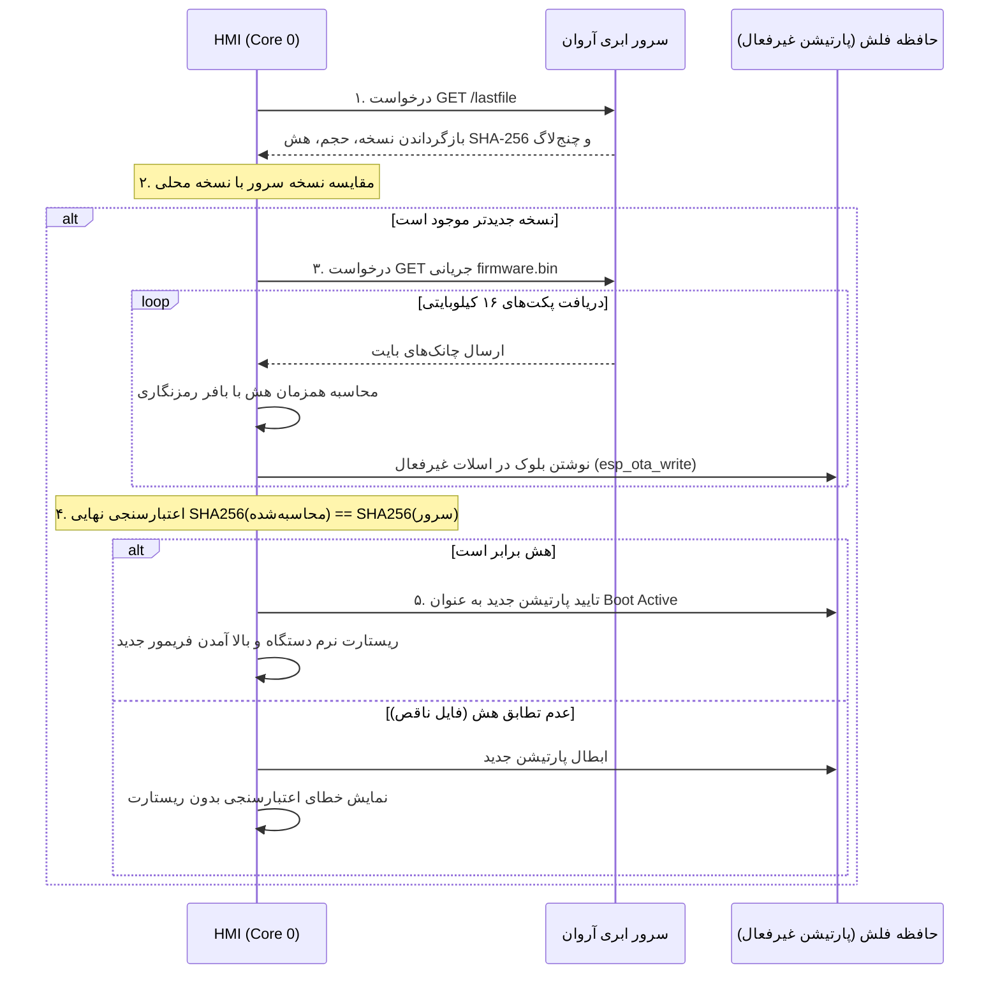

# پروتکل استاندارد آپدیت سرور و انتشار OTA (Dual-Partition OTA Protocol)
## دستگاه چانه‌گیر و گردکن خمیر نانوایی هافلر (Bakery Dough Divider HMI)

این مستند استانداردهای معماری دوپارتیشنی، ارتباط با سرور ابری آروان‌کلود (ArvanCloud S3)، فرآیند دانلود جریانی، اعتبارسنجی هش SHA-256 و ساخت بسته انتشار فریم‌ور را تشریح می‌کند.

---

## ۱. ساختار پارتیشن‌های فلش ۱۶ مگابایتی (`partitions.csv`)

دستگاه از جدول پارتیشن سفارشی و افزونه دوگانه با دو اسلات ۷ مگابایتی بهره می‌برد:

```text
# Name,   Type, SubType, Offset,  Size,     Flags
nvs,      data, nvs,     0x9000,  0x5000,
otadata,  data, ota,     0xe000,  0x2000,
app0,     app,  ota_0,   0x10000, 0x700000,
app1,     app,  ota_1,   0x710000,0x700000,
spiffs,   data, spiffs,  0xe10000,0x1e0000,
coredump, data, coredump,0xff0000,0x10000,
```

- **پارتیشن جاری:** اگر نسخه فعال روی `app0` باشد، آپدیت جدید به صورت جریانی روی `app1` نوشته می‌شود (و بالعکس).
- **حفاظت ابدی از کالیبراسیون و قفل (NVS Safety):** پارتیشن `nvs` در افست `0x9000` هرگز در حین OTA بازنویسی یا پاک نمی‌شود؛ بنابراین کالیبراسیون وزن چانه، شمارنده‌ها و روزشمار دستگاه همواره دست‌نخورده باقی می‌ماند.
- **بازگشت خودکار در صورت خطا (Anti-Brick Rollback):** در صورت قطع برق در حین نوشتن فلش یا کرش فریم‌ور جدید در بوت اولیه، بوت‌لودر ESP32-S3 پس از ۳ بار ریست ناموفق، اجرای کد را فوراً به پارتیشن سالم قبلی برمی‌گرداند.

---

## ۲. توصیف‌گر انتشار سرور (`lastfile`) و ساختار ابری

سرویس آپدیت آنلاین هافلر بر روی باکت اختصاصی آروان‌کلود میزبانی می‌شود:
- آدرس سرور: `https://ota.haffler-infi.ir/bakery/firmware`
- فایل توصیف‌گر متنی: `https://ota.haffler-infi.ir/bakery/lastfile`

### فرمت استاندارد `lastfile`:
```text
[version]
V.1.1.1
[size]
3145728
[sha256]
A7B2C4D8E9F1023456789ABCDEF0123456789ABCDEF0123456789ABCDEF01234
[url]
https://ota.haffler-infi.ir/bakery/firmware/firmware.bin
[description]
* V.1.1.1: بهبود اینترلاک اینورتر و افزایش پایداری سنسور قیف
* V.1.1.0: نسخه اولیه چانه‌گیر نانوایی با نمایشگر ۴۸۰ در ۳۲۰
```

---

## ۳. مراحل دانلود جریانی و اعتبارسنجی یکپارچگی (Streaming OTA Workflow)



---

## ۴. ابزار خودکار ساخت بسته انتشار (`tools/gen_lastfile.py`)

با دستور کارفرما جهت تحویل بسته سرور، اسکریپت پایتون اجرا شده و اقدامات زیر را خودکار انجام می‌دهد:
1. استخراج شماره نسخه از `VERSION` و `version.json`.
2. یافتن باینری تولیدشده PlatformIO (`.pio/build/esp32-s3/firmware.bin` یا `V.1.1.0/ChoneProject/...`).
3. محاسبه دقیق هش باینری بر مبنای SHA-256 (حروف بزرگ).
4. استخراج چنج‌لاگ‌های فشرده (حداکثر ۱۳ کلمه‌ای).
5. تولید فایل نهایی `lastfile` با انکودینگ UTF-8 و ساختار استاندارد.
