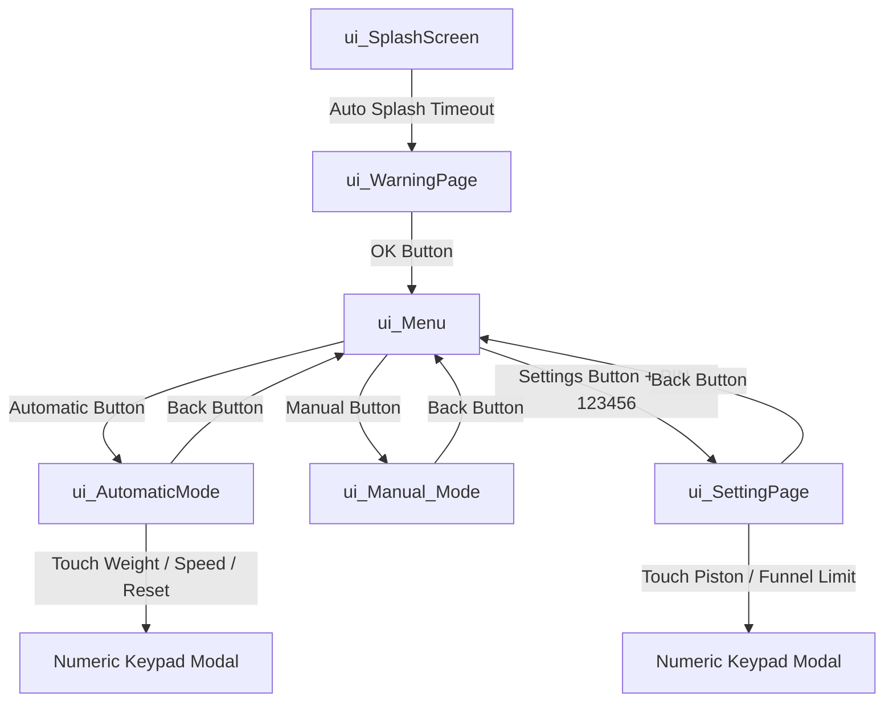

# UI Screen Inventory & Widget Hierarchy — Bakery HMI

This document specifies the complete inventory of user interface screens, widget trees, event bindings, and navigation contracts implemented via LVGL in the Bakery HMI system.

---

## 1. Screen Navigation Architecture

---

## 2. Detailed Screen Descriptors

### 2.1. Splash Screen (`ui_SplashScreen`)
- **Descriptor Object:** `ui_SplashScreen`
- **Purpose:** Displays corporate branding and firmware version upon power-up.
- **Assets:** `ui_img_logo_png` brand graphic.

### 2.2. Safety Warning Screen (`ui_WarningPage`)
- **Descriptor Object:** `ui_WarningPage`
- **Purpose:** Informs operator of moving machinery hazards before allowing access to motor controls.
- **Widgets:**
  - Confirmation button: `ui_WarningPage_Button1`
  - Callback: `warning_next_btn` -> Navigates to `ui_Menu`.

### 2.3. Main Menu Dashboard (`ui_Menu`)
- **Descriptor Object:** `ui_Menu`
- **Purpose:** Central operational dashboard displaying real-time clock, date, portion tally, and subsystem routing.
- **Widgets & Dynamic Bindings:**
  - Real-Time Clock: `ui_Menu_TimeLable` (Updated every 1s from DS3231)
  - Gregorian / Persian Date: `ui_Menu_DateLable`
  - Total Portion Tally: `ui_Menu_Counter_Lable`
  - Automatic Mode Button: `ui_Menu_AutomaticModeButton` -> `menue_automatic_btn`
  - Manual Mode Button: `ui_Menu_ManualModeButton` -> `menue_manual_btn`
  - Settings Gear Button: `ui_Menu_SettingImageButton` -> Opens password popup
  - Password Popup Modal: `ui_Menu_SettingPasswordPanle` with keypad `ui_Menu_KeyboardSetting` (Valid PIN: `123456`).

### 2.4. Automatic Portioning Screen (`ui_AutomaticMode`)
- **Descriptor Object:** `ui_AutomaticMode`
- **Purpose:** Primary working screen during bread production.
- **Widgets & Dynamic Bindings:**
  - Start / Stop Button: `ui_AutomaticMode_StartStopButton` (Toggles state and label: "شروع" / "توقف")
  - Back Button: `ui_AutomaticMode_BackButton` (Locked out while machine is in motion)
  - Weight Adjustment: `ui_AutomaticMode_WeightButtonAdd` / `ui_AutomaticMode_WeightValueRemove` or touch `ui_AutomaticMode_WeightValue` for keypad modal
  - Speed / Pace Adjustment: `ui_AutomaticMode_SpeedButtonAdd` / `ui_AutomaticMode_SpeedValueRemove` or touch `ui_AutomaticMode_SpeedValue` for keypad modal
  - Counter Reset Button: `ui_AutomaticMode_CounterResetButton` (Requires PIN `654321`)
  - Acoustic Beep Toggle: `ui_AutomaticMode_Silent_key` (Mutes/unmutes portion completion beep)
  - Cycle Progress Indicator: `ui_AutomaticMode_Bar2` (Displays real-time phase completion 0% to 100%).

### 2.5. Manual Jogging Screen (`ui_Manual_Mode`)
- **Descriptor Object:** `ui_Manual_Mode`
- **Purpose:** Independent actuator jogging for calibration, cleaning, and maintenance.
- **Widgets:**
  - Piston Retract Top: `ui_Manual_Mode_PistonUpButton` -> `manoal_PistonUp_btn`
  - Piston Advance Down: `ui_Manual_Mode_PistonDownButton` -> `manoal_PistonDown_btn`
  - Funnel Retract Home: `ui_Manual_Mode_Funnle_BackButton` -> `manoal_FunnleBack_btn`
  - Funnel Advance Forward: `ui_Manual_Mode_Funnle_ForwardButton` -> `manoal_FunnleForward_btn`
  - Exit to Menu: `ui_Manual_Mode_BackButton1` -> `manoal_back_btn` (Stops all actuators immediately).

### 2.6. Technical Settings Screen (`ui_SettingPage`)
- **Descriptor Object:** `ui_SettingPage`
- **Purpose:** Calibration of mechanical travel limits.
- **Widgets:**
  - Piston Limit: `ui_SettingPage_PistonValue` with increment/decrement buttons and keypad modal
  - Funnel Limit: `ui_SettingPage_FunnleValue` with increment/decrement buttons and keypad modal
  - Keypad Modal: `ui_SettingPage_SettingPanleKeybord`.
