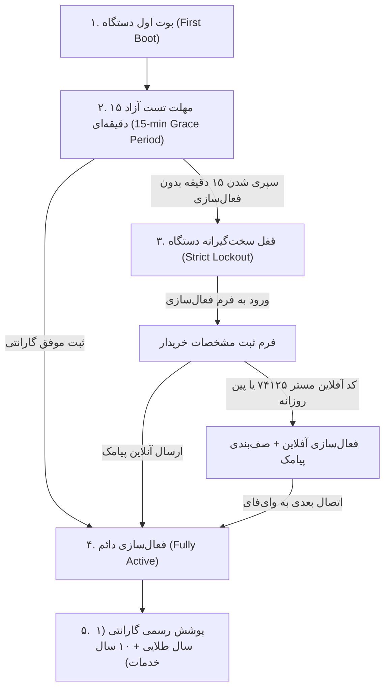

# نظام‌نامه فنی گارانتی ۵ مرحله‌ای و قفل اجاره‌ای هافلر — اره تک‌سر دیجیتال
# Haffler 5-Stage Warranty & Day-Lock Lease Engine Specification

> **پروژه:** اره تک‌سر دیجیتال (متر دیجیتال) — `Cutter_single_head(Digital_metr)`  
> **پلتفرم سخت‌افزاری:** ESP32-S3 (16MB Flash, PSRAM) + ST7796 SPI LCD + GT911 Capacitive Touch  
> **فریم‌ورک:** Arduino ESP32 (نسخه پین‌شده ۳.۳.۹) + LVGL 9.4.0  

---

## ۱. چرخه عمر ۵ مرحله‌ای گارانتی و قفل اجاره‌ای (5-Stage Architecture)

### مرحله ۱: راه‌اندازی اولیه و شروع شمارش معکوس
- پس از فلش فریم‌ورک و نخستین بوت، شمارندهٔ زمان کارکرد معکوس از ۹۰۰ ثانیه (۱۵ دقیقه) آغاز می‌شود.
- در صورت فعال بودن گارانتی (`warranty_is_active() == true`)، این شمارنده غیرفعال بوده و دستگاه بدون محدودیت کار می‌کند.

### مرحله ۲: دوران تست آزاد (Grace Period)
- اپراتور و سازنده می‌توانند دستگاه را تست کرده، کالیبراسیون خط‌کش و تیغه را بررسی نمایند.
- ثانیه‌شمار هر ۱ ثانیه یک‌بار در ترد `Task10` (Core 0) تیک می‌زند بدون ایجاد کوچکترین وقفه روی رندرینگ ۶۰ فریم LVGL (Core 1).

### مرحله ۳: انقضای مهلت و قفل ایمن دستگاه
- در ثانیه ۰، فلگ `s_expired_and_locked = true` و فلگ سخت‌گیرانه `device_locked = true` فعال می‌شود.
- تمامی فرامین حرکت استپر (`Task3`)، سیکل برش تیغه (`Task8`) و ورودی‌های کیبورد (`Task4`) متوقف شده و دیالوگ قرمز هشدار روی لایه فوقانی (`lv_layer_top`) باز می‌شود.
- بستن دیالوگ مانع از قفل نمی‌شود؛ تا زمان ثبت گارانتی، سیستم در حالت قفل باقی می‌ماند.

### مرحله ۴: ثبت اطلاعات و تولید کد مشتری مبتنی بر مک‌آدرس
- سیستم با خواندن مک‌آدرس وای‌فای سخت‌افزار (`ESP_MAC_WIFI_STA`) و اعمال هش ۶۴ بیتی، یک کد مشتری ۱۱ رقمی استاندارد با رقم کنترلی الگوریتم لوهن (Luhn Algorithm) تولید می‌کند.
- فرم ۳ فیلدی با کیبورد مجازی لمسی اپل لایت (Apple Clean Light Style) برای ورود نام خریدار، شهر و شماره همراه نمایش داده می‌شود.
- در حالت آنلاین: ارسال خودکار ۲ فقره پیامک (یکی به شماره سازنده/هافلر و دیگری تبریک و گواهی گارانتی به شماره خریدار).
- در حالت آفلاین: امکان بازگشایی با کد مستر `74125` یا پین روزانه، و صف‌بندی پیامک برای ارسال خودکار به محض اتصال وای‌فای (`warranty_on_wifi_connected()`).

### مرحله ۵: گواهی پوشش رسمی در منوی F5
- پس از فعال‌سازی، کلید فعال‌سازی در منوی F5 به تایل پوشش گارانتی تبدیل شده و با لمس آن، گزارش روزهای مانده از گارانتی ۱ ساله، ۲ ساله و ۱۰ ساله نمایش داده می‌شود.

---

## ۲. ایمنی صنعتی و تفکیک هسته‌ها (Core Quarantine & Zero-Lag)
- **ارسال پیامک و شبکه:** منحصراً روی Core 0 در تسک پس‌زمینه `WarrSMS` با استک ۴۰۹۶ بایت.
- **تیک شمارنده:** در ترد کمّکی `Task10` روی Core 0 بدون هیچ‌گونه تخصیص حافظه (`malloc`).
- **رابط کاربری:** روی Core 1 با رعایت کامل اصل `shadow_width = 0` و متون فارسی عاری از وارونگی BiDi و حذف دونقطه بعد از کلمات فارسی (HWL-13).
