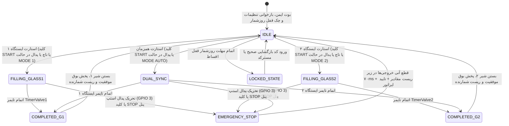

# دستور کار جامع و مستند مرجع فنی سیستم کنترل دستگاه گاز پرکن صنعتی شیشه دوجداره
## Master Engineering Specification & Control Directive — Argon Gas Filling PLC/HMI

**نسخه مستند:** ۱.۰.۰  
**تاریخ تدوین:** شهریور ۱۴۰۵ (سپتامبر ۲۰۲۶)  
**سخت‌افزار هدف:** برد کنترل صنعتی بر پایه **ESP32-S3 (Dual-Core 240MHz, 16MB Flash, 2MB PSRAM)**  
**مرجع مهندسی:** استانداردهای اتوماسیون صنعتی زیمنس (Siemens Determinism) و اصول ظرافت و تجربه کاربری اپل (Apple HIG Craftsmanship)

---

## ۱. مقایسه وضعیت پروژه: سیستم سنتی/دلتا در برابر معماری مدرن هافلر

| ردیف | بخش / ماژول | سیستم قبلی (دلتا / مدارات آنالوگ) | سیستم مدرن هافلر (پیاده‌سازی شده در سفت‌افزار) | ارزش افزوده و دستاورد صنعتی |
|:---:|:---|:---|:---|:---|
| **۱** | **رابط کاربری (HMI)** | صفحات ساده متنی با کلیدهای غشایی خشک و تاچ مقاومتی با تاخیر بالا | رابط گرافیکی فوق‌العاده مدرن بر پایه **LVGL 9.5**، گرید ۸ پیکسلی، فونت فارسی وزیر، تقارن هندسی کارت‌ها و رندر ۶۰ فریم | تجربه کاربری روان، ممانعت از خطای دید اپراتور، نمایش زنده گرافیکی پیشرفت تزریق |
| **۲** | **محاسبه هوشمند حجم و زمان** | تنظیم دستی زمان حدسی با پتانسیومتر یا تایمر چرخشی | **محاسبه ترمودینامیکی پیوسته** بر اساس ابعاد شیشه ($L \times H \times D$)، دبی گاز ($Q_s$) و فشار منبع ($P_1/P_2$) با دقت ۱۰۰ میلی‌ثانیه | بهینه‌سازی مصرف کپسول گاز آرگون (صرفه‌جویی تا ۳۵٪) و تضمین پرشدگی بیش از ۹۰٪ استاندارد EN 1279 |
| **۳** | **کاربری بدون تاچ (Touchless Mode)** | وابستگی مطلق به کلیدهای فیزیکی یا تاچ خراب‌شونده | **پشتیبانی کامل از ۱۰ کلید پنل جلو و پدال پایی** همزمان با تاچ خازنی GT911؛ کنترل ۱۰۰٪ دستگاه بدون لمس صفحه | کارکرد پیوسته دستگاه در محیط‌های خشن و دستکش کارگاهی با کلیدهای F1..F5، MODE، START، STOP، SAVE، CANCEL |
| **۴** | **سامانه لیزینگ و امنیت فروش** | عدم وجود یا قفل‌های ساده با رمز ۴ رقمی قابل دور زدن | **سامانه قفل روزشمار ۵ مرحله‌ای** با کد چالش/پاسخ آفلاین بر اساس ساعت سخت‌افزاری و شمارش اتمیک در NVS | تضمین ۱۰۰٪ وصول مطالبات اقساطی بدون امکان دور زدن نرم‌افزاری، همراه با مهلت اضطراری ۱۰ روزه |
| **۵** | **اتصال بیسیم و اینترنت اشیا (IoT)** | فاقد هرگونه ارتباط بیسیم | **وب‌اپلیکیشن داخلی (SoftAP 192.168.4.1)** با پشتیبانی از مانیتورینگ زنده، تنظیمات، تست دستی و **خروجی اکسل/CSV آمار تولید** | دسترسی آسان مدیر کارگاه و اپراتور از طریق موبایل و تبلت بدون نیاز به باز کردن درب تابلو برق |
| **۶** | **سیستم به‌روزرسانی (OTA)** | نیاز به حضور فیزیکی تکنسین با پروگرمر و کابل | **سیستم دوگانه ارتقای فریمور (Dual-OTA)** از طریق وب‌پورتال و سرور آنلاین با تاییدیه هش SHA-256 و لاگ تغییرات ۱۳ کلمه‌ای | ارتقای آنی نرم‌افزار در محل کارخانه بدون خاموشی خط و با قابلیت رول‌بک خودکار در صورت خطا |
| **۷** | **ایمنی خروجی‌ها و شیرهای گاز** | تحریک ناخواسته رله‌ها هنگام نوسان یا ریست | **واچ‌داگ سخت‌افزاری ۱۸۰ ثانیه‌ای**، مدیریت پولاریته N.O/N.C، و قطع اضطراری زیر ۷۰ میلی‌ثانیه | جلوگیری قطعی از تخلیه تصادفی کپسول گاز آرگون و آتش‌سوزی در اثر نقص مکانیکی سنسور |

---

## ۲. مدل ریاضی و ترمودینامیک فرآیند تزریق گاز آرگون

دستگاه گاز پرکن بر مبنای تزریق با جابجایی هوا در فضای بین دو لایه شیشه کار می‌کند. الگوریتم سفت‌افزار پارامترهای ابعاد را بلافاصله پس از ورود اپراتور به زمان تزریق با دقت دهم ثانیه تبدیل می‌کند:

### ۲.۱. فرمول‌های ریاضی محاسبه
1. **محاسبه حجم هندسی محفظه شیشه ($V$ بر حسب لیتر):**
   $$V = \frac{\text{طول (cm)} \times \text{ارتفاع (cm)} \times \text{ضخامت اسپیسر (cm)}}{1000}$$
   *(ورودی ضخامت بر حسب میلی‌متر است که توسط نرم‌افزار به سانتی‌متر تبدیل می‌شود).*

2. **محاسبه حجم گاز آرگون مورد نیاز ($Gas$ بر حسب نرمال لیتر):**
   $$Gas = \left(\frac{P_1}{P_2}\right) \times V$$
   - $P_1$: فشار ورودی رگلاتور گاز (پیش‌فرض تنظیمی در منو)
   - $P_2$: فشار جو/تخلیه داخل شیشه ($P_2 > 0$ به صورت سخت‌گیرانه در کد محافظت شده است تا خطای تقسیم بر صفر رخ ندهد).

3. **محاسبه زمان لازم برای تزریق کامل ($t$ بر حسب ثانیه):**
   $$t = \left(\frac{Gas}{Q_s}\right) \times 60$$
   - $Q_s$: دبی جریان فلومتر کالیبره شده بر حسب لیتر بر دقیقه ($Q_s > 0$ الزامی است).

4. **تبدیل به تیک‌های تایمر سخت‌افزاری ۱۰۰ میلی‌ثانیه‌ای:**
   $$\text{TimerValveSaved} = \text{uint32\_t}\left(t \times 10.0\text{f} + 0.5\text{f}\right)$$
   *(گرد کردن قطعی جهت جلوگیری از خطای همیشگی کاهش یک ثانیه‌ای ناشی از `(int)` ساده).*

---

## ۳. ماشین حالت صلب صنعتی (Deterministic Finite State Machine)

فرآیند کنترل بر روی دو ایستگاه مستقل (شیشه ۱ - سمت راست، شیشه ۲ - سمت چپ) اجرا می‌شود. ماشین حالت دستگاه در یک حلقه غیرمسدودکننده (Non-blocking) اجرا شده و تضمین می‌کند تحریک خروجی‌ها تحت هر شرایطی کاملاً قطعی و ایمن باشد.

### ۳.۱. قوانین ایمنی شیرها (Process Safety Redlines)
- **پولاریته خروجی (N.O / N.C):** در متغیر `vr_OutPutType` ذخیره می‌شود:
  - حالت نرمال باز (N.O): فعال بودن شیر معادل سطح منطقی `0` (Active-LOW) و غیرفعال بودن `1` (HIGH) است.
  - حالت نرمال بسته (N.C): فعال بودن شیر معادل سطح منطقی `1` (Active-HIGH) و غیرفعال بودن `0` (LOW) است.
- **واچ‌داگ قطع اتوماتیک ۱۸۰ ثانیه‌ای:** در صورتی که ابعاد شیشه غیرعادی وارد شود یا خطای تایمر رخ دهد، هر دو شیر به صورت سخت‌افزاری پس از ۱۸۰ ثانیه متوقف می‌شوند تا از هدررفت گاز جلوگیری شود.
- **ایمنی تایمر سخت‌افزاری (ISR Safety):** تابع وقفه تایمر ۱۰۰ میلی‌ثانیه‌ای (`onTimer`) هرگز توابع گرافیکی LVGL را فراخوانی نمی‌کند. وقفه فقط فلگ‌های فرار اتمیک (`volatile bool`) را فعال می‌کند و هسته اصلی در تابع `ui_process_isr_requests()` در حلقه اصلی آن‌ها را اعمال می‌نماید.

---

## ۴. سناریوی جامع کاربری بدون تاچ (Touchless 10-Key Panel & Pedal)

در کارگاه‌های تولید شیشه دوجداره به دلیل گرد و خاک، چسب پلی‌سولفاید و استفاده از دستکش ضخیم، تاچ اسکرین ممکن است پاسخگو نباشد. دستگاه مجهز به سیستم خواندن ۱۰ کلید فیزیکی و پدال صنعتی است:

### ۴.۱. تفکیک کلیدهای آنالوگ (Resistor Ladder Decoding)
برد با استفاده از دو پین آنالوگ (ADC) و شبکه مقاومتی، ۱۰ کلید را با ضریب اطمینان بالا قرائت می‌کند:

| پین میکرو | محدوده ADC (۰-۴۰۹۵) | کلید فیزیکی | عملکرد در سفت‌افزار |
|:---:|:---:|:---:|:---|
| **GPIO 1** | ۳۱۰۰ تا ۳۶۰۰ | **F1** | انتقال مستقیم به صفحه اصلی تزریق (MAIN) |
| **GPIO 1** | ۲۴۵۰ تا ۳۰۰۰ | **F2** | باز کردن زبانه تنظیمات عمومی (General Settings) |
| **GPIO 1** | ۱۷۰۰ تا ۲۳۰۰ | **F3** | باز کردن زبانه تنظیمات فرآیند (Process Parameters) |
| **GPIO 1** | ۹۵۰ تا ۱۵۵۰ | **F4** | باز کردن زبانه تست سخت‌افزار و سیم‌بندی (Test & Diagnostics) |
| **GPIO 1** | ۲۰۰ تا ۸۵۰ | **F5** | باز کردن زبانه مدیریت، قفل روزشمار و رمزها (Admin Panel) |
| **GPIO 2** | ۳۱۰۰ تا ۳۶۰۰ | **MODE** | جابجایی بین حالت‌های: شیشه ۱ راست $\to$ شیشه ۲ چپ $\to$ همزمان دوگانه |
| **GPIO 2** | ۲۴۵۰ تا ۳۰۰۰ | **START** | شروع تزریق با توجه به وضعیت انتخاب‌شده در کلید MODE |
| **GPIO 2** | ۱۷۰۰ تا ۲۳۰۰ | **STOP** | توقف آنی کلیه شیرها و ریست فرآیند تزریق |
| **GPIO 2** | ۹۵۰ تا ۱۵۵۰ | **SAVE** | ذخیره قطعی پارامترهای تغییر یافته در حافظه دائمی EEPROM/NVS |
| **GPIO 2** | ۲۰۰ تا ۸۵۰ | **CANCEL** | بستن دیالوگ‌های باز، پاپ‌آپ‌ها و انصراف از تغییرات |

### ۴.۲. ورودی‌های صنعتی ایزوله (Optocoupled Inputs)
- **پدال استارت صنعتی (GPIO 7):** ورودی ایزوله با اپتوکوپلر که با اتصال به زمین (Active-Low) فعال می‌شود. پدال استارت دقیقاً معادل کلید START پنل عمل کرده و چرخه تزریق را مطابق حالت انتخابی MODE فعال می‌کند.
- **استپ اضطراری E-Stop (GPIO 3):** ورودی شستی قارچی اضطراری تابلویی. در کمتر از ۷۰ میلی‌ثانیه تمام پایه‌های خروجی شیرها و آژیر را غیرفعال کرده و پیام هشدار توقف اضطراری را روی نمایشگر نشان می‌دهد.

---

## ۵. سامانه امنیتی روزشمار قفل ۵ مرحله‌ای (Leasing Security Architecture)

تولیدکننده دستگاه می‌تواند دستگاه را به صورت اقساطی به خریدار واگذار نماید. سفت‌افزار مجهز به یک سیستم امنیتی چندلایه و غیرقابل هک است:

1. **شمارش پایدار در حافظه NVS:**
   - متغیرهای قفل در فضای `haffler_lock` در حافظه فلش با شمارشگر ثانیه‌ای اتمیک ذخیره می‌شوند. قطع و وصل برق نمی‌تواند زمان باقیمانده را ریست کند.
2. **شمارش خاموش و بدون هشدار زودهنگام (Silent Operation):**
   - جهت حفظ آرامش اپراتور و عدم سواستفاده، تا روز آخر هیچ پیام هشداردهنده‌ای روی صفحه نمایش داده نمی‌شود.
3. **قفل کامل دستگاه پس از اتمام زمان:**
   - پس از اتمام روزهای مجاز، شیرها قفل شده و صفحه کد فعال‌سازی ظاهر می‌شود.
4. **الگوریتم کد چالش و پاسخ آفلاین (Challenge-Response OTP):**
   - دستگاه یک عدد چالش تصادفی ۵ رقمی (`dev_lock_challenge`) تولید می‌کند.
   - خریدار عدد چالش را به کارخانه اعلام می‌کند.
   - کارخانه با استفاده از فرمول محرمانه الگوریتم:
     $$\text{Unlock Code} = f(\text{Challenge}, \text{AdminPin}, \text{Stage})$$
     کد پاسخ را به خریدار می‌دهد. خریدار با وارد کردن کد، مرحله بعدی را فعال می‌کند.
5. **مهلت اضطراری ۱۰ روزه (10-Day Emergency Grace):**
   - در شرایط اضطراری کارگاهی، اپراتور می‌تواند یک‌بار برای همیشه از گزینه مهلت ۱۰ روزه استفاده کند تا دستگاه تا رسیدن تکنسین یا واریز قسط متوقف نماند.

---

## ۶. وب‌اپلیکیشن صنعتی و درگاه IoT (Embedded Web Portal)

کنترلر دارای یک وب‌سرور سبک، سریع و کاملاً واکنش‌گرا (Responsive) است که با استانداردهای دارک‌مود اپل و زبان فارسی طراحی شده است:

### ۶.۱. مشخصات اتصال بیسیم
- **نقطه دسترسی (SoftAP):** `Haffler-GasFiller-V1.8.x`
- **آدرس آی‌پی پیش‌فرض:** `192.168.4.1` (مجهز به Captive Portal جهت باز شدن خودکار مرورگر در گوشی اپراتور)
- **رمز اتصال:** پیش‌فرض بدون رمز یا با قابلیت تنظیم در منوی سیستم.

### ۶.۲. قابلیت‌های پورتال تحت وب
1. **داشبورد زنده (Live Dashboard):**
   - نمایش گرافیکی نوار پیشرفت تزریق شیشه ۱ و شیشه ۲.
   - نمایش زمان باقیمانده با فرکانس ۱ ثانیه.
   - کلیدهای استارت و استپ مستقل برای هر دو ایستگاه از راه دور.
2. **تنظیمات فرآیند و فرمول (Process Setup):**
   - تغییر مقادیر ابعاد شیشه، دبی گاز $Q_s$ و نسبت فشار بدون لمس پنل HMI.
3. **نظارت بر پایه‌ها (I/O Monitoring):**
   - مشاهده وضعیت منطقی ورودی پدال، کلیدهای پنل و خروجی‌های رله.
4. **مدیریت قفل روزشمار (Day Lock):**
   - مشاهده وضعیت قفل و وارد کردن کدهای چالش از راه دور با گوشی.
5. **استخراج فایل اکسل گزارش تولید (`/api/export_csv`):**
   - امکان دانلود مستقیم فایل CSV حاوی تعداد شیشه‌های تزریق‌شده، حجم کل گاز مصرفی و تاریخچه کارکرد در انتهای شیفت کاری.
6. **ارتقای فریمور از روی وب (`/update`):**
   - آپلود مستقیم فایل `firmware.bin` از طریق مرورگر موبایل یا لپ‌تاپ بدون کابل.

---

## ۷. معماری به‌روزرسانی آنلاین و سروری (Dual-OTA & LASTFILE)

1. **پارتیشن‌بندی دوگانه ۷ مگابایتی:**
   - فلش ۱۶ مگابایتی به دو پارتیشن مساوی `app0` (آدرس `0x10000`) و `app1` (آدرس `0x710000`) تقسیم شده است.
2. **پروتکل استریمینگ سروری (HTTP 16KB Stream):**
   - ارتباط با سرور رسمی `http://ota.haffler-infi.ir` از طریق هسته 0 (Core 0 FreeRTOS) با استک ۸ کیلوبایت بدون درگیر کردن هسته UI.
3. **اعتبارسنجی یکپارچگی با هش SHA-256:**
   - فایل در حین دانلود بایت‌به‌بایت با هش ثبت‌شده در فایل متنی `lastfile` تطبیق داده می‌شود.
4. **تغییرات تجمعی با استاندارد ۱۳ کلمه (13-Word Changelog):**
   - تغییرات هر نسخه در فایل‌های `VERSION`، `version.h` و `fw_changelog.h` ثبت شده و قبل از شروع دانلود به صورت متنی به زبان فارسی برای اپراتور نمایش داده می‌شود.
5. **رول‌بک خودکار (Auto-Rollback):**
   - در صورت بروز کراش یا بوت‌لوپ در نسخه جدید، مکانیزم سخت‌افزاری ESP32-S3 فریمور را بلافاصله به نسخه قبلی برمی‌گرداند.

---

## ۸. سیستم نمایشگر، تاچ و گزارش صوتی استودیویی

- **درایور نمایشگر:** تراشه ST7796 بر روی باس پرسرعت SPI2 با فرکانس **40MHz** و بافر جزئی ۴۰ خطی (`LV_COLOR_FORMAT_RGB565`). دستور `tft.setSwapBytes(true)` ترتیب بایت‌ها را در سطح سخت‌افزار اصلاح می‌کند.
- **درایور تاچ GT911:** روی باس I2C با فرکانس 400kHz. نگاشت دوران ۲۷۰ درجه لندسکیپ با رابطه:
  $$\text{display\_x} = 479 - \text{raw\_y}, \quad \text{display\_y} = \text{raw\_x}$$
- **فیلتر حذف نویز پله‌ای (EMA Noise Filter):** در حرکت‌های پیوسته، یک فیلتر صحیح $X = (3X_{\text{prev}} + X_{\text{raw}}) / 4$ از لرزش ناشی از کنتاکتورها و موتورهای کارگاهی جلوگیری می‌کند.
- **گزارش صوتی استودیویی (Studio Voice Reporter):**
  - ابزار خط فرمان `tools/hmi_voice_reporter.py` با موتور عصبی مایکروسافت اج و صدای دل‌آرا (`fa-IR-DilaraNeural`) گزارش‌های فنی و ممیزی دیداری صفحات را بدون اعراب‌های نامفهوم و با زبان فارسی روان تولید می‌نماید.
