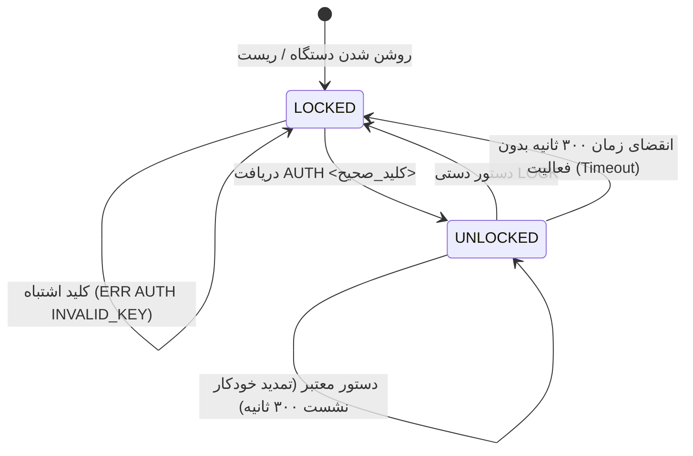

# پروتکل امنیتی ارتباط سریال HMI گاز پرکن هافلر (Haffler Serial Security Protocol)

این مستند مشخصات فنی، معماری امنیتی و پروتکل تبادل داده از طریق درگاه سریال USB-CDC صنعتی دستگاه تزریق گاز دو جداره هافلر را تشریح می‌کند تا هر برنامه‌نویس و مهندس سفت‌افزار بتواند به درستی با ماشین تعامل کند.

---

## ۱. اهداف امنیتی و معماری لایه‌ای (Security Architecture)

در محیط‌های صنعتی، پورت سریال کنترلر نباید بدون کنترل دسترسی در اختیار هر فرد یا ابزار خارجی قرار گیرد تا از تغییرات خرابکارانه، خواندن داده‌های حساس فرآیند، یا فعال‌سازی غیرمجاز شیرهای برقی و بازر جلوگیری شود.

### سطوح دسترسی (State Machine)



1. **حالت قفل (LOCKED - پیش‌فرض):**
   - به محض راه‌اندازی دستگاه یا پس از انقضای زمان عدم فعالیت، نشست سریال در حالت `LOCKED` قرار دارد.
   - در این حالت، دستگاه فقط به دستورات بی‌خطر `PING` و `HELP` و `AUTH` پاسخ می‌دهد.
   - هرگونه درخواست عکس‌برداری، حرکت بین صفحات، خواندن آمار تولید، یا صدور پالس شیر برقی با خطای زیر رد می‌شود:
     ```text
     ERR AUTH_REQUIRED (Session locked. Send AUTH <key> to unlock)
     ```

2. **حالت باز (UNLOCKED - سطح مدیر/مهندس):**
   - پس از ارسال موفق دستور احراز هویت با کلید معتبر، نشست برای مدت ۳۰۰ ثانیه (۵ دقیقه) باز می‌شود.
   - هر فرمان معتبر دریافتی در این بازه، اجاره‌نامه زمانی (Session Lease) را برای ۳۰۰ ثانیه دیگر تمدید می‌کند.
   - تمامی دستورات ناوبری، اسکرین‌شات پرسرعت، شبیه‌سازی تاچ و خواندن متغیرها مجاز هستند.

---

## ۲. مشخصات درگاه فیزیکی و باودریت

- **درگاه:** Native USB-CDC / UART0 (تراشه ESP32-S3)
- **باودریت:** `921600` باود (۸ بیت دیتا، ۱ بیت استاپ، بدون توازن - 8N1)
- **خطوط کنترلی:** سیگنال‌های DTR و RTS باید در حالت غیرفعال (`False`) قرار گیرند تا کنترلر به حالت دانلود ریست نشود.
- **جداکننده خطوط (Delimiter):** کاراکترهای پایان خط استاندارد ASCII (`\n` یا `\r\n`).

---

## ۳. فرمت دستورات و پاسخ‌ها

### الف) دستورات عمومی و احراز هویت

| دستور | حالت دسترسی | خروجی نمونه | شرح |
| :--- | :--- | :--- | :--- |
| `PING` | آزاد | `PONG GasFilling_HMI AGENT=1 AUTH=LOCKED VER=1.8.37` | بررسی زنده بودن و وضعیت قفل نشست |
| `AUTH <KEY>` | آزاد | `OK AUTH LEVEL=ADMIN TIMEOUT=300s` | احراز هویت با کلید اشتراکی صنعتی |
| `LOCK` | باز | `OK LOCKED` | قفل کردن دستی و فوری نشست سریال |
| `HELP` یا `?` | آزاد | لیست کامل دستورات | راهنمای پارامترها |

> 🔑 **کلید امنیتی پیش‌فرض سفت‌افزار:**
> ```text
> HAFFLER-SEC-2026-X9
> ```
> این کلید در هدر [agent_hmi.h](file:///c:/Users/Haffler/Documents/Haffler/PLC/PLC%20HMI/Software/Gas-filling/GasFilling_HMI/agent_hmi.h) تحت ثابت `AGENT_SEC_KEY` پیکربندی شده و قابل شخصی‌سازی است.

---

### ب) دستورات ناوبری از راه دور (Remote Navigation - NAV)

تمامی دستورات زیر نیازمند تاییدیه `AUTH` هستند:

| دستور | شرح عملکرد در نمایشگر |
| :--- | :--- |
| `NAV MAIN` | بارگذاری آنی صفحه اصلی فرآیند (`SCREEN_ID_MAIN`) |
| `NAV SET` | ورود به صفحه تنظیمات (`SCREEN_ID_SETTING`) |
| `NAV TAB 0` | تغییر به زبانه **عمومی (General)** |
| `NAV TAB 1` | تغییر به زبانه **فرآیند (Process)** |
| `NAV TAB 2` | تغییر به زبانه **تست صنعتی و شیرها (Test)** |
| `NAV TAB 3` | تغییر به زبانه **ورود مدیر و آمار (Admin)** |
| `NAV LANG fa` | تغییر زبان سیستمی به **فارسی** و ذخیره در EEPROM |
| `NAV LANG en` | تغییر زبان سیستمی به **انگلیسی** و ذخیره در EEPROM |
| `NAV LANG tr` | تغییر زبان سیستمی به **ترکی** و ذخیره در EEPROM |
| `NAV LANG ru` | تغییر زبان سیستمی به **روسی** و ذخیره در EEPROM |
| `NAV MODAL OTA` | باز کردن کادر دیالوگ به‌روزرسانی سروری |
| `NAV MODAL HELP` | باز کردن کادر راهنمای سریع تنظیمات |

---

### ج) اسکرین‌شات فوق سریع و بدون لگ (Zero-Lag Screen Capture)

دستور `SHOT` با استفاده از تسک مستقل FreeRTOS روی Core 0 پردازنده تصویر ۴۸۰ در ۳۲۰ را در کمتر از ۴ ثانیه بدون افت فریم در نمایشگر ارسال می‌کند:

- **درخواست:** `SHOT`
- **پاسخ اولیه:** `SHOT_BEGIN 480 320 RGB565LE`
- **بدنه داده:** ۳۲۰ سطر انکودشده با Base64 (هر سطر شامل ۴۸۰ پیکسل ۲ بایتی)
- **پایان فریم:** `SHOT_END`

---

## ۴. نمونه کدهای اتصال برای توسعه‌دهندگان

### کد پایتون (Python 3):

```python
import serial, time

ser = serial.Serial("COM3", 921600, timeout=1.0)
ser.dtr = False
ser.rts = False

# ۱. احراز هویت
ser.write(b"AUTH HAFFLER-SEC-2026-X9\n")
res = ser.readline().decode()
if "OK AUTH" in res:
    print("نشست با موفقیت تایید شد.")

# ۲. انتقال به صفحه تنظیمات و زبانه فرآیند
ser.write(b"NAV SET\n")
ser.readline()
ser.write(b"NAV TAB 1\n")
ser.readline()

# ۳. قفل کردن نشست
ser.write(b"LOCK\n")
ser.close()
```

### کد سی‌شارپ (.NET / C#):

```csharp
using System.IO.Ports;

var port = new SerialPort("COM3", 921600, Parity.None, 8, StopBits.One);
port.DtrEnable = false;
port.RtsEnable = false;
port.Open();

// احراز هویت
port.WriteLine("AUTH HAFFLER-SEC-2026-X9");
string reply = port.ReadLine();
if (reply.StartsWith("OK AUTH")) {
    port.WriteLine("NAV MAIN");
}
port.Close();
```
