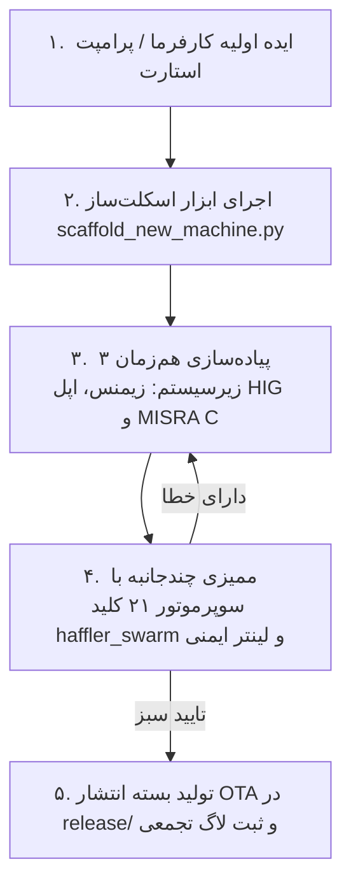

# 📘 نظام‌نامه جامع و خودکار تولید پروژه صنعتی جدید هافلر
## Haffler Universal Machine Builder & Autonomous Architecture Guide
### مستند مرجع شماره ۰۰ — راهنمای تبدیل ایده کارفرما به فریم‌ور کامل و آماده کارخانه

---

## ۱. نقشه راه ۵ مرحله‌ای از ایده تا خروجی تولید (5-Phase Pipeline)



---

## ۲. مشخصات سخت‌افزاری استاندارد پلتفرم هافلر

تمامی پروژه‌های جدید بر روی سخت‌افزار استاندارد مشترک شرکت هافلر پیاده‌سازی می‌شوند:

- **میکروکنترلر:** ESP32-S3 (N16R8) با ۱۶MB فلش و ۸MB بافر پرسرعت PSRAM
- **نمایشگر:** ال‌سی‌دی ۳.۵ یا ۴.۰ اینچ موازی با کنترلر ILI9488 یا ST7796 و بافر DMA
- **تاچ اسکرین:** سنسور خازنی GT911 روی گذرگاه I2C (آدرس `0x5D` یا `0x14`)
- **ساعت زمان‌واقعی:** آی‌سی DS3231 با محافظت ضد دستکاری زمان (Anti-Tamper Monotonic Clock)
- **سنسورهای دما:** رابط سخت‌افزاری SPI با پشتیبانی از آی‌سی‌های ترموکوپل MAX6675 / MAX31855
- **خروجی‌های رله (Q0 تا Q5):** Active-LOW، با ایمنی بوت (مقداردهی ۱ منطقی قبل از کانفیگ پین‌ها)
- **ورودی‌های دیجیتال (I0 تا I7):** Active-LOW، با مقاومت Pull-Up داخلی و مدار فیلتر سخت‌گیرانه نویز دیبانس (Debounce)

---

## ۳. استاندارد پیاده‌سازی فریمور (Core Standards)

### الف) تفکیک دوهسته‌ای FreeRTOS:
- **هسته ۰ (Core 0):** کنترل بلادرنگ صنعتی (`actions_task` با پریود قطعی ۵۰ms)، اجرای ماشین وضعیت PackML، پردازش ایمنی و وای‌فای/وب‌پورتال.
- **هسته ۱ (Core 1):** رندرینگ گرافیکی رابط کاربری LVGL و هندلر تاچ خازنی GT911.
- **ارتباط بین دو هسته:** کلیه فرامین تغییر صفحه یا آپدیت مقادیر از هسته ۰ به هسته ۱ باید مشروط به اخذ قفل بازگشتی `lvgl_lock(pdMS_TO_TICKS(50))` و `lvgl_unlock()` باشند.

### ب) ماشین وضعیت صنعتی زیمنس (PackML FSM):
- وضعیت‌های استاندارد:
  - `STATE_STOPPED`: تمامی خروجی‌های محرک قطع، ماشین آماده دریافت فرمان استارت.
  - `STATE_STARTING`: بررسی اینترلاک‌های ایمنی، سنسورهای فشار باد، دمای مجاز و تاییدیه‌ها.
  - `STATE_EXECUTE`: چرخه اصلی تولید با نظارت بر تایم‌اوت‌های صلب سنسورها و جک‌ها.
  - `STATE_COMPLETING` و `STATE_COMPLETE`: اتمام چرخه، ثبت آمار در حافظه پایدار NVS و ریست پارامترها.
  - `STATE_ABORTED`: تریپ استپ اضطراری یا فالت‌های بحرانی (قطع کلیه رله‌ها ظرف کمتر از ۲۰ms).

### ج) طراحی رابط کاربری بر پایه Apple HIG:
- پالت رنگی: Dark Slate تیره مات (`#334155`) با حاشیه ظریف ۱px (`#475569`).
- حذف ۱۰۰٪ سایه‌های نرم‌افزاری (`shadow_width = 0`) برای تضمین رندرینگ روان بالای ۵۰ FPS.
- ارگونومی لمسی: حداقل ابعاد کلیدها ۴۴×۴۴ پیکسل یا گسترش با `lv_obj_set_ext_click_area`.
- تراز ریاضی ارقام: قرار دادن متن در کانتینر با پدینگ صفر و تراز در مرکز با `lv_obj_center`.

### د) سیستم سه‌زبانه بدون کاراکتر مربعی (Zero-Tofu):
- تعریف تمامی عبارات در `ui_lang.h` و `ui_lang.c`.
- پشتیبانی کامل از زبان‌های فارسی (راست‌چین)، انگلیسی (چپ‌چین) و ترکی استانبولی.
- عدم استفاده از حروف اکسنت‌دار ناسازگار در ترکی (`ü, ç, ı, ş, ğ, ö`) و استفاده از معادل‌های استاندارد صنعتی.

---

## ۴. چک‌لیست اعتبارسنجی پیش از تحویل (Verification Suite)

قبل از پایان هر تسک، ایجنت موظف است دستورات زیر را اجرا کند:

```powershell
# ۱. ممیزی ایمنی MISRA C، استانداردهای اپل و زیمنس (اجرای سریع ۰.۱ ثانیه)
python tools/haffler_safety_linter.py --dir firmware/

# ۲. ممیزی موازی ۳ ایجنتی با سوپرموتور ۲۱ کلید جیمینی
python tools/haffler_swarm.py --batch-audit firmware/src/main.cpp firmware/src/machine_fsm.cpp firmware/src/haffler_ui_builder.cpp

# ۳. اعتبارسنجی انطباق ساختار پروژه با استانداردهای هافلر
python tools/verify_project_compliance.py
```

---

## ۵. تحویل بسته انتشار ابری (OTA Release Packaging)

- خروجی‌ها منحصراً در پوشه داخلی پروژه (`release/`) ذخیره می‌شوند.
- فایل `firmware.bin` به همراه متادیتای ۸ گانه `lastfile` آماده می‌گردد.
- **حذف پین بازر:** پین `BZ` در نقشه پایه‌های ورودی/خروجی نباید ظاهر شود.
- **ممنوعیت دسکتاپ:** قرار دادن هرگونه فایل روی دسکتاپ کارفرما اکیداً ممنوع است.
