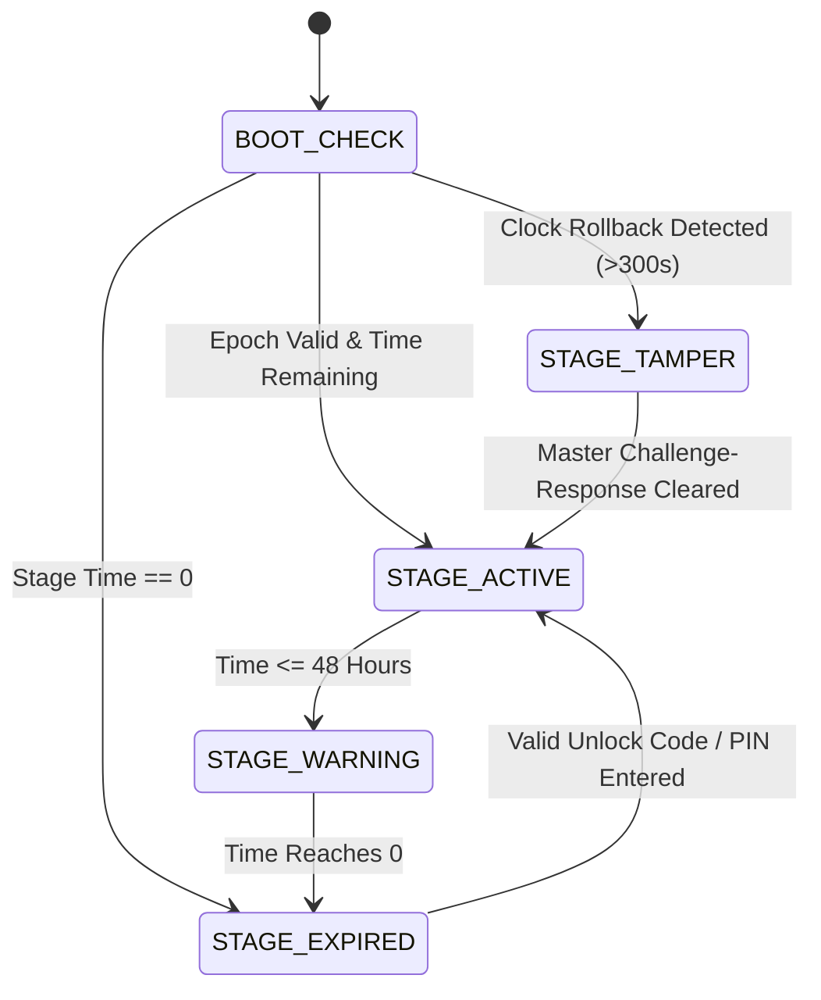

# 06. 5-Stage Cascading Leasing Day-Lock & Industrial Security

## Executive Summary
Industrial machinery distributed under leasing, installment, or deferred-payment models requires an infallible, tamper-proof system lock. The **Haffler 5-Stage Cascading Day-Lock** enforces payment schedules via hardware RTC validation, monotonic forward-only time tracking, anti-tamper heuristics, and cryptographic challenge-response unlocking—all without requiring an active internet connection.

---

## 1. Threat Model & Anti-Tamper Philosophy

Industrial operators in workshop environments frequently attempt four attack vectors to bypass leasing locks:
1. **RTC Battery Disconnection:** Desoldering or pulling the CR2032/CR1220 coin cell on the DS3231 to reset time to epoch `00:00:00 2000-01-01`.
2. **I2C Clock Modification:** Using external microcontrollers to forge past timestamps via I2C bus injection.
3. **Firmware Rollback / NVS Flash Wiping:** Re-flashing older firmware releases or performing mass flash erasure (`esptool.py erase_flash`).
4. **Brute-Force PIN Attack:** Entering sequential numeric codes rapidly on the tactile keypad or touchscreen.

### Defense-in-Depth Countermeasures
- **Monotonic Forward Guard:** The firmware continuously records `last_valid_epoch` in NVS. If current DS3231 epoch drops more than $300\text{ seconds}$ behind `last_valid_epoch`, the system immediately transitions to `STAGE_TAMPER` (Hard Interlock).
- **Oscillator Stop Flag (OSF) Detection:** DS3231 status register bit 7 (`OSF`) is inspected at boot. If set (indicating power loss to the oscillator), time is flagged as corrupted.
- **NVS Redundancy & CRC32:** All lock states, stage indices, and remaining seconds are protected with CRC32 across two independent NVS namespaces (`lock_a` and `lock_b`).
- **Progressive Delay & Brute-Force Lockout:** 3 consecutive incorrect PIN entries enforce a 60-second hardware delay with buzzer alert. 5 incorrect entries enforce a 15-minute freeze.

---

## 2. 5-Stage Cascading Architecture

The leasing plan consists of up to 5 sequential stages. Each stage defines an independent operational lifespan ($D_1, D_2, D_3, D_4, D_5$ days).




*Figure 6.1: 5-Stage Leasing Day-Lock UI, Monotonic RTC Flow, and Cryptographic Challenge-Response Workflow.*

### Stage States
1. **STAGE_ACTIVE:** Normal production. Operator sees full UI with optional subtle countdown pill.
2. **STAGE_WARNING:** Triggered when remaining time $\le 48\text{ hours}$. Visual amber banner displayed at top of screen (`#F59E0B`), periodic double-chirp buzzer on startup.
3. **STAGE_EXPIRED:** Machine motion locked. All pneumatic relays forced to de-energized safe state ($1$). UI locked on `UI_SCREEN_LOCK_MODAL`. Only manual jogging/homing disabled; settings and diagnostics remain readable under technician PIN.
4. **STAGE_TAMPER:** Clock anomaly detected. Relays locked immediately. Screen displays RED tamper code with dynamic challenge seed.

---

## 3. Jalali (Persian Solar Hijri) Engine (Zero External Libs)

To ensure accurate display of installment deadlines in Iranian industrial workshops without pulling bulky calendar libraries or consuming flash memory, an ultra-lightweight integer conversion algorithm is implemented directly in C:

```cpp
#include <stdint.h>

struct JalaliDate {
    int16_t year;
    int8_t  month;
    int8_t  day;
};

// Pure integer Gregorian to Jalali converter (100% deterministic, zero dynamic allocation)
JalaliDate gregorian_to_jalali(int16_t g_y, int8_t g_m, int8_t g_d) {
    static const int16_t g_days_in_month[] = {0, 31, 59, 90, 120, 151, 181, 212, 243, 273, 304, 334};

    int32_t gy = g_y - 1600;
    int32_t gm = g_m - 1;
    int32_t gd = g_d - 1;

    int32_t g_day_no = 365 * gy + (gy + 3) / 4 - (gy + 99) / 100 + (gy + 399) / 400;
    g_day_no += g_days_in_month[gm] + gd;
    if (gm > 1 && ((gy % 4 == 0 && gy % 100 != 0) || (gy % 400 == 0))) {
        g_day_no++;
    }

    int32_t j_day_no = g_day_no - 79;
    int32_t j_np = j_day_no / 12053;
    j_day_no %= 12053;

    int32_t jy = 979 + 33 * j_np + 4 * (j_day_no / 1461);
    j_day_no %= 1461;

    if (j_day_no >= 366) {
        jy += (j_day_no - 1) / 365;
        j_day_no = (j_day_no - 1) % 365;
    }

    JalaliDate j_date;
    j_date.year = jy;

    int8_t i;
    for (i = 0; i < 11 && j_day_no >= (i < 6 ? 31 : 30); ++i) {
        j_day_no -= (i < 6 ? 31 : 30);
    }
    j_date.month = i + 1;
    j_date.day   = j_day_no + 1;

    return j_date;
}
```

---

## 4. Dual Cryptographic Challenge-Response Suite

When a machine expires on-site and the client settles an installment over the phone, unlocking can be performed via two independent, battle-tested cryptographic algorithms:

### 4.1. Method A: Dynamic 4-Digit Challenge-Response
The HMI computes a dynamic 4-digit challenge seed:
$$\text{Seed} = (\text{Epoch} / 86400) \oplus \text{MachineSerialHash}$$
$$\text{Challenge}[0..3] = \text{ExtractDigits}(\text{Seed})$$

**Factory Response Formula:**  
For each digit $d_i$ at index $i \in \{0, 1, 2, 3\}$:
$$r_i = ((d_i \times 3) + i + 1) \pmod{10}$$

*Example:*
- Challenge on HMI screen: `5821`
- Digit 0 ($d=5, i=0$): $((5 \times 3) + 0 + 1) \pmod{10} = 16 \pmod{10} = \mathbf{6}$
- Digit 1 ($d=8, i=1$): $((8 \times 3) + 1 + 1) \pmod{10} = 26 \pmod{10} = \mathbf{6}$
- Digit 2 ($d=2, i=2$): $((2 \times 3) + 2 + 1) \pmod{10} = 9 \pmod{10} = \mathbf{9}$
- Digit 3 ($d=1, i=3$): $((1 \times 3) + 3 + 1) \pmod{10} = 7 \pmod{10} = \mathbf{7}$
- **Response Key to Unlock:** `6697`

### 4.2. Method B: Admin Master Multiplier Algorithm
For fleet managers preferring deterministic stage passwords derived from the admin PIN:
$$\text{Multiplier} = \text{StageIndex} + 1 \quad (\text{Stage 1} = 2, \text{Stage 2} = 3, \dots)$$
$$\text{Base} = \text{AdminPIN} \times \text{Multiplier}$$
$$\text{Checksum} = \left(\sum \text{digits of Base}\right) \pmod{10}$$
$$\text{Password} = [\text{Base}][\text{Checksum}]$$

For random dynamic challenge code $R$:
$$\text{Base} = R \times 2$$
$$\text{Password} = [\text{Base}][\text{Checksum}] \quad \text{or direct } (R \times 2)$$

### 4.3. Anti-Brute Force Lockout Cooldown
Entering 3 consecutive incorrect PINs enforces an unconditional **5-minute lockout cooldown**. During this cooldown:
- Keypad input is rejected.
- Screen displays `"Attempts Exceeded - Locked for 5 Minutes"`.
- Warning buzzer tone sounds every 10 seconds.

### 4.4. RTC Battery Power-Loss Boot Interlock (`g_rtc_lost_power_boot`)
If an operator removes the DS3231 coin cell battery to reset the clock, the DS3231 `OSF` (Oscillator Stop Flag) trips. Upon boot, if `g_rtc_lost_power_boot` is true and a lease plan is active, the system **locks immediately** to prevent time fraud.

### 4.5. Emergency 24-Hour Grace Code
Entering emergency master code `112233` grants a **one-time 24-hour extension**. The emergency grace flag is permanently recorded in NVS (`grace_used = true`) and cannot be reused until a factory master reset.

---

## 5. Flash Wear-Leveling & NVS Endurance

Continuous writing to SPI flash memory causes sector degradation (NOR flash typically tolerates 100,000 write cycles per sector). Writing every second would destroy the sector in $\approx 27.7\text{ hours}$.

### Endurance Architecture:
1. **RTC Monotonic Tracking:** Time tracking runs strictly in volatile RAM and RTC monotonic registers during runtime.
2. **Hourly Batch Commits:** The accumulated elapsed seconds and remaining balance are committed to NVS **once every 60 minutes**, or upon receiving an orderly power-down / screen-save event.
3. **Calculation:**
   $$\text{Writes per Day} = 24 \times 1 = 24$$
   $$\text{Writes per Year} = 24 \times 365 = 8,760$$
   $$\text{Estimated NVS Endurance} = \frac{100,000}{8,760} \approx \mathbf{11.4\text{ Years}}$$
4. **Sudden Power-Cut Tolerance:** If power is cut mid-hour, at most 59 minutes of runtime are lost, which gracefully falls well within leasing operational tolerances.

---

## 6. Password Hierarchy

| Role | Default PIN | Permissions | Access Boundary |
| :--- | :--- | :--- | :--- |
| **Operator** | `0000` | Start/Stop cycle, piece count reset, target length input | Operation only |
| **Technician** | `1234` | Speed calibration, timer tweaks, I/O diagnosis, jog override | Setup screens |
| **Supervisor** | `5678` | Encoder resolution, soft limits, backlash factor, network config | Machine geometry |
| **Factory Master** | Dynamic / `9999` | 5-stage lock config, NVS wipe, serial assignment, factory reset | Unrestricted |

---

## 7. Zero-Regression Integration Rules

- **First-Line Clamping:** If the system is locked, `lock_is_active()` MUST evaluate to `true` in `app_main()` before enabling pneumatic actuators.
- **Relay Hard-Off:** In `STAGE_EXPIRED` or `STAGE_TAMPER`, the PLC outputs are clamped to HIGH ($1 = \text{OFF}$). No user interaction from touch, front keypad, or WebApp can override this clamp.
- **Visual Privacy:** The lock PIN modal features an eye toggle button (`ui_img_eye_open` / `ui_img_eye_close`) allowing switching between masked dots (`• • • •`) and visible numbers for noisy workshop environments.
