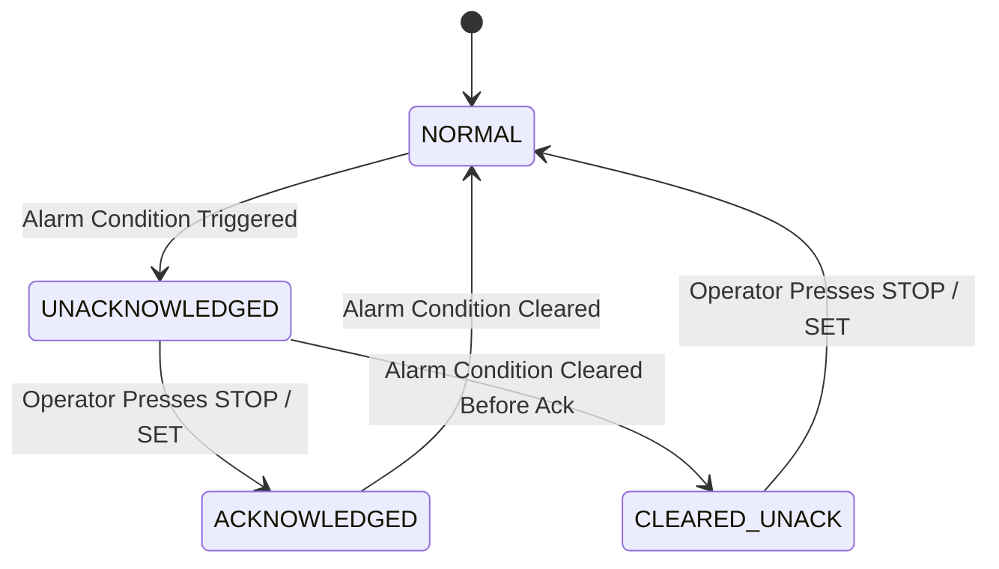

# 13. Crash Resilience, RTC Blackbox, and ISA-18.2 Alarms

## Executive Summary
In mission-critical industrial manufacturing, unexpected controller halts, resets, or unhandled exceptions cause profile ruin, mechanical collisions, and factory downtime. The Haffler controller incorporates hardware-level watchdog timers, brownout protection, an **RTC Fast SRAM Blackbox Flight Recorder**, and an **ISA-18.2 compliant alarm management engine**.

---

## 1. Reset Reason Auditing & Watchdog Architecture

Every boot cycle begins by querying the ESP32-S3 hardware reset controller to determine why the chip restarted:

```cpp
#include "esp_system.h"

void audit_boot_reason(void) {
    esp_reset_reason_t reason = esp_reset_reason();
    switch (reason) {
        case ESP_RST_POWERON:
            // Normal cold boot
            break;
        case ESP_RST_SW:
            // Intentional software reboot (e.g. OTA update)
            break;
        case ESP_RST_PANIC:
            // Kernel crash / Guru Meditation / Memory Exception
            record_crash_event("KERNEL_PANIC");
            break;
        case ESP_RST_INT_WDT:
        case ESP_RST_TASK_WDT:
            // Infinite loop or deadlock detected by watchdog
            record_crash_event("WATCHDOG_TIMEOUT");
            break;
        case ESP_RST_BROWNOUT:
            // Severe line voltage dip (<2.8V)
            record_crash_event("BROWNOUT_VOLTAGE_SAG");
            break;
        default:
            break;
    }
}
```

### Watchdog Configuration
- **Task Watchdog Timer (TWDT):** Enforces a $3000\text{ ms}$ deadline on Core 1 (machine control) and Core 0 (LVGL). If any loop hangs due to an unhandled condition, TWDT triggers a controlled reset.
- **Interrupt Watchdog Timer (IWDT):** Enforces a $300\text{ ms}$ deadline to catch ISR lockups.
- **Hardware Brownout Detector:** Set to **Level 7 ($2.8\text{V}$)**. When line voltage collapses, the detector asserts reset immediately before supply rails decay below flash write thresholds, preventing SPI flash corruption.

---

## 2. RTC Fast SRAM Blackbox Flight Recorder

The ESP32-S3 features $8\text{ KB}$ of RTC Fast SRAM that remains powered across software resets, watchdog reboots, and kernel panics (cleared only by a cold power cut).

### Blackbox Data Structure
```cpp
#define BLACKBOX_MAGIC 0x504C4342 // "PLCB"

typedef struct {
    uint32_t magic;
    uint32_t timestamp_epoch;
    uint32_t reset_reason;
    uint32_t program_counter;  // PC register at crash
    uint32_t stack_pointer;    // SP register at crash
    uint32_t backtrace[8];     // Call stack addresses
    uint16_t active_state;     // PackML state
    uint16_t active_relays;    // s_active_relay_mask
    uint16_t active_inputs;    // Opto input snapshot
    char     fault_message[64];
    uint32_t crc32;
} rtc_blackbox_t;

// Placed in RTC fast memory section
RTC_FAST_ATTR static rtc_blackbox_t s_blackbox;
```

### Post-Reboot Blackbox Recovery
1. At boot, if `s_blackbox.magic == BLACKBOX_MAGIC` and CRC32 is valid:
   - The crash dump is serialized and appended to `/spiffs/crash_log.txt`.
   - An amber diagnostic banner appears on the HMI: `"Unplanned Reboot Detected: Watchdog Timeout in STATE_CUTTING"`.
   - The blackbox memory is zeroed out to prevent repeated triggers.

---

## 3. ISA-18.2 Industrial Alarm Management

All process anomalies, sensor timeouts, and safety trips conform to the international standard **ISA-18.2 (Management of Alarm Systems for the Process Industries)**.



### Alarm Presentation Hierarchy
1. **Critical Safety Alarms (Priority 1):**
   - *Triggers:* Emergency Stop pressed, Saw safety hood opened during cycle, Pneumatic pressure loss.
   - *Behavior:* Instant relay de-energize ($1 = \text{OFF}$), full-screen red overlay (`#DC2626`), high-pitch continuous $2.7\text{ kHz}$ siren, requires physical operator acknowledgment on `STOP` key.
2. **Process Warnings (Priority 2):**
   - *Triggers:* Heater temperature deviation $\pm 5^\circ\text{C}$, Day-lock warning $\le 48\text{ hours}$, Blade wear threshold reached.
   - *Behavior:* Amber top banner (`#F59E0B`), intermittent double-chirp chime, machine continues non-hazardous operation.
3. **Informational Notices (Priority 3):**
   - *Triggers:* Wi-Fi connected, Profile recipe loaded, Shift counter reached.
   - *Behavior:* Blue pill badge (`#2563EB`) auto-dismissing after $4\text{ seconds}$.

### Alarm History Ring Buffer
The controller maintains the last 50 alarms in non-volatile storage with millisecond timestamps, stage context, and duration:
```json
[
  {"id": 14, "code": "E02_HOOD_OPEN", "ts": 1726134520, "dur_s": 12, "ack": true},
  {"id": 15, "code": "W04_AIR_LOW",   "ts": 1726135890, "dur_s": 4,  "ack": true}
]
```
Technicians can review this ring buffer directly in the Diagnostics tab (F5) or export it as a JSON file via the embedded WebApp.
