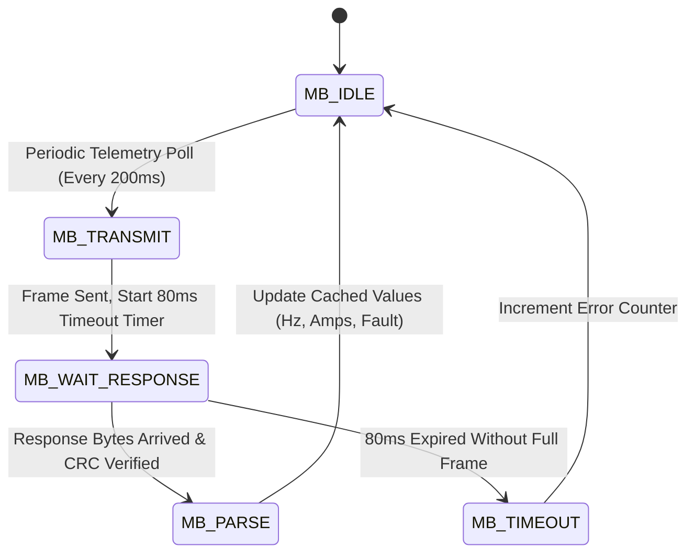

# 17. RS485 Modbus RTU Protocol & Industrial Inverter (VFD) Control

## Executive Summary
Modern Haffler machinery employs Variable Frequency Drives (VFDs / Inverters) to control high-speed cutting saw spindles, copy router drilling heads, ice cream auger motors, and bakery oven convection fans. In dual-head machines, synchronized positioning between independent heads is coordinated over the isolated RS485 bus. 

This guide details non-blocking Modbus RTU communication, hardware transceiver direction control, and standardized VFD register profiles.

---

## 1. Hardware Transceiver Architecture & Direction Timing

RS485 communication is routed through hardware serial interface `UART_NUM_2`:
- **TX (Data Out):** `GPIO 43`
- **RX (Data In):** `GPIO 44`
- **DE / RE (Direction Control):** `GPIO 47` ($1 = \text{Transmit Mode}, 0 = \text{Receive Mode}$)
- **Standard Baud Rates:** $9600$ to $115200\text{ baud}$, $8\text{N}1$ frame format.

### The Half-Duplex Direction Timing Bug
A frequent failure mode in microcontroller firmware is pulling `GPIO 47` low immediately after calling the serial write function, while trailing frame bytes are still shifting out of the physical transceiver buffer. This truncates the CRC checksum and invalidates transmission.

```cpp
#include "driver/uart.h"

#define PIN_RS485_TX   43
#define PIN_RS485_RX   44
#define PIN_RS485_DIR  47
#define RS485_UART_NUM UART_NUM_2

void rs485_init(uint32_t baudrate) {
    uart_config_t uart_config = {
        .baud_rate = (int)baudrate,
        .data_bits = UART_DATA_8_BITS,
        .parity    = UART_PARITY_DISABLE,
        .stop_bits = UART_STOP_BITS_1,
        .flow_ctrl = UART_HW_FLOWCTRL_DISABLE,
        .source_clk = UART_SCLK_DEFAULT
    };
    uart_param_config(RS485_UART_NUM, &uart_config);
    uart_set_pin(RS485_UART_NUM, PIN_RS485_TX, PIN_RS485_RX, UART_PIN_NO_CHANGE, UART_PIN_NO_CHANGE);
    uart_driver_install(RS485_UART_NUM, 256, 256, 0, NULL, 0);

    gpio_set_direction((gpio_num_t)PIN_RS485_DIR, GPIO_MODE_OUTPUT);
    gpio_set_level((gpio_num_t)PIN_RS485_DIR, 0); // Default to Receive (RX)
}

void rs485_send_packet(const uint8_t* buffer, size_t len) {
    gpio_set_level((gpio_num_t)PIN_RS485_DIR, 1); // Switch to Transmit (TX)
    uart_write_bytes(RS485_UART_NUM, (const char*)buffer, len);
    
    // CRITICAL: Block until hardware transmitter FIFO is completely empty
    uart_wait_tx_done(RS485_UART_NUM, pdMS_TO_TICKS(20));
    
    gpio_set_level((gpio_num_t)PIN_RS485_DIR, 0); // Return immediately to Receive (RX)
}
```

---

## 2. Non-Blocking Modbus RTU Master State Machine

Under Siemens industrial discipline, communication routines must never halt the deterministic 50ms machine scan loop. Modbus requests and responses operate as a non-blocking asynchronous state machine:



### Industrial CRC-16 Calculation
```cpp
uint16_t modbus_crc16(const uint8_t *buf, uint16_t len) {
    uint16_t crc = 0xFFFF;
    for (uint16_t pos = 0; pos < len; pos++) {
        crc ^= (uint16_t)buf[pos];
        for (int i = 8; i != 0; i--) {
            if ((crc & 0x0001) != 0) {
                crc >>= 1;
                crc ^= 0xA001;
            } else {
                crc >>= 1;
            }
        }
    }
    return crc;
}
```

---

## 3. Standard Inverter Register Map (Delta / Inovance / LS)

Most industrial inverters implement standard Modbus holding register addresses:

| Modbus Register | Function | Values | Description |
| :--- | :--- | :--- | :--- |
| `0x2000` | Control Word | `0x0001` = Stop<br>`0x0002` = Run<br>`0x0020` = Fault Reset | Spindle start/stop command |
| `0x2001` | Frequency Target Setpoint | `0` to `6000` ($0.01\text{ Hz}$ resolution)<br>e.g. $5000 = 50.00\text{ Hz}$ | Adjust motor RPM |
| `0x2100` | Actual Output Frequency | Read-Only ($0.01\text{ Hz}$) | Real-time rotor speed |
| `0x2104` | Actual Motor Current | Read-Only ($0.1\text{ Amperes}$) | Mechanical load torque check |
| `0x2101` | Inverter Trip / Error Code | `0` = OK, `1` = Overcurrent (oc), `2` = Overvoltage (ov) | Remote motor fault diagnostics |

---

## 4. Communication Loss Failsafe Protocols

1. **Heartbeat Loss Detection:** If the PLC fails to receive an acknowledgment from the inverter for $>1000\text{ ms}$, the controller immediately enters `STATE_ALARM`, cancels all automatic pneumatic cycles, and sounds the warning buzzer.
2. **Inverter Parameter Configuration:** The inverter hardware parameter for "Loss of RS485 Communication" MUST be programmed to **"Decelerate to Stop with Fault Trip"**, preventing uncontrolled motor freewheeling if the RS485 cable is severed.

---

## 5. Discrete Relay Inverter Control & Direction Dead-Time Interlock

When inverters are commanded via discrete PLC relay terminals (`INVERTER_FORWARD` on $Q_2$ / Pin 39 and `INVERTER_REVERSE` on $Q_3$ / Pin 48) rather than RS485 Modbus, the firmware must enforce an **ironclad directional interlock**:

### 5.1. Safety Red Line: Zero Simultaneous Conduction
Under no circumstances may both `INVERTER_FORWARD` and `INVERTER_REVERSE` relays be energized (`LOW/0`) at the same time. Energizing both can cause phase-to-phase short circuits across external reversing contactors or drive the inverter microcontroller into an unrecoverable hardware fault.

### 5.2. Mandatory 100ms Hardware Dead-Time
Whenever the motor reverses direction (e.g. from Forward to Reverse in a dough divider or carriage return), the PLC must enforce a minimum dead-time of **at least $100\text{ ms}$** (`INVERTER_DEADTIME_MS`):
1. De-energize the current active direction relay (`HIGH/1`).
2. Delay execution for $100\text{ ms}$ (`vTaskDelay(pdMS_TO_TICKS(100))`).
3. Energize the opposing direction relay (`LOW/0`).

```cpp
#include "haffler_pins.h"
#include "freertos/FreeRTOS.h"
#include "freertos/task.h"

#define PIN_INV_FWD         PIN_RELAY_Q2 // GPIO 39
#define PIN_INV_REV         PIN_RELAY_Q3 // GPIO 48
#define INVERTER_DEADTIME_MS 100

typedef enum {
    INV_DIR_STOP = 0,
    INV_DIR_FORWARD,
    INV_DIR_REVERSE
} inverter_dir_t;

static inverter_dir_t s_current_inverter_dir = INV_DIR_STOP;

void inverter_set_direction(inverter_dir_t target_dir) {
    if (target_dir == s_current_inverter_dir) return;

    // 1. Unconditionally kill both direction signals first (Active-LOW: 1 = OFF)
    gpio_set_level((gpio_num_t)PIN_INV_FWD, 1);
    gpio_set_level((gpio_num_t)PIN_INV_REV, 1);

    // 2. If transitioning between opposite directions, enforce 100ms dead-time
    if ((s_current_inverter_dir == INV_DIR_FORWARD && target_dir == INV_DIR_REVERSE) ||
        (s_current_inverter_dir == INV_DIR_REVERSE && target_dir == INV_DIR_FORWARD)) {
        vTaskDelay(pdMS_TO_TICKS(INVERTER_DEADTIME_MS));
    }

    // 3. Energize desired direction
    if (target_dir == INV_DIR_FORWARD) {
        gpio_set_level((gpio_num_t)PIN_INV_FWD, 0); // 0 = Active LOW ON
    } else if (target_dir == INV_DIR_REVERSE) {
        gpio_set_level((gpio_num_t)PIN_INV_REV, 0); // 0 = Active LOW ON
    }

    s_current_inverter_dir = target_dir;
}

void inverter_emergency_kill(void) {
    gpio_set_level((gpio_num_t)PIN_INV_FWD, 1);
    gpio_set_level((gpio_num_t)PIN_INV_REV, 1);
    s_current_inverter_dir = INV_DIR_STOP;
}
```

