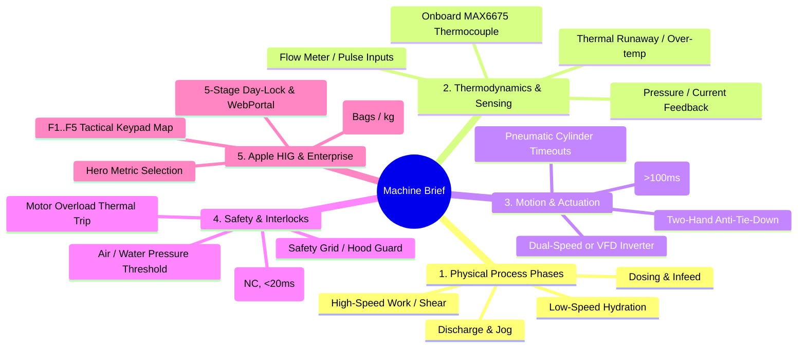
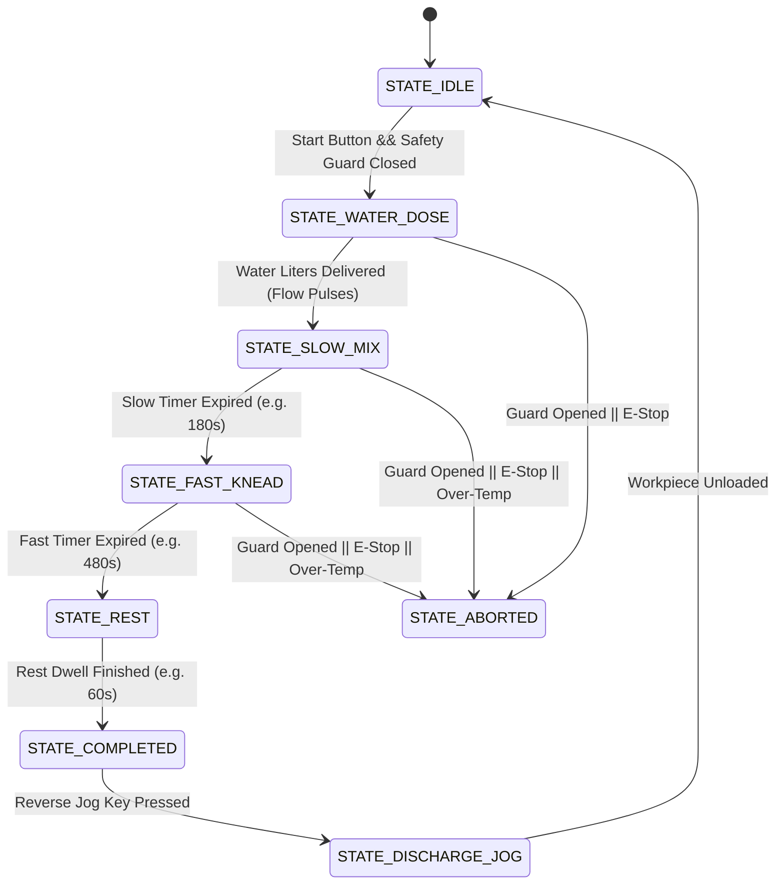

# 28. Autonomous Scenario Expansion, Sensory Intelligence & Pin Contention Resolver
## How an AI Agent Transforms a Terse 1-Line Machine Brief into a World-Class Industrial Controller

> **Document ID:** `28_AUTONOMOUS_SCENARIO_EXPANSION_AND_PIN_RESOLVER.md`  
> **Target Audience:** Autonomous AI Coding Agents and Senior Industrial Systems Architects.  
> **Core Mandate:** When the factory owner provides a minimal prompt (e.g. *"Write a project for a bakery mixer mixing flour with water"*), the AI agent must NOT write a naive on/off switch. The agent must think like an elite industrial automation veteran—deducing physical phases, thermodynamics, water/dough temperature monitoring via onboard MAX6675, motor safety, ergonomic HMI metrics, and conflict-free pin allocation.

---

## 1. The Autonomous Scenario Expansion Heuristic (The 5 Industrial Dimensions)

When an agent receives a brief machine prompt, it must systematically evaluate the process across **5 Industrial Dimensions** before writing code:



---

## 2. Case Study: Commercial Bakery Spiral Dough Mixer

### 2.1. The Engineering Reality of Dough Mixing (Why Naive Code Fails)
If an agent only turns a motor on for 10 minutes:
1. **Flour Dust Explosion / Mess:** Starting at high speed throws dry flour into the workshop air and creates lumps.
2. **Gluten Network Destruction:** High-speed mixing before hydration tears protein bonds.
3. **Dough Overheating (Thermodynamic Failure):** Mechanical friction of the spiral hook heats dough by **$+1.0^\circ\text{C}$ every 2 minutes**. If water is warm ($>22^\circ\text{C}$), the dough exits above $28^\circ\text{C}$, causing yeast to ferment prematurely and ruining the batch.

### 2.2. Intelligent Sensor & Actuator Derivation (The Elite Machine Map)

#### Digital Inputs ($I_0..I_7$):
- **$I_0$ (GPIO 5):** Emergency Stop Mushroom Pushbutton (NC, Safety Class 3).
- **$I_1$ (GPIO 4):** Stainless Steel Safety Bowl Guard (NC). Lifting guard stops hook in $<800\text{ ms}$.
- **$I_2$ (GPIO 3):** Motor Thermal Overload Relay (`OL_TRIP`, NC). Detects motor overheating/jam.
- **$I_3$ (GPIO 7):** Water Level / Pressure OK Sensor (NO). Ensures water supply is pressurized.
- **$I_4$ (GPIO 6):** Water Flow Meter Pulse Input (Reed/Hall effect pulse counter for precise liter dosing).
- **$I_5$ (GPIO 21):** Bowl Tilt / Position Limit Switch (NO).
- **$I_6$ (GPIO 37):** Foot Pedal / Jog Button (NO). Allows pulsing bowl in reverse for dough discharge.
- **$I_7$ (GPIO 47):** Spare Auxiliary Sensor / Material Hopper Sensor.

#### Relay Outputs ($Q_0..Q_9$):
- **$Q_0$ (GPIO 16):** Spiral Hook Motor Slow Speed ($100\text{ RPM}$ / VFD $25\text{ Hz}$).
- **$Q_1$ (GPIO 42):** Spiral Hook Motor Fast Speed ($200\text{ RPM}$ / VFD $50\text{ Hz}$).
- **$Q_2$ (GPIO 39):** Rotating Bowl Forward (Clockwise rotation).
- **$Q_3$ (GPIO 48):** Rotating Bowl Reverse (Counter-Clockwise discharge jog, with $100\text{ms}$ dead-time).
- **$Q_4$ (GPIO 40):** Water Dosing Solenoid Valve (Automatic recipe water injection).
- **$Q_5$ (GPIO 15):** High-Speed SSR PWM / Chilled Water Recirculation Valve.
- **$Q_6$ (GPIO 35):** Bowl Hydraulic Lift / Tilt Solenoid.
- **$Q_7$ (GPIO 36):** Flour Dust Extractor / Blower Contactor ($M_0$).
- **$Q_8$ (GPIO 38):** Stack Light Green (Active Mixing).
- **$Q_9$ (GPIO 41):** Stack Light Red / Audible Buzzer Relay (Over-temp / Safety Trip).

#### Onboard SPI Thermocouple Integration (MAX6675):
The Haffler PLC includes dual MAX6675 K-type thermocouple interfaces:
- **Thermocouple 1 (`TC1` on $CS_1$): Water Infeed Temperature.**  
  *Rule:* If water temp $> 18^\circ\text{C}$ in summer, display amber warning `"WARNING: Water too warm for target dough temp!"` and trigger chilled water valve.
- **Thermocouple 2 (`TC2` on $CS_2$): Dough Core Temperature Probe.**  
  *Rule:* If dough temp exceeds $27.0^\circ\text{C}$ during fast kneading, automatically downshift to slow speed or halt to prevent yeast killing.

---

## 3. Hardware Pin Contention & Collision Resolver

The Haffler Universal ETV3A platform has multiplexed pins on the ESP32-S3. An autonomous agent MUST verify zero pin contention:

| Shared Terminal | Default Function | Secondary / Multiplexed Function | Mutual Exclusion Rule |
| :--- | :--- | :--- | :--- |
| **GPIO 21** | Digital Input $I_5$ / Joy T1 | MAX6675 Thermocouple 1 Chip Select ($CS_1$) | **If reading Thermocouple 1, GPIO 21 CANNOT be used as digital input $I_5$.** Reassign $I_5$ to MCP23017 or GPIO 37. |
| **GPIO 0** | Bootstrap Pin / Pulse In | MAX6675 Thermocouple 2 Chip Select ($CS_2$) | Must float HIGH during boot. Only use for $CS_2$ if double thermocouple is required. |
| **GPIO 16 / 42 / 39** | Relays $Q_0, Q_1, Q_2$ | Stepper Pulse, Dir, Enable (`PIN_STEP_*`) | If machine uses stepper motion, $Q_0..Q_2$ are dedicated to step pulses; do not drive 220V mechanical relays. |
| **GPIO 39 / 48** | Relays $Q_2, Q_3$ | Inverter Forward / Reverse | **Strict $100\text{ ms}$ directional dead-time enforced in software.** |
| **GPIO 1 / 2** | ADC1_CH0, ADC1_CH1 | Front Keypad Resistor Ladders | Strictly dedicated to tactile buttons; never assign digital outputs to GPIO 1 or 2. |
| **GPIO 8 / 9** | I2C Bus (SDA / SCL) | GT911 Touch Screen + DS3231 RTC | Must retain $4.7\text{k}\Omega$ pull-ups; never assign relays to GPIO 8 or 9. |
| **GPIO 10..14** | SPI2 Bus (Display) | ST7796 480x320 IPS Screen | Dedicated high-speed display bus (up to $80\text{ MHz}$). |
| **GPIO 43 / 44 / 46**| UART2 Serial Bus | RS485 Transceiver (TX, RX, Direction DE) | Dedicated Modbus RTU / Inverter / Thermal Printer bus. |
| **GPIO 45** | Piezo Buzzer | LEDC Hardware PWM Audio Channel | Dedicated acoustic synthesizer; NEVER expose in `lastfile` `[outputs]`. |

---

## 4. Complete FSM Sequence Specification (Spiral Bakery Mixer)

The agent translates the scenario into an 8-stage deterministic state machine:



### Stage Breakdown:
1. `STATE_IDLE`: Motors OFF, water valve closed. Operator selects recipe (e.g. *"Baguette 65% Hydration"*, *"Toast Bread 60%"*). HMI shows Recipe name, target dough temp ($24^\circ\text{C}$), and water temp.
2. `STATE_WATER_DOSE`: Opens Water Valve $Q_4$. Reads pulses from $I_4$ until target water volume is reached. Simultaneously samples Water Temp via MAX6675 $CS_1$.
3. `STATE_SLOW_MIX`: Hook Motor Slow $Q_0$ ON, Bowl Forward $Q_2$ ON. Runs for configured Slow Time ($120\text{ s}$). Gently blends flour and water without dust cloud.
4. `STATE_FAST_KNEAD`: Hook Motor Slow $Q_0$ OFF, dwell $100\text{ ms}$, Hook Motor Fast $Q_1$ ON. Runs for configured Fast Time ($420\text{ s}$). Gluten formation. Continuously samples dough temperature; if $T > 27.5^\circ\text{C}$, triggers `ALARM_DOUGH_OVERTEMP`.
5. `STATE_REST`: Shuts off hook. Allows dough relaxation ($60\text{ s}$).
6. `STATE_COMPLETED`: Chimes pleasant `SOUND_PORTION_DONE` melody. Increments shift flour counter:  
   $$\text{Flour Mass} = \text{Batches} \times \text{Bag Weight (e.g. 50 kg)}$$
7. `STATE_DISCHARGE_JOG`: Allows operator to hold pedal/jog key to pulse Bowl Reverse $Q_3$ ($100\text{ RPM}$) to peel dough off spiral hook.

---

## 5. Apple HIG HMI Screen Layout & Ergonomics

The agent automatically architectures the 480x320 touch display:

```
+-----------------------------------------------------------------------+
| HAFFLER MIX-PRO 50     [BAGUETTE 65%]        24.2°C     14:32:05   FA |
+-----------------------------------------------------------------------+
|  STAGE: FAST KNEADING (PHASE 2/3)         [ SAFETY GUARD: LOCKED OK ] |
|                                                                       |
|                     06:45                                             |
|              REMAINING MIX TIME                                       |
|                                                                       |
|  [ WATER: 14.5°C ]      [ DOUGH: 23.8°C ]      [ MOTOR: 12.4A / 48Hz ]|
+-----------------------------------------------------------------------+
| [F1] RECIPE  | [F2] TIMERS  | [F3] WATER DOSE | [F4] STATS  | [F5] ADM |
+-----------------------------------------------------------------------+
```

1. **Hero Metric:** Remaining Phase Countdown Timer (`06:45`), displayed in `ui_font_digit80` centered mathematically.
2. **Sub-HUD Pills:** Live Water Temp, Live Dough Temp, and Inverter Current (Amperes).
3. **Color Semantics:**
   - Slate background `#0A0C10`, card container `#161B22`, border `#30363D`.
   - Running State: Apple Emerald `#22C55E`.
   - Temperature Safe: Ice Blue `#38BDF8`.
   - Temperature Warning ($>26^\circ\text{C}$): Amber Orange `#F59E0B`.
   - E-Stop / Guard Trip: Industrial Red `#EF4444`.

---

## 6. How Any Autonomous Agent Uses This Playbook

When given ANY industrial scenario:
1. **Identify the Process Core:** Is it cutting, mixing, heating, dispensing, or positioning?
2. **Inject Missing Physical Intelligence:** Add sensor watchdogs, ambient/fluid temperature checks via MAX6675, motor dead-times, and multi-stage sequences without waiting for the user to ask.
3. **Check the Pin Contention Matrix:** Ensure GPIOs 21, 0, 16, 42, 39, 48 are assigned safely without bus collision.
4. **Build, Test & Release:** Execute `pio run`, verify DRAM $>45\text{KB}$, generate release files strictly inside `<project>/release/` (`lastfile` + `firmware.bin`), deploy directly to ArvanCloud S3 (`ota-plc`), and report progress with ultra-brevity.
