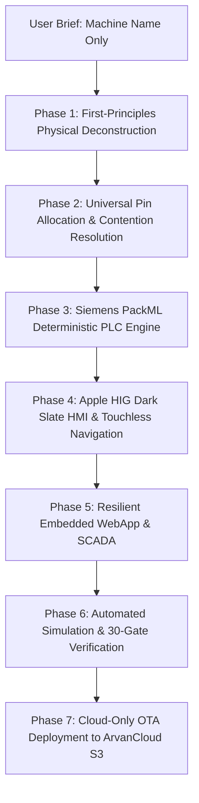

# 32. Autonomous Machine Synthesis, Domain Research & Scenario Engineering
## The Master Protocol for Building Any Industrial PLC + HMI Controller from Zero to Production

> **Document ID:** `32_AUTONOMOUS_MACHINE_SYNTHESIS_AND_DOMAIN_RESEARCH.md`  
> **Audience:** Autonomous AI Coding Agents (Antigravity, Gemini, Claude, Cursor) and Chief Automation Engineers.  
> **Core Mandate:** When an operator provides ONLY a machine name (e.g. *"Commercial Espresso Machine"*, *"Liquid Bottling Station"*, *"Industrial Autoclave"*, *"Rotary Tablet Press"*), the AI agent MUST NOT ask basic questions or hardcode machine-specific biases. The agent autonomously decomposes the machine physics, assigns universal pins without conflict, builds the PackML state machine, designs the Apple HIG HMI, configures the embedded WebApp, verifies through automated simulation, and deploys directly to the cloud with zero desktop clutter.

---

## 1. The 7-Phase Autonomous Synthesis Pipeline



---

## 2. Phase 1: First-Principles Physical Deconstruction (The 5 Engineering Domains)

When given any machine concept, systematically analyze the physical reality across five universal domains before generating code:

### 2.1. Thermodynamics & Temperature Regulation
1. **Heating / Cooling Zones:**
   - Does the process require heat (ovens, boilers, sealing bars, extruders, platens)?
   - Does the process require refrigeration (chillers, freezing cylinders, condensing units)?
2. **Actuator Selection:**
   - High-duty cycle PID heating elements MUST be assigned to **Solid-State Relays (SSRs)**: `Q5 (SSR1)` and `Q8 (SSR2)`.
   - Mechanical contactors or refrigeration compressors MUST be assigned to standard 2A outputs (`Q3`, `Q4`, `Q6`, `Q7`) with anti-short-cycle delays ($\ge 180\text{s}$).
3. **Sensory Feedback:**
   - Dual onboard MAX6675 SPI K-type thermocouples: `T1` (CS = GPIO 21) and `T2` (CS = GPIO 0), measuring $0^\circ\text{C}$ to $+1024^\circ\text{C}$.
   - Safety cutoffs: Hard thermal runaway trip, sensor disconnect detection (`raw_temp == 0xFFFF`), and pre-heat dwell timeouts.

### 2.2. Fluidics, Hydraulics & Pneumatics
1. **Flow & Pressure Generation:**
   - Pumps (rotary, peristaltic, gear, vibration, diaphragm) and pneumatic air supplies.
2. **Valving Architecture:**
   - Directional control valves (solenoids), dosing valves, proportional valves, purge valves.
3. **Sensory Feedback:**
   - Pressure switches (system air OK, boiler pressure threshold).
   - Fluid level floats (hopper empty, reservoir low, overflow condensate).
   - Pulse flowmeters (reed/Hall sensors on discrete inputs for volume dispensing).

### 2.3. Kinematics, Mechanics & Motion
1. **Actuator Types:**
   - Induction motors / VFDs: Controlled via RS485 Modbus RTU or digital contactors (`Q6`).
   - Stepper / Servo positioning: Dedicated high-speed pulse channels (`Q0 = STEP_PUL`, `Q1 = STEP_DIR`, `Q2 = STEP_EN`).
   - Pneumatic cylinders: Wrapped in standard `PneumaticCylinder` classes with forward/retract limit sensors and travel timeout alarms ($1500\text{ ms}$ to $5000\text{ ms}$).
2. **Directional Interlocks:**
   - Any reversible motor or actuator MUST enforce a **minimum $100\text{ ms}$ directional dead-time** in software to prevent contactor short circuits and mechanical shock.

### 2.4. Operational Sequences & Recipe Architecture
1. **Cycle Topologies:**
   - **Continuous Flow:** Runs indefinitely while monitored (e.g. pasteurizer, conveyor dryer).
   - **Discrete Batch / Step Cycle:** Fixed sequential phases (e.g. Infeed $\rightarrow$ Clamp $\rightarrow$ Process $\rightarrow$ Exhaust $\rightarrow$ Unclamp).
   - **On-Demand Dispense:** Triggered by operator or sensor (e.g. espresso extraction, cup fill).
2. **Recipe Parameters:**
   - Every machine must expose 3 to 6 tunable parameters saved in persistent NVS storage (e.g. Target Temperature, Dwell Duration, Speed Setpoint, Pressure Threshold).

### 2.5. Safety Interlocks & Machine Directives (ISO 13849 / IEC 62061)
1. **Emergency Stop (NC):**
   - Always mapped to dedicated optocoupled input `I6 (GPIO 3)`.
   - Hardware/software instant trip: De-energizes all outputs ($Q_0..Q_9 = 1$) in $<20\text{ ms}$.
2. **Operator Guard & Enclosure:**
   - Safety hood, light curtain, or guard interlock mapped to `I4` or `I5`. Machine halts if guard opens during automatic cycle.
3. **Anti-Tie-Down Two-Hand Control:**
   - When pinch hazards exist, both hands must press within $500\text{ ms}$ (`two_hand_safety.h`).

---

## 3. Phase 2: Universal Pin Allocation & Contention Resolution Matrix

The **HAFFLER ET-V3A** universal hardware controller provides standardized electrical terminals. Pins must be mapped based on **electrical characteristics and load types**, NOT arbitrary names:

### 3.1. Power Output Classification ($Q_0..Q_9$) — Active-LOW (0 = ON, 1 = OFF)

| Terminal | ESP32 GPIO | Output Hardware Type | Permitted Electrical Loads | Mutual Exclusion & Rules |
| :--- | :---: | :--- | :--- | :--- |
| **Q0** | GPIO 16 | 24V/2A Transistor / Fast Pulse | Stepper Pulse (`STEP_PUL`), Fast Dosing Pulse, Primary Contactor | Shared with motion pulse. |
| **Q1** | GPIO 42 | 24V/2A Transistor / Direction | Stepper Dir (`STEP_DIR`), Motor Forward, Digital Power Driver 1 | Shared with motion direction. |
| **Q2** | GPIO 39 | 24V/2A Transistor / Enable | Stepper Enable (`STEP_EN`), Motor Reverse, Digital Power Driver 2 | Enforce 100ms dead-time if paired with Q1 for reverse. |
| **Q3** | GPIO 48 | 24V/2A Active-LOW Transistor | Primary Pneumatic Solenoid, Process Pump, Contactor | General purpose 2A sink. |
| **Q4** | GPIO 40 | 24V/2A Active-LOW Transistor | Secondary Pneumatic Solenoid, Dosing Valve, Actuator | General purpose 2A sink. |
| **Q5** | GPIO 15 | **Onboard 10A Solid-State Relay 1** | Primary Heating Element (PID PWM), High-Cycle AC/DC Valve | Dedicated SSR power contacts on rear panel. |
| **Q6** | GPIO 35 | 24V/2A Active-LOW Transistor | Auxiliary Motor Starter, Agitator, Circulation Pump | General purpose 2A sink. |
| **Q7** | GPIO 36 | 24V/2A Active-LOW Transistor | Cooling Fan, Vacuum Blower, Compressor Starter | General purpose 2A sink. |
| **Q8** | GPIO 38 | **Onboard 10A Solid-State Relay 2** | Secondary Heating Element (PID PWM), Fast Solenoid, Spare | Dedicated SSR power contacts on rear panel. |
| **Q9** | GPIO 41 | 24V/2A Active-LOW Transistor | Stack Light Alarm Beacon, Acoustic Horn, Work Illuminator | General purpose 2A sink. |

### 3.2. Digital Input Classification ($I_0..I_7$) — Optocoupled Active-LOW (0 = Active)

| Terminal | ESP32 GPIO | Input Circuit Mode | Permitted Industrial Sensors | Safety / Determinism Priority |
| :--- | :---: | :--- | :--- | :--- |
| **I0** | GPIO 6 | Discrete Opto / Analog Band Low | Axis Home Prox, Optical Infeed Sensor, Reed Switch 1 | 50ms multi-sample debounce. |
| **I1** | GPIO 6 | Analog Band High (Divider) | Flowmeter Pulse Counter, Reed Switch 2 | Pulse counter or discrete sensor. |
| **I2** | GPIO 5 | Discrete Opto / Analog Band Low | Pressure Switch OK, Vacuum Threshold Sensor | Critical process interlock. |
| **I3** | GPIO 5 | Analog Band High (Divider) | Fluid Level Float (Low/High), Hopper Empty Sensor | Process safety interlock. |
| **I4** | GPIO 4 | Discrete Opto / Analog Band Low | Safety Enclosure Guard, Light Curtain OSSD | Instant cycle abort if opened. |
| **I5** | GPIO 4 | Analog Band High (Divider) | Motor Thermal Overload Relay (`OL_TRIP`), Auxiliary Sensor | Safety shutdown on fault. |
| **I6** | GPIO 3 | **Dedicated Discrete Opto (NC)** | **Physical Emergency Stop (E-Stop) Mushroom Button** | **Class 3 Safety: Hardware/Software <20ms instant trip.** |
| **I7** | GPIO 7 | **Dedicated Discrete Opto (NO)** | **Cycle Start Pushbutton / Pneumatic Foot Pedal** | Anti-repeat lockout (must release before retrigger). |

### 3.3. Analog, Communication & Peripheral Buses

| Peripheral | ESP32 Pins | Protocol / Specs | Permitted Industrial Roles | Pin Collision Guardrails |
| :--- | :---: | :--- | :--- | :--- |
| **T1 (Thermocouple 1)** | CS=GPIO 21, SCK=47, SO=37 | MAX6675 SPI Bus | Zone 1 Temperature ($0^\circ\text{C}..1024^\circ\text{C}$) | **GPIO 21 cannot be used as digital input if T1 is enabled.** |
| **T2 (Thermocouple 2)** | CS=GPIO 0, SCK=47, SO=37 | MAX6675 SPI Bus | Zone 2 Temperature ($0^\circ\text{C}..1024^\circ\text{C}$) | GPIO 0 is strapping pin; must float HIGH during boot. |
| **Front Keypad** | GPIO 1 (F1..F5), GPIO 2 (Nav) | ADC1 Resistor Ladder | 10 Membrane Buttons (F1..F5, SAVE, CANCEL, MODE, START, STOP)| ADC1 only (immune to Wi-Fi). Never assign outputs to GPIO 1/2. |
| **Display TFT** | MOSI=10, SCLK=12, CS=13, DC=14 | SPI2 (FSPI) 80MHz | 480x320 IPS Color Screen | Dedicated high-speed display bus. |
| **Touch & RTC** | SDA=8, SCL=9 | I2C0 400kHz Fast-Mode | GT911 Capacitive Touch + DS3231 TCXO RTC | Shared hardware I2C bus with external 4.7k pull-ups. |
| **RS485 Fieldbus** | TX=43, RX=44, DE=46 | UART2 Half-Duplex | Modbus RTU VFD Inverter, Thermal Printer, MES | Automatic direction control via GPIO 46. |
| **Piezo Buzzer** | GPIO 45 | LEDC PWM (2.7kHz-4kHz) | Acoustic touch feedback, alarms, installment warning | **EXCLUDED from lastfile [outputs] (Standard Law).** |
| **Virtual Channels** | `M0` through `M7` | Software Register | Auxiliary alarms, MES run signal, heartbeat pulse | **MUST be declared in lastfile [outputs].** |

---

## 4. Phase 3: Siemens PackML Deterministic PLC Engine (Core 1)

### 4.1. Core Isolation & Deterministic Scan Loop
- Pinned to **Core 1** with real-time priority `configMAX_PRIORITIES - 1`.
- Rigid deterministic period: **50ms** ($\pm 1\text{ms}$).
- **Prohibited:** Any blocking call (`delay()`, flash write, long string formatting, LVGL API invocation).

### 4.2. Boot Zero-Glitch Clamping (Nanosecond 0)
```c
// Mandatory in the very first line of setup() / app_main():
void hal_relays_boot_clamp(void) {
    const uint8_t relay_pins[] = {
        PIN_RELAY_Q0, PIN_RELAY_Q1, PIN_RELAY_Q2, PIN_RELAY_Q3,
        PIN_RELAY_Q4, PIN_RELAY_Q5, PIN_RELAY_Q6, PIN_RELAY_Q7,
        PIN_RELAY_Q8, PIN_RELAY_Q9
    };
    for (size_t i = 0; i < sizeof(relay_pins); ++i) {
        gpio_set_level((gpio_num_t)relay_pins[i], 1); // 1 = OFF
        gpio_config_t io_conf = {
            .pin_bit_mask = (1ULL << relay_pins[i]),
            .mode = GPIO_MODE_INPUT_OUTPUT,          // Bidirectional mode fixes ESP32 read bug
            .pull_up_en = GPIO_PULLUP_ENABLE,        // Internal pullup engaged
            .pull_down_en = GPIO_PULLDOWN_DISABLE,
            .intr_type = GPIO_INTR_DISABLE
        };
        gpio_config(&io_conf);
    }
}
```

### 4.3. PackML Standard States
Every synthesized machine implements the universal PackML finite state machine:
- `STATE_IDLE`: Machine ready, waiting for start trigger.
- `STATE_STARTING`: Pre-checks (temperatures reached, air pressure OK, guards closed).
- `STATE_EXECUTE`: Active sequential execution of process steps.
- `STATE_HOLDING` / `STATE_HELD`: Temporary pause (e.g. operator paused, waiting for material).
- `STATE_STOPPING` / `STATE_STOPPED`: Normal orderly shutdown.
- `STATE_ABORTING` / `STATE_ABORTED`: Immediate emergency shutdown (all outputs de-energized).

---

## 5. Phase 4: Apple HIG Dark Matte Slate HMI (Core 0)

### 5.1. Visual Aesthetic Guidelines
- **Palette:** Deep Matte Slate canvas (`#0A0C10`), elevated cards (`#161B22`), subtle 1px border (`#30363D`), accent Apple Indigo (`#0284C7`), warning Amber (`#D97706`), alarm Crimson (`#DC2626`).
- **Hero Metric:** The single most vital operational indicator centered mathematically inside a dedicated container (`pad_all = 0`, `lv_obj_center()`).
- **Steppers:** Minimum 16px breathing margin between `+` button and title label. Touch targets $\ge 44\text{px}$.
- **Zero Software Shadows:** Explicitly set `shadow_width = 0` to preserve GPU cycles and guarantee **50+ FPS**.
- **Dirty-Driven Rendering:** Redraw UI elements ONLY when values genuinely change (`if (val != last_val)`).

### 5.2. BiDi Radar & Trilingual System (Zero Tofu Mandate)
- Static dictionary supporting **Persian (RTL)**, **English (LTR)**, and **Turkish (LTR)**.
- **BIDI RADAR LAW:** Never use colons (`%02d:%02d`) in Persian time strings (inverts minutes and seconds). Use pure descriptive Persian (`"X دقیقه و Y ثانیه"`) or explicit Unicode LRO/PDF directional locks.
- Numbers and units must be isolated inside explicit LTR containers.

### 5.3. Real-Time Hardware I/O Diagnostics Screen
- Accessible via technician menu: Displays all 8 optocoupled inputs with 14px circular neon green lamps (`#22C55E` when active, `#1E293B` when inactive).
- Live manual toggles for all 10 relay outputs with real-time software mask verification.

---

## 6. Phase 5: Resilient Embedded WebApp & SCADA Portal

1. **Memory Ceiling:** Free internal DRAM must stay $>40\text{KB}$ under all conditions.
2. **Bundle Compression:** Entire web portal (HTML/CSS/JS) bundled into a single file and compressed with GZIP to $<16\text{KB}$ in ROM (`haffler_webapp_bundle.h`).
3. **Captive Portal 204:** Immediate HTTP 204 handler for `/generate_204`, `/hotspot-detect.html`, and `/ncsi.txt` preventing iOS/Android disconnection.
4. **WebSocket Telemetry:** Broadcasts 250ms real-time JSON frames containing:
   - PackML state string
   - Raw 8-bit input mask & 10-bit relay output mask
   - Temperatures ($T_1, T_2$) and Hero Metric values
   - Alarm codes and shift parts counter

---

## 7. Phase 6: Deep Case Study — Commercial Espresso / Coffee Machine

To illustrate how an autonomous agent applies this protocol to an unfamiliar domain, here is the complete synthesis for a **Commercial Dual-Boiler Espresso Machine**:

### 7.1. Physical Deconstruction
- **Thermodynamics:**
  - Coffee Brew Boiler: Small volume, tight PID regulation at $93.5^\circ\text{C}$ ($\pm 0.5^\circ\text{C}$). Driven by **SSR 1 (Q5)** with thermocouple **T1**.
  - Steam / Service Boiler: Large volume, high pressure ($1.5\text{ Bar}$), regulated at $125.0^\circ\text{C}$. Driven by **SSR 2 (Q8)** with thermocouple **T2**.
- **Fluidics:**
  - Rotary Vane Pump: Driven by contactor on **Q0** ($9.0\text{ Bar}$ extraction pressure).
  - 3-Way Grouphead Solenoid Valve: **Q3** (energized during extraction, de-energized to vent backpressure).
  - Hot Water Dispense Solenoid: **Q4** (tea water valve).
  - Steam Boiler Autofill Solenoid: **Q6** (inlets water when steam boiler probe detects low level).
- **Sensors:**
  - Emergency Stop: **I6 (NC)**.
  - Brew Group Lever / Paddle Switch: **I7 (NO)** (Starts extraction).
  - Volumetric Pulse Flowmeter: **I0** (Counts milliliters for automatic dosing).
  - Water Reservoir Low Level Float: **I1** (Prevents dry-boil).
  - Steam Boiler Water Level Probe: **I2** (Conductive / float level detection).
  - Boiler Over-Pressure Safety Switch: **I3** (Trips if mechanical pressure exceeds $2.2\text{ Bar}$).
  - Maintenance Service Hatch: **I4** (Safety interlock).

### 7.2. Pin Mapping Table (Commercial Espresso Machine)

```
+---------------------------------------------------------------------------------------------------------+
|                                  COMMERCIAL ESPRESSO MACHINE PINOUT                                     |
+------+-----------+-------------------------+------------------------------------------------------------+
| Pin  | GPIO      | Electrical Type         | Machine Assignment                                         |
+------+-----------+-------------------------+------------------------------------------------------------+
| Q0   | GPIO 16   | Transistor 24V/2A       | Rotary Pump Motor Contactor (9 Bar Extraction Pressure)    |
| Q1   | GPIO 42   | Transistor 24V/2A       | Auxiliary Drain / Rinse Pump                               |
| Q2   | GPIO 39   | Transistor 24V/2A       | Cup Warmer Tray Heater Element                             |
| Q3   | GPIO 48   | Transistor 24V/2A       | 3-Way Brew Grouphead Solenoid Valve (Extraction / Vent)    |
| Q4   | GPIO 40   | Transistor 24V/2A       | Hot Water Dispense Solenoid Valve (Tea Water)              |
| Q5   | GPIO 15   | Onboard 10A SSR 1       | Coffee Brew Boiler PID Heating Element (93.5°C)            |
| Q6   | GPIO 35   | Transistor 24V/2A       | Steam Boiler Autofill Inlet Solenoid Valve                 |
| Q7   | GPIO 36   | Transistor 24V/2A       | Chassis Cooling Fan / Barista Work Illuminator             |
| Q8   | GPIO 38   | Onboard 10A SSR 2       | Steam Boiler PID Heating Element (125.0°C)                 |
| Q9   | GPIO 41   | Transistor 24V/2A       | Machine Status / Empty Reservoir Alarm Beacon              |
| I0   | GPIO 6    | Opto Input 0            | Flowmeter Hall-Effect Pulse Input (Volumetric Dosing)      |
| I1   | GPIO 6    | Opto Input 1 (Divider)  | Fresh Water Reservoir Low Level Float Switch (NC)          |
| I2   | GPIO 5    | Opto Input 2            | Steam Boiler Autofill Water Level Conductivity Probe       |
| I3   | GPIO 5    | Opto Input 3 (Divider)  | Boiler Over-Pressure Safety Switch (NC, Cutoff > 2.2 Bar)  |
| I4   | GPIO 4    | Opto Input 4            | Service Access Panel Safety Interlock Switch (NC)          |
| I5   | GPIO 4    | Opto Input 5 (Divider)  | Motor Thermal Overload Trip Sensor (`OL_TRIP`)             |
| I6   | GPIO 3    | Dedicated Opto (NC)     | Emergency Stop Pushbutton (<20ms Instant Trip)             |
| I7   | GPIO 7    | Dedicated Opto (NO)     | Barista Extraction Lever / Grouphead Start Switch          |
| T1   | CS=21     | MAX6675 SPI Bus         | Coffee Brew Boiler Thermocouple (0.25°C Precision)         |
| T2   | CS=0      | MAX6675 SPI Bus         | Steam Boiler Thermocouple (0.25°C Precision)               |
+------+-----------+-------------------------+------------------------------------------------------------+
```

### 7.3. PackML Process Sequence (Extraction Cycle)
1. **`STATE_STARTING` (Pre-Infusion):**
   - Open 3-Way Valve (`Q3 = 0`).
   - Run Pump at low pressure or mains line pressure for $3.0\text{s}$ to saturate coffee puck gently without channeling.
2. **`STATE_EXECUTE` (Full Extraction):**
   - Full pump operation (`Q0 = 0`, `Q3 = 0`).
   - Monitor flowmeter pulses on `I0`.
   - Hero metric on HMI displays **Live Extraction Time** (`28.4 s`) and **Dosed Volume** (`36.5 ml`).
   - Terminate when flowmeter reaches target volume ($36.0\text{ml}$) or maximum timeout ($40\text{s}$).
3. **`STATE_COMPLETING` (Pressure Venting):**
   - Turn off pump (`Q0 = 1`).
   - Close 3-Way Valve (`Q3 = 1`), venting expansion water into drip tray.
   - Increment parts counter (`total_shots++`). Return to `STATE_IDLE`.

---

## 8. Phase 7: Strict Zero-Desktop Cloud-Only Release Protocol

### 8.1. The Zero-Desktop Golden Law
Under no circumstances may any file (binary, lastfile, script, log, shortcut) be written to the operator's Desktop (`C:\Users\Haffler\Desktop`). The employer's desktop must remain **100% clean**.

### 8.2. Local Release Directory
All release artifacts are generated strictly inside the project's internal folder:
- `<project_root>/release/lastfile`
- `<project_root>/release/firmware.bin`

### 8.3. Structure of `lastfile` (Strict 8-Section Mandate)
1. `[company]`: Must be `haffler`.
2. `[version]`: Must match `version.h` (e.g. `V.1.8.3`).
3. `[binary]`: Must be `firmware.bin`.
4. `[description_fa]`: Concise Persian changelog ($\le 13\text{ words}$ per line).
5. `[description_en]`: English changelog ($\le 13\text{ words}$ per line).
6. `[description_tr]`: Turkish changelog ($\le 13\text{ words}$ per line).
7. `[inputs]`: Full mapping of `I0` through `I7`.
8. `[outputs]`: Full mapping of `Q0` through `Q9` and virtual auxiliary channels `M0` through `M7`. **The buzzer (`BZ`) must NEVER appear in this section.**

### 8.4. Cloud Publishing to ArvanCloud S3
Releases are uploaded directly to the ArvanCloud S3 bucket `ota-plc` and verified online via:
```powershell
python tools/haffler_ota_publisher.py --publish <project_name>
```
Online verification requires:
- HTTP 200 OK from `https://ota.haffler-infi.ir/<project_path>/lastfile`
- HTTP 200 OK from `https://ota.haffler-infi.ir/<project_path>/firmware.bin`
- Exact `Content-Length` match with binary size
- SHA-256 hash match between local build and cloud server

---

## 9. Master Autonomous Verification Protocol

Before declaring any project complete, execute the automated compliance suite:
```powershell
# 1. Run 30-Gate Industrial Compliance Auditor
python tools/verify_project_compliance.py <project_dir>

# 2. Run Automated Machine Logic Simulator
python tools/simulate_machine.py --test-all

# 3. Verify firmware compiles with 0 errors
pio run
```

If all 30 gates pass and the simulator verifies E-Stop response in $<20\text{ms}$, the controller is certified production-ready.
