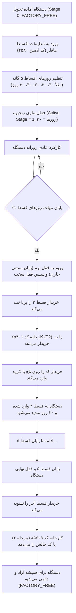

# HAFFLER DAY-LOCK 5-STAGE LEASING & INSTALLMENT SYSTEM
## Master Architectural Specification & Operational Reference
**Project:** Haffler / ASTIAJ CM-700 Industrial Soft Ice Cream Machine  
**Controller:** ESP32-S3-WROOM-1 N16R8 | **Display:** ILI9488 3.5" Parallel + GT911 Capacitive Touch  
**Last Hardened & Verified:** September 2026

---

## ۱. اهداف و فلسفه طراحی (Design Objectives)

سیستم قفل اقساطی ۵ مرحله‌ای هافلر (Day-Lock 5-Stage System) جهت مدیریت فروش اقساطی، اجاره به شرط تملیک و ضمانت تعهدات خریداران ماشین‌آلات صنعتی هافلر بدون نیاز به اتصال دائم اینترنت طراحی شده است.

### اصول کلیدی:
1. **دترمینیسم و عدم وابستگی به اینترنت (Offline-First):** زمان با ساعت سخت‌افزاری دقیق DS3231 (با باتری پشتیبان سکه‌ای CR2032) و انباشتگر ثانیه‌ای داخلی محاسبه می‌شود.
2. **غیرقابل دور زدن (Fortified Anti-Bypass):** هیچ راه فراری از طریق کی‌پد فیزیکی، بستن مدال، وب‌پورتال محلی، یا بازنشانی ساعت برای خریدار وجود ندارد.
3. **تداوم کارکرد بدون شوک به خمیر بستنی (Soft-Lock to Hard-Lock):** در پایان مهلت، دستگاه وارد «قفل نرم» می‌شود تا چرخه جاری انجماد به پایان برسد و به مخزن آسیبی وارد نشود؛ سپس با بازگشت به حالت بیکار (IDLE)، به طور کامل قفل سخت (Hard-Lock) می‌گردد.
4. **مهاجرت بدون درز NVS (Zero-Loss Migration):** ساختارهای داده قدیمی ۴۲ بایتی بدون پاک شدن سوابق قبلی، به صورت خودکار به فرمت جدید ۴۳ بایتی ارتقا می‌یابند.

---

## ۲. مدل داده و تفکیک حیاتی معماری (NVS Data Model)

### خطای بحرانی در طراحی‌های اولیه و نحوه حل ریشه‌ای:
در گذشته، متغیر `active_stage` هم برای نگهداری شماره قسط فعلی (۱ تا ۵) و هم برای حالات ماشین حالت قفل (FREE=0, ACTIVE=1, GRACE=2, SOFT_LOCK=3, HARD_LOCK=4, TAMPER=5) استفاده می‌شد! این امر باعث می‌شد:
- ورود به قفل مرحله ۱، قسط را به مرحله ۴ بپرد!
- ورود به قفل مرحله ۳، فوراً دستگاه را به عنوان SOFT_LOCK شناسایی کند و قفل فوری بزند!
- ورود به مرحله ۵، آژیر خطای دستکاری (TAMPER) را به صدا درآورد!

### ساختار اصلاح‌شده و مستقل (`day_lock_types.h`):
```c
typedef struct {
    uint32_t magic;             /* 0x4841464C = "HAFL" */
    uint8_t  lock_state;        /* 0=FREE, 1=ACTIVE, 2=GRACE, 3=SOFT_LOCK, 4=HARD_LOCK, 5=TAMPER */
    uint8_t  active_stage;      /* 0=Factory Free, 1..5=Installment Stage */
    int16_t  remain_days;       /* روزهای باقیمانده مرحله جاری */
    int16_t  stage_days[5];     /* روزهای تنظیم‌شده برای هر یک از مراحل ۱ تا ۵ */
    uint32_t sec_accumulator;   /* ثانیه‌های سپری‌شده روز جاری (0..86399) */
    uint32_t last_known_epoch;  /* آخرین زمان معتبر ثبت‌شده RTC (جلوگیری از عقب کشیدن ساعت) */
    bool     grace10_used;      /* وضعیت مصرف رمز اضطراری قدیمی (112233) */
    uint8_t  grace_pins_used;   /* بیت‌ماسک ۳ رمز اضطراری: bit0='11', bit1='22', bit2='33' */
    uint8_t  failed_attempts;   /* تعداد خطاهای متوالی ورود رمز کی‌پد */
    uint32_t lockout_until_sec; /* زمان پایان فریز بروت‌فورس */
    uint32_t challenge_seed;    /* بذر شبه‌تصادفی تولید چالش */
    uint32_t reserved[2];
    uint16_t crc16;             /* چکسام یکپارچگی داده */
} __attribute__((packed)) DayLockRecord_t;
```

---

## ۳. لایه‌های ۴ گانه احراز هویت و کدهای فعال‌سازی

| لایه | نوع رمز | طول / ساختار | عملکرد و رفتار سیستم |
|---|---|---|---|
| **لایه ۱** | کدهای مستر کارخانه | `4580`, `12773`, `123456`, `12733`, `1127730` | پاکسازی کامل قفل، تنظیم `active_stage=0` و آزادسازی دائمی کارخانه (`FACTORY_FREE`) |
| **لایه ۲** | رمزهای اضطراری ۱۰ روزه | `"11"`, `"22"`, `"33"` (یکبار مصرف) | اعطای ۱۰ روز مهلت اضطراری به خریدار در صورت عدم دسترسی به کارخانه (هر کد یکبار مصرف، ذخیره در بیت‌ماسک NVS) |
| **لایه ۳** | کدهای مراحل اقساط | T1 تا T5 بر پایه فرمول الگوریتمی | پیشروی قسط به مرحله بعد، تنظیم روزهای مرحله مربوطه و صدور تأییدیه صوتی |
| **لایه ۳ب** | کد تسویه نهایی اقساط | مرحله ۶ بر پایه فرمول الگوریتمی | آزادسازی دائمی دستگاه پس از اتمام پرداخت کلیه ۵ قسط بدون نیاز به دانستن مستر کد ادمین |
| **لایه ۴** | چالش و پاسخ ۴ رقمی | چالش ۵ رقمی روی HMI $\rightarrow$ پاسخ ۴ رقمی کارخانه | تمدید ۳۰ روزه یا پیشروی به مرحله بعد با کلیدهای یکبار مصرف مشتق از زمان و مک‌آدرس |

---

## ۴. فرمول ریاضی تولید کدهای اقساط (T1..T5 و کد تسویه مرحله ۶)

کدهای مراحل اقساط هافلر به صورت آفلاین بر اساس رقم‌های پین ادمین کارخانه (`DEFAULT_ADMIN_PIN = "4580"`) و ضریب مرحله به شرح زیر محاسبه می‌شوند:

$$\text{mult} = \text{stage} + 1$$

برای هر رقم از پین ادمین:
$$d_i = (d_{\text{admin}, i} \times \text{mult}) \pmod{10}$$

رقم پایانی (کنترلی / Checksum):
$$\text{checksum} = \left(\sum d_i\right) \pmod{10}$$

### جدول کدهای ۵ رقمی تولیدشده با پین ادمین پیش‌فرض (۴۵۸۰):

| مرحله قسط | ضریب (mult) | محاسبه ارقام | چکسام | کد نهایی ۵ رقمی | عملکرد |
|---|---|---|---|---|---|
| **قسط ۱ (T1)** | $1 + 1 = 2$ | $(4\times 2, 5\times 2, 8\times 2, 0\times 2) \rightarrow 8, 0, 6, 0$ | $(8+0+6+0)\%10 = 4$ | **80604** | شروع / تمدید قسط ۱ |
| **قسط ۲ (T2)** | $2 + 1 = 3$ | $(4\times 3, 5\times 3, 8\times 3, 0\times 3) \rightarrow 2, 5, 4, 0$ | $(2+5+4+0)\%10 = 1$ | **25401** | پیشروی به قسط ۲ |
| **قسط ۳ (T3)** | $3 + 1 = 4$ | $(4\times 4, 5\times 4, 8\times 4, 0\times 4) \rightarrow 6, 0, 2, 0$ | $(6+0+2+0)\%10 = 8$ | **60208** | پیشروی به قسط ۳ |
| **قسط ۴ (T4)** | $4 + 1 = 5$ | $(4\times 5, 5\times 5, 8\times 5, 0\times 5) \rightarrow 0, 5, 0, 0$ | $(0+5+0+0)\%10 = 5$ | **05005** | پیشروی به قسط ۴ |
| **قسط ۵ (T5)** | $5 + 1 = 6$ | $(4\times 6, 5\times 6, 8\times 6, 0\times 6) \rightarrow 4, 0, 8, 0$ | $(4+0+8+0)\%10 = 2$ | **40802** | پیشروی به قسط ۵ |
| **تسویه نهایی (T6)** | $6 + 1 = 7$ | $(4\times 7, 5\times 7, 8\times 7, 0\times 7) \rightarrow 8, 5, 6, 0$ | $(8+5+6+0)\%10 = 9$ | **85609** | **آزادسازی دائمی کارخانه** |

---

## ۵. سدهای امنیتی نفوذناپذیر (Anti-Bypass Fortresses)

برای جلوگیری از دور زدن قفل توسط خریداران متخلف، اقدامات امنیتی چندلایه زیر پیاده‌سازی شده‌اند:

### ۱. مسدودسازی درگاه وب محلی (`main/webportal.c`):
- اندپوینت `/api/lease` نیازمند فیلد `"pin"` یا `"code"` معتبر است.
- ارسال درخواست‌های جعلی نظیر `{"action":"unlock_factory"}` یا `{"action":"extend30"}` بدون پین معتبر، توسط `day_lock_validate_pin()` رد شده و خطای احراز هویت بازمی‌گرداند.

### ۲. حفاظت در برابر دکمه وای‌فای مدال قفل (`main/day_lock_ui.c`):
- در صورت قفل بودن دستگاه، فشردن کلید وای‌فای مدال هرگز مدال را نمی‌بندد و کاربر را به تب تنظیمات شبکه نمی‌برد؛ فقط وضعیت اتصال را در بنر داخلی مدال نمایش می‌دهد.

### ۳. قفل سخت‌افزاری کی‌پد فیزیکی (`main/panel_nav.c`):
- تابع `panel_nav_dismiss_active_modal()` در وضعیت قفل (`day_lock_is_locked() == true`) از بستن مدال خودداری می‌کند.
- کلید CANCEL پنل فیزیکی مدال را نمی‌بندد.
- تمام کلیدهای F1 تا F5 و کلیدهای جلوی پنل مستقیماً توسط `day_lock_ui_handle_physical_key()` تسخیر می‌شوند و منوها یا چرخه‌های تولید را فعال نمی‌کنند.

### ۴. ضد دستکاری زمان RTC (Anti-Tamper Monotonic Clock):
- در هر تیک ۱ ثانیه‌ای، مقدار `last_known_epoch` ذخیره می‌شود.
- اگر ساعت سخت‌افزاری بیش از ۱ ساعت به عقب کشیده شود، وضعیت بلافاصله به `LOCK_STAGE_TAMPER` تغییر یافته، آژیر هشدار به صدا درآمده و کارکرد دستگاه تا حضور تکنسین مجاز هافلر قفل کامل می‌گردد.

### ۵. فریز ضد حدس رمز (Brute-Force Lockout):
- پس از ۳ بار تلاش اشتباه: قفل ورودی به مدت ۳۰ ثانیه.
- پس از ۶ بار تلاش اشتباه: قفل ورودی به مدت ۱۸۰ ثانیه.
- پس از ۱۰ بار تلاش اشتباه: قفل دائم دستکاری (Tamper Lock).

---

## ۶. گردش کار اپراتوری و کارخانه (Factory & Field Workflow)



---

## ۷. ابزارهای خط فرمان و شبیه‌سازی (CLI Verification)

مهندسان و تکنسین‌ها برای آزمایش وضعیت قفل می‌توانند از دستورات بومی زیر در ترمینال استفاده کنند:

```powershell
# بررسی وضعیت قفل، روزهای باقیمانده و کدهای چالش:
python tools/haffler_icecream_cli.py daylock

# شبیه‌ساز تست کامل گرافیکی در مرورگر:
python tools/haffler_icecream_cli.py sim

# کامپایل سریع پروژه جهت اطمینان از سلامت کدهای قفل:
python tools/build_firmware.py
```
