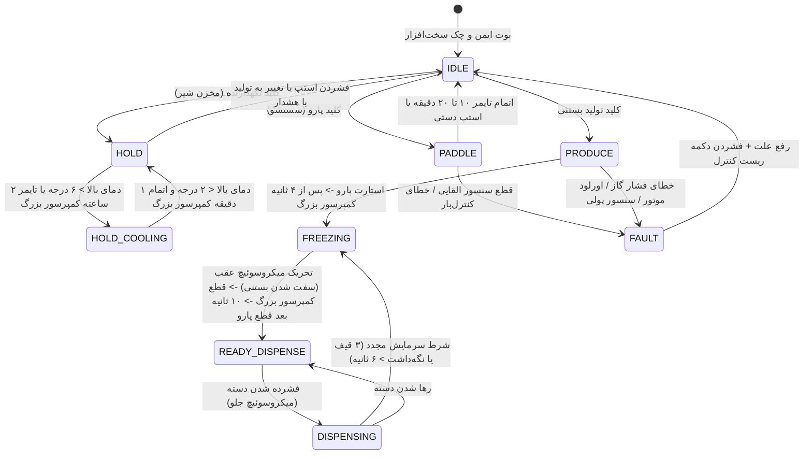

# دستور کار جامع و مستند مرجع فنی سیستم کنترل دستگاه بستنی‌ساز صنعتی ASTIAJ CM-700
## Master Engineering Specification & Control Directive

**نسخه مستند:** ۱.۰.۰  
**تاریخ تدوین:** شهریور ۱۴۰۵ (سپتامبر ۲۰۲۶)  
**سخت‌افزار هدف:** برد کنترل صنعتی اختصاصی بر پایه **ESP32-S3 (N16R4/N16R8)**  
**مرجع مستندات ورودی:**
1. جلسات صوتی کارفرما و تیم فنی (`20250805_142652.m4a`)
2. فیلم کارکرد و بازرسی مکانیکی تابلو و اجزای دستگاه ASTIAJ CM-700 (`VID_20250805_151155.mp4`)
3. تصاویر صفحات نمایشگر قبلی دلتا (HMI Screens: Main, Setup 1, Setup 2)
4. اسناد فنی: `راهنمای plc تاچ.pdf`، `سناریوی_دستگاه_بستنی‌ساز.pdf`، `فهرست_اصلاحات_دستگاه_بستنی‌ساز_نسخه_۹٫۲٫۲.pdf`
5. درایور و متدولوژی تست درایور دمای MAX6675 برگرفته از پروژه جوش حرارتی (`Welding_single_head`)
6. تصویر راهنمای سیم‌بندی و پین‌اوت تایید شده کاربر (`media_1788677090993.png`)

---

## ۱. مقایسه وضعیت پروژه: خواسته‌های کارفرما در برابر پیاده‌سازی تیم ما

| ردیف | بخش / ماژول | خواسته اولیه کارفرما | وضعیت در نسخه قبلی (دلتا / ۹.۲.۲) | پیاده‌سازی تیم ما (برتر و کامل‌تر) | ارزش افزوده و بهبود اعمال شده |
|:---:|:---|:---|:---|:---|:---|
| **۱** | **رابط کاربری (HMI)** | صفحات ساده دلتا با کادرهای خشک | اسلایدرهای ناقص با فونت‌های پیش‌فرض | طراحی کاملاً گرافیکی، مدرن و صنعتی بر پایه **LVGL 9.4** با فونت‌های استاندارد یکان و آیکون‌های متحرک | ظاهر فوق‌العاده مدرن، تجربه کاربری روان، چیدمان ارگونومیک، واکنش لمسی آنی |
| **۲** | **اتصال بیسیم و نظارت** | فقط گفتند «شاید بعداً بدون اینترنت وصل بشیم» | پیاده نشده بود | راه‌اندازی **Web Portal** داخلی (SoftAP با IP: 192.168.4.1) برای مانیتورینگ زنده و اعمال تنظیمات از روی موبایل | کاربر بدون نیاز به باز کردن درب تابلو یا لمس پنل، کلیه مقادیر و خطاها را روی گوشی می‌بیند |
| **۳** | **سنسورهای دما** | کارفرما گفت: «ترموستات جدا ساموان داریم و سنسور دما کار زیادی نداره» | فقط کنترل زمانی کمپرسور بزرگ بدون مانیتور دما | راه‌اندازی **۲ کانال ترموکوپل دقیق صنعتی با آی‌سی MAX6675** (دمای مخزن بالا شیر و دمای سیلندر انجماد) با نمایش زنده روی HMI و وب | کنترل فوق‌العاده دقیق برودت، نمایش دیجیتال دمای هر دو مخزن، حذف ترموستات‌های عقربه‌ای/مجزا |
| **۴** | **حفاظت کمپرسور** | تاخیر ساده ۲ دقیقه‌ای | بدون قفل ضد تکرار | الگوریتم **Anti-Short Cycle (۱۸۰ ثانیه)** جهت تخلیه فشار مبرد و جلوگیری از سوختن سیم‌پیچ کمپرسور هنگام نوسان برق | تضمین طول عمر کمپرسور و جلوگیری از آسیب هیدرولیکی مبرد مایع |
| **۵** | **حفاظت مکانیکی پارو** | سنسور القایی پولی و قطع تولید | ناقص و بدون دیبانس | سنسور القایی با فیلتر لبه سخت‌افزاری ۴ ثانیه‌ای + تشخیص اضافه بار اینورتر و کنترل‌بار | توقف در کمتر از ۲۰ میلی‌ثانیه قبل از بریدن پین کلاچ یا پاره شدن تسمه |
| **۶** | **سیستم لیزینگ و امنیت** | قفل بعد از ۱۲۰ روز با رمز دوره‌ای | در حد ایده کلامی | معماری اختصاصی رمزنگاری OTP/Challenge-Response بر اساس ساعت داخلی RTC DS3231 و ذخیره اتمیک در NVS | غیرقابل هک بودن سیستم اقساط و امنیت کامل برای تولیدکننده دستگاه |
| **۷** | **مدیریت مصرف و شیفت شب** | اشاره کلی به نگهدارنده شب | دستی | قابلیت **Night Scheduler** خودکار (تنظیم ساعت شروع و پایان نگهداری شبانه) | مصرف بهینه انرژی و حفظ استاندارد بهداشتی شیر بدون دخالت کاربر |

---

## ۲. سناریوی جامع کنترل ماشین (State Machine & Logic)

دستگاه دارای یک ماشین حالت صلب (Deterministic FSM) است که در هر لحظه تنها یکی از حالت‌های اصلی فعال است. فعال‌سازی حالت جدید، مستلزم تایید یا توقف نرم حالت قبلی است:

### ۲.۱. جزییات حالت‌ها و توالی عملکرد

#### الف) حالت تکی — پارو (Paddle / Wash)
- **کاربرد:** شستشوی سیلندر با آب و مواد ضدعفونی یا همزدن اولیه مایع بستنی.
- **توالی خروجی:** تنها خروجی `Q2 (GPIO 39)` فعال می‌شود. کمپرسورها اکیداً خاموش هستند.
- **تایمر کارکرد:** تایمر محافظ ۱۰ الی ۲۰ دقیقه (پیش‌فرض ۱۰ دقیقه). پس از اتمام زمان، پارو به صورت خودکار متوقف می‌شود.
- **حفاظت:** نظارت مستمر بر پالس سنسور القایی پولی؛ در صورت عدم دریافت پالس طی ۴ ثانیه، موتور متوقف شده و خطای گردش پولی صادر می‌شود.

#### ب) حالت تکی — نگهدارنده (Hold Mode)
- **کاربرد:** نگهداری مایع بستنی در مخزن بالا در دمای بهداشتی (۲ تا ۶ درجه سانتی‌گراد) در ساعات تعطیلی یا شیفت شب.
- **کمپرسور کوچک (Q0 - GPIO 16):** با سنسور ترموکوپل دمای بالا (T1) کنترل می‌شود. 
  - در دمای بالای **۶+ درجه** روشن می‌شود (با اعمال تاخیر ضدتکرار حداقل ۱۲۰ ثانیه).
  - در دمای زیر **۲+ درجه** خاموش می‌شود.
- **کمپرسور بزرگ سیلندر (Q1 - GPIO 42):** جهت جلوگیری از دوفاز شدن یا ترشیدگی شیر باقی‌مانده در سیلندر پایین:
  - هر **۲ ساعت یک‌بار** به مدت **۱ دقیقه** روشن می‌شود.
  - پیش‌شرط: سنسور سیلندر T2 دمای بالاتر از ۲- درجه را نشان دهد.

#### ج) حالت تولید بستنی (Freeze & Produce Mode)
- **گام ۱ (استارت اولیه):** بلافاصله خروجی موتور پارو `Q2 (GPIO 39)` روشن می‌شود تا شیر در سیلندر به گردش درآید.
- **گام ۲ (شروع برودت):** پس از تاخیر تنظیمی (بین ۴ تا ۱۰ ثانیه، پیش‌فرض ۴ ثانیه)، کمپرسور بزرگ اصلی `Q1 (GPIO 42)` وارد مدار می‌شود.
- **گام ۳ (نگهدارنده جانبی):** کمپرسور کوچک `Q0` پس از ۲ دقیقه و مشروط به مجاز بودن سنسور دمای مخزن وارد مدار کمکی می‌شود.
- **گام ۴ (تشخیص سفت شدن بستنی - میکروسوئیچ عقب):** 
  - با سفت شدن بستنی، فشار مکانیکی روی مارپیچ همزن افزایش یافته و فنر کلاچ عقب فشرده می‌شود تا میکروسوئیچ عقب `IO5` تحریک گردد.
  - بلافاصله در اولین ضربه، **کمپرسور اصلی Q1 خاموش می‌شود.**
  - موتور پارو به مدت ۱۰ الی ۲۰ ثانیه دیگر کار کرده و سپس خاموش می‌شود.
  - دستگاه به حالت **آماده فروش (Ready to Dispense)** وارد می‌شود.

#### د) فاز فروش و شارژ برودت (Dispense Phase)
- اپراتور با پایین کشیدن دسته، میکروسوئیچ جلو `IO4` را فعال می‌کند.
- الکتروموتور پارو بلافاصله روشن شده و بستنی خارج می‌شود.
- **شرط استارت مجدد کمپرسور بزرگ در حین فروش:**
  1. کشیده شدن **۳ عدد قیف** (هر بار فشردن و رها شدن میکرو جلو = ۱ قیف)، **یا**
  2. پایین نگه داشتن پیوسته دسته بیش از **۶ ثانیه** (فروش کیلویی یا ظرفی).
  3. **پیش‌شرط قطعی ایمنی:** سنسور/میکروسوئیچ عقب باید کاملاً آزاد باشد (اهرم از کلاچ جدا شده باشد).

---

## ۳. سناریوی جامع سنسورهای دمای MAX6675 (Thermodynamic Logic)

برد کنترلر به دو تراشه **MAX6675** متصل به ترموکوپل‌های دقیق صنعتی تیپ K مجهز است:

### ۳.۱. نگاشت سخت‌افزاری و پین‌های SPI
مطابق طراحی مهندسی برد و فایل `راهنمای plc تاچ.pdf`:
- **خط داده مشترک (MISO / SO):** `GPIO 37`
- **کلاک مشترک (SCK):** `GPIO 12` (یا `GPIO 47` روی هدر دوم)
- **چیپ سلکت سنسور بالا (CS1):** `GPIO 21` -> **کانال T1 (ترمینال ۲۵ و ۲۳): دمای مخزن شیر (بن‌ماری)**
- **چیپ سلکت سنسور پایین (CS2):** `GPIO 0` -> **کانال T2 (ترمینال ۲۴ و ۲۳): دمای سیلندر انجماد**

### ۳.۲. متدولوژی قرائت ایمن (Fail-Safe Thermocouple Reading)
برگرفته از تجربه صنعتی پیاده‌سازی شده در `Welding_single_head`:
1. **تشخیص قطعی ترموکوپل (Open Circuit Detection):**
   بیت D2 رجیستر ۱۶ بیتی MAX6675 وضعیت اتصال فیزیکی پراب را نشان می‌دهد. در صورت قطع سیم سنسور، این بیت ۱ شده و دما عدد غیرواقعی (۱۰۲۴ یا بازگشت خطا) می‌شود. در این حالت:
   - سیستم بلافاصله خطای `FAULT_THERMO_DISCONNECT` صادر می‌کند.
   - جهت جلوگیری از انجماد بیش از حد یا سوختن کمپرسور، خروجی‌های سرمایش مربوطه خاموش می‌شوند.
2. **پایش محدوده مجاز (Range Boundary):**
   - سنسور مخزن شیر T1: بازه نرمال `0°C` تا `+15°C`. در دمای بالاتر از `+10°C` هشدار گرم شدن شیر داده می‌شود.
   - سنسور سیلندر T2: بازه نرمال `-25°C` تا `+5°C`. در حالت تولید اگر دما به کمتر از `-22°C` برسد و میکروسوئیچ عقب عمل نکرده باشد، سیستم با اینترلاک حرارتی جهت جلوگیری از خرد شدن پارو کمپرسور را قطع می‌کند.
3. **نمایش روی HMI و وب‌پورتال:**
   دمای هر دو سنسور در هدر بالای صفحه و در کارت اختصاصی تنظیمات برودت به صورت زنده و با دقت ۰.۲۵ درجه سانتی‌گراد نمایش داده می‌شود.

---

## ۴. ماژول‌های جانبی: لبه رنگی، رینبو و شیر باد

### ۴.۱. لبه رنگی (Colored Edge)
- **عملگرها:** پمپ تزریق کرم/شربت و شیر برقی باد `Q8 (GPIO 38)`.
- **منطق تولید:** با روشن شدن مد لبه رنگی، پمپ حداقل ۵ ثانیه روشن می‌شود. شیر برقی باد تنها زمانی باز می‌شود که میکروسوئیچ جلو (دسته بستنی) فعال باشد.
- **منطق شستشو:** پمپ و شیر برقی بدون نیاز به میکروسوئیچ جلو به مدت حداکثر ۵ دقیقه فعال می‌شوند تا لوله‌ها تمیز گردند.

### ۴.۲. رینبو (Rainbow - تزریق ژله رنگین‌کمان)
- **عملگر:** خروجی رله `Q4 (GPIO 40)`.
- **گزینه تولید (RP):** همگام با خروج بستنی و تحریک میکرو جلو فعال می‌شود.
- **گزینه شستشو (RPW):** چرخه شستشوی تناوبی ۳ دقیقه‌ای بدون درگیری کمپرسور.

---

## ۵. جدول جامع خطاها و ماتریس ایمنی (ISA-18.2 Interlocks & Fault Matrix)

سیستم مجهز به رینگ‌بافر ثبت ۱۰ خطای اخیر در حافظه NVS با ثبت برچسب زمانی دقیق بر اساس ساعت تقویم سخت‌افزاری DS3231 است:

| کد خطا | شناسه فریمور | عنوان خطا | شرط تحریک | رفتار خودکار PLC | روش بازنشانی (Reset) |
|:---:|:---:|:---|:---|:---|:---|
| **E00** | `FAULT_EMERGENCY_STOP` | استپ اضطراری پنل | فشرده شدن کلید قارچی استپ (`IO3 = Low`) | قطع بلادرنگ تمامی رله‌ها در کمتر از ۲۰ میلی‌ثانیه | چرخاندن شستی قارچی + تایید روی HMI |
| **E01** | `FAULT_INDUCTIVE_STALL` | توقف پولی (سنسور وسط) | عدم دریافت پالس از سنسور القایی `IO6` طی ۴ ثانیه کار موتور | قطع کل فرآیند تولید و پارو | رفع گیر مکانیکی/تسمه + کلید ریست |
| **E02** | `FAULT_MOTOR_OVERLOAD` | کنترل‌بار موتور همزن | تریپ رله اضافه بار پارو (`IO15 = Low`) | قطع فوری پارو و کمپرسورها | پالس رله ریست `GPIO 18` + تایید روی HMI |
| **E03** | `FAULT_COMP_OVERLOAD` | کنترل‌بار کمپرسور | تریپ رله اضافه جریان برودت (`IO17 = Low`) | خاموش شدن فوری کمپرسور بزرگ | بررسی فشار گاز و جریان + دکمه ریست |
| **E04** | `FAULT_THERMO_TOP_DISCONNECT` | قطعی سنسور شیر (T1) | فعال شدن بیت D2 در تراشه MAX6675 شماره ۱ | قطع کمپرسور کوچک و توقف خنک‌کاری مخزن | بررسی و اتصال فیزیکی ترموکوپل T1 |
| **E05** | `FAULT_THERMO_CYL_DISCONNECT` | قطعی سنسور سیلندر (T2) | فعال شدن بیت D2 در تراشه MAX6675 شماره ۲ | سوئیچ به مد کنترلی زمانی ایمن | بررسی و اتصال فیزیکی ترموکوپل T2 |
| **E06** | `FAULT_TORQUE_PREDICT` | هشدار افزایش فشار بار | بار مداوم روی همزن بیش از حد مجاز | هشدار صوتی و آماده‌سازی برای قطع نرم | تنظیم پیچ رگلاژ فنر یا روان‌سازی شیر |
| **E07** | `FAULT_LEASE_EXPIRED` | انقضای اعتبار روزشمار | اتمام روزهای باقیمانده کارکرد دستگاه | قفل نرم (اتمام چرخه) و سپس قفل سخت (قطع خروجی) | وارد کردن رمز چالش تولیدشده با کی‌جن |
| **E08** | `FAULT_STUCK_LEVER` | گیر کردن اهرم تخلیه | پایین ماندن مداوم اهرم جلو بیش از ۶۰ ثانیه | قطع کمپرسور جهت جلوگیری از یخ‌زدگی ممتد | رها کردن اهرم جلو |
| **E09** | `FAULT_STUCK_REAR` | درگیر بودن میکرو عقب | بسته ماندن میکروسوئیچ عقب در لحظه آغاز تولید | ممانعت از استارت کمپرسور بزرگ | بررسی فنر و کلاچ مکانیکی عقب |
| **E10** | `FAULT_FREEZE_TIMEOUT` | زمان بیشینه انجماد | عدم تریپ میکرو عقب پس از زمان بیشینه تنظیمی | قطع کمپرسور بزرگ جهت حفاظت از گیربکس | بررسی گاز برودت و تنظیمات فشار |
| **E12** | `FAULT_BROWNOUT` | افت ولتاژ شبکه | افت شدید ولتاژ برق ورودی تغذیه برد | ثبت خطا، بازیابی فوری صفحه پس از پایداری | بررسی استابیلایزر و برق کارگاه |
| **E13** | `FAULT_WATCHDOG_RESET` | تریپ واچ‌داگ (Task WDT) | قفل شدن یک حلقه اجرایی بیش از زمان مجاز | ریست خودکار و بازیابی نامحسوس صفحه با RTC | ثبت لاگ و بررسی تسک‌های سیستم |
| **E14** | `FAULT_CORE_PANIC` | کرش هسته پردازنده | رخ دادن استثنای حافظه سخت‌افزاری | ریست با مکانیزم ضد لوپ کرش (حداکثر ۲ بار) | بازگشت خودکار به صفحه اصلی سیستم |

---

## ۶. مشخصات زیرسیستم‌های تکمیلی مهندسی

### ۶.۱. سیستم قفل روزشمار و اقساط دستگاه (Day-Lock Leasing)
- **معماری:** موتور کنترلی مستقل با ذخیره در حافظه NVS با پروتکل رمزنگاری چالش-پاسخ (Challenge-Response).
- **مراحل:** پشتیبانی از ۵ مرحله پرداخت اقساط (مرحله ۱ تا ۵) با تعداد روزهای مجزا برای هر مرحله.
- **محافظت ضد دستکاری زمان (Anti-Tamper):** با خواندن زمان اتمیک از ساعت RTC DS3231 و مقایسه ترتیبی با آخرین زمان ثبت‌شده در حافظه، هرگونه عقب کشیدن دستی ساعت، قطع باتری بکاپ یا نوسان غیرعادی زمان شناسایی شده و دستگاه وارد حالت Tamper Lock می‌شود.
- **مهلت اضطراری (Emergency Grace):** کد یکبار مصرف جهت ۱۰ روز مهلت کارکرد موقت در شرایط اضطراری کارگاهی بدون باز کردن قفل دائمی.
- **ابزار صدور کلید کارخانه:** اسکریپت `tools/haffler_day_lock_keygen.py` با الگوریتم چک‌سام ارقام ضرب‌شده برای صدور رمز بر اساس کد ۵ رقمی روی پنل دستگاه.

### ۶.۲. کلاینت سرور به‌روزرسانی OTA و لاگ تجمعی (Rollup Changelog)
- **انطباق بر استاندارد:** اجرای دقیق نظام‌نامه بسته انتشار هافلر (`STANDARDS_HAFFLER_OTA_RELEASE_AND_ROLLUP_CHANGELOG.md`).
- **تحلیل فراداده `lastfile`:** استخراج خودکار ۸ بخش فایل توصیفگر شامل نسخه‌ها، هش اعتبارسنجی SHA-256، متون توضیحات سه‌زبانه، و نقشه ورودی‌ها و خروجی‌ها.
- **تجمیع لاگ تغییرات:** کلاینت HMI با مقایسه نسخه محلی و نسخه سرور، کلیه اصلاحات و نکات ارتقای نسخه‌های میانی را تجمیع و در قالب یک متن یکپارچه به زبان فعال اپراتور نمایش می‌دهد.
- **نقشه اتصالات صنعتی:** نمایش گرافیکی نقشه‌های I/O بدون نمایش پین بازر (`BZ`) و با تفکیک پایه‌های کمکی دوطرفه `M0..M7`.

### ۶.۳. موتور بومی‌سازی سه‌زبانه و ارگونومی Apple HIG
- **زبان‌های پشتیبانی‌شده:** فارسی (FA)، انگلیسی (EN) و ترکی استانبولی (TR) با امکان سوئیچ آنی از تنظیمات بدون نیاز به ریست دستگاه.
- **تضمین Zero Tofu:** فونت‌های یکان در سایزهای ۱۶، ۲۰ و ۲۴ پیکسل به همراه فونت فال‌بک مونتسرات برای نمایش بدون نقص کاراکترهای لاتین و گلیف‌های ترکی بدون ایجاد کادر مربعی (`[]`).
- **پالت Apple HIG:** استفاده از زمینه متالیک تیره `#334155` برای دکمه‌ها، رنگ نیلی `#0284c7` برای دکمه ذخیره فعال، کادرهای روشن `#F1F5F9` با خط دور ۱px به رنگ `#CBD5E1` برای نمایش اعداد، و اسکرین‌سیور مدرن تمام‌صفحه با ساعت دیجیتال بزرگ.
