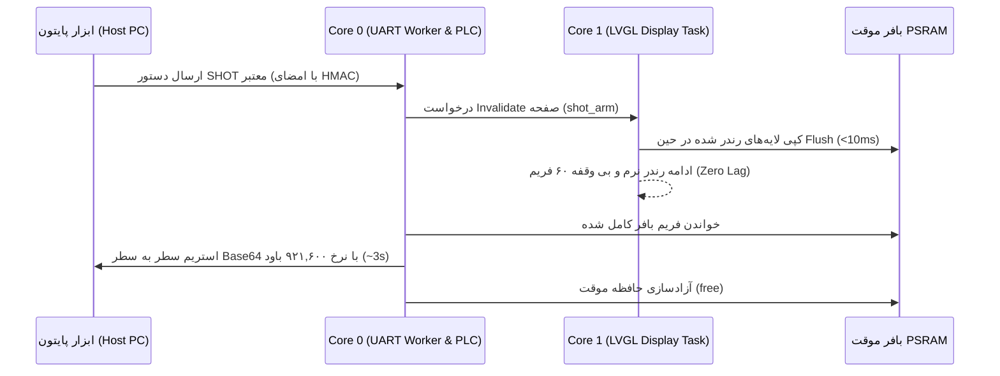

# پروتکل امن سریال جهت کنترل HMI و دریافت اسکرین‌شات (Secure Serial HMI & Snapshot Protocol)

این مستند، معماری، پروتکل امنیتی، دستورات و روش پیاده‌سازی سیستم کنترل صفحه و اسکرین‌شات فوق‌سریع دستگاه بستنی را تشریح می‌کند تا هر برنامه‌نویسی در آینده بتواند با استاندارد کامل به توسعه و نگهداری آن بپردازد.

---

## ۱. اهداف و مشخصات کلیدی

| پارامتر | مقدار | توضیح |
|---|---|---|
| **نرخ تبادل (Baud Rate)** | `921600 bps` | انتقال هر فریم کامل (480x320 به صورت RGB565) در **کمتر از ۳ تا ۴ ثانیه** |
| **تأخیر در اجرای HMI و تاچ** | **صفر (Zero UI Freeze)** | فرآیند گرفتن کپی در حافظه PSRAM کمتر از ۱۰ میلی‌ثانیه طول کشیده و ارسال توسط ورکر پس‌زمینه در هسته ۰ انجام می‌شود |
| **مکانیسم امنیت و اصالت‌سنجی** | **HMAC-SHA256 Token** | جلوگیری از تزریق دستور غیرمجاز، دستکاری تنظیمات یا شنود ناخواسته از پورت سریال |
| **واسط ارتباطی** | `UART0` (پورت CP210x) / `USB-Serial-JTAG` | پیش‌فرض UART0 با قابلیت تغییر مسیر |

---

## ۲. ساختار فریم پروتکل امنیتی (Frame Structure)

هر بسته دستوری از ساختار متنی رمزشده زیر پیروی می‌کند:

```text
$ICE,<SEQ>,<NONCE>,<CMD>,<PAYLOAD>*<HMAC_SIGNATURE>\r\n
```

### اجزای فریم:
1. **پیشوند فریم:** `$ICE` (شروع بسته)
2. **شماره ترتیب (`SEQ`):** شمارنده صعودی ۴ رقمی جهت رد بسته‌های تکراری (Anti-Replay Attack).
3. **نانس تصادفی (`NONCE`):** رشته هگزادسیمال تصادفی تولید شده در هر درخواست.
4. **دستور (`CMD`):** نام دستور (مانند `NAV`، `SHOT`، `STATUS`، `LANG`).
5. **آرگومان‌ها (`PAYLOAD`):** پارامترهای همراه با دستور.
6. **جداکننده:** `*`
7. **امضای هگز HMAC-SHA256:** هش ۶۴ کاراکتری از ترکیب `SEQ,NONCE,CMD,PAYLOAD` با کلید محرمانه اختصاصی دستگاه (`MASTER_SECRET_KEY`).

> **نکته امنیتی:** کلید اختصاصی در حافظه امن فریمور نگهداری شده و در ابزار کلاینت پایتون نیز بارگذاری می‌شود. فریمور تا زمانی که امضای HMAC بسته با کلید منطبق نباشد هیچ تغییری در صفحات یا سیستم اعمال نمی‌کند.
> در زمان توسعه می‌توان با فلگ `#define SERIAL_SEC_BYPASS 1` حالت آزاد را فعال کرد، اما در تولید صنعتی روی `0` قرار می‌گیرد.

---

## ۳. دیکشنری دستورات استاندارد (Command Set)

### ۱. دستور ناوبری و تغییر صفحه (`NAV`)
انتقال دستگاه به صفحه و زبانه مورد نظر جهت تست و عکاسی:

- `$ICE,0001,A1B2,NAV,1*<HMAC>`: انتقال به صفحه اصلی (Screen 1 - کارکرد و وضعیت موتورها).
- `$ICE,0002,C3D4,NAV,2:0*<HMAC>`: انتقال به صفحه تنظیمات (Screen 2) - زبانه F1 (زمان‌های تولید و نگهداری).
- `$ICE,0003,E5F6,NAV,2:1*<HMAC>`: صفحه تنظیمات - زبانه F2 (تنظیمات جریان و تاخیر کمپرسور).
- `$ICE,0004,G7H8,NAV,2:2*<HMAC>`: صفحه تنظیمات - زبانه F3 (تغییر زبان و واحدها).
- `$ICE,0005,I9J0,NAV,2:3*<HMAC>`: صفحه تنظیمات - زبانه F4 (شبکه و وای‌فای).
- `$ICE,0006,K1L2,NAV,2:4*<HMAC>`: صفحه تنظیمات - زبانه F5 (عیب‌یابی کارخانه).
- `$ICE,0007,M3N4,NAV,MODAL:RESET*<HMAC>`: باز کردن پنجره مدال ریست شمارنده.

### ۲. دستور تغییر زبان (`LANG`)
- `$ICE,0008,O5P6,LANG,FA*<HMAC>`: تغییر زبان به فارسی.
- `$ICE,0009,Q7R8,LANG,EN*<HMAC>`: تغییر زبان به انگلیسی.

### ۳. دستور اسکرین‌شات فوق سریع (`SHOT`)
- `$ICE,0010,S9T0,SHOT,RGB565*<HMAC>`: درخواست عکس کامل از صفحه فعال فعلی.

**پاسخ فریمور هنگام ارسال اسکرین‌شات:**
```text
SHOT_BEGIN 480 320 RGB565LE\n
<Base64-encoded row 0>\n
<Base64-encoded row 1>\n
...
<Base64-encoded row 319>\n
SHOT_END <CRC32>\n
```

### ۴. دستور شبیه‌سازی تاچ یا کلید سخت‌افزاری (`EVENT`)
جهت تست خودکار UI توسط اسکریپت تست بدون نیاز به دست زدن فیزیکی:
- `$ICE,0011,U1V2,EVENT,KEY:START*<HMAC>`: تحریک کلید سخت‌افزاری استارت.
- `$ICE,0012,W3X4,EVENT,KEY:STOP*<HMAC>`: تحریک کلید سخت‌افزاری استاپ.
- `$ICE,0013,Y5Z6,EVENT,TOUCH:240:160:CLICK*<HMAC>`: کلیک روی مختصات ۲۴۰ و ۱۶۰.

---

## ۴. معماری پیاده‌سازی فریمور (Non-Blocking Zero-Lag Architecture)



### گام‌های عملکرد فریمور:
1. **دریافت و تأیید هویت:** ورکر سریال در Core 0 پکت را خوانده و با استفاده از کتابخانه سخت‌افزاری `mbedtls_sha256` امضای HMAC را در کمتر از ۱ میلی‌ثانیه راستی‌آزمایی می‌کند.
2. **آماده‌سازی بافر:** یک بافر به حجم $480 \times 320 \times 2 = 307,200$ بایت در حافظه خارجی PSRAM با `heap_caps_malloc(..., MALLOC_CAP_SPIRAM)` تخصیص داده می‌شود.
3. **کپی غیرمسدودکننده:** در زمان رندر عادی LVGL، متد `shot_on_flush()` در هوک دیسپلی، بخش‌های رندرشده را بدون معطلی در بافر کپی می‌کند.
4. **استریم موازی:** ورکر Core 0 فریم‌بافر آماده را به صورت چانک‌های Base64 از طریق پورت سریال ۹۲۱,۶۰۰ ارسال کرده و پس از پایان، حافظه موقت بلافاصله آزاد می‌شود. کنترل ماشین در PLC و نرخ تازه‌سازی ۶۰ هرتز نمایشگر حتی برای ۱ میلی‌ثانیه نیز دچار افت فریم نمی‌شود.

---

## ۵. اسکریپت پایتون دریافت و اعتبارسنجی (`tools/hmi_commander.py`)

اسکریپت پایتون وظیفه دارد:
1. با کلید محرمانه `$ICE` بسته‌ها را امضا و ارسال کند.
2. دستور ناوبری به هر صفحه را بدهد.
3. داده‌های Base64 اسکرین‌شات را دریافت، اعتبارسنجی CRC32 انجام دهد و به فرمت PNG ذخیره نماید.
