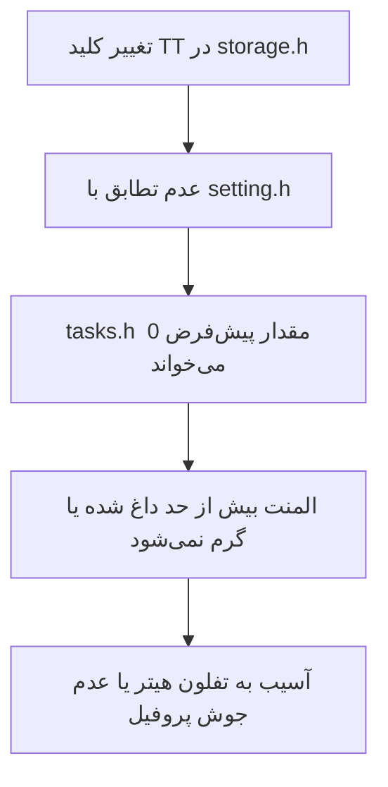
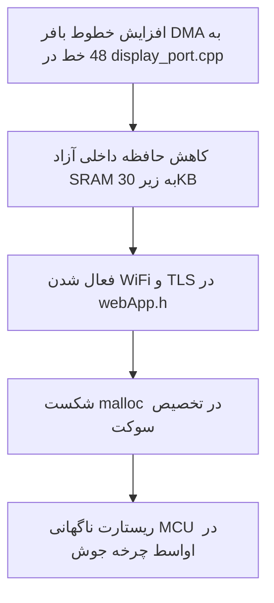

# ماتریس تأثیر تغییرات پروژه (Change Impact Matrix — Welding HMI)

این سند مشخص می‌کند اگر یک فایل در سورس‌کد تغییر کند، چه فایل‌ها، تسک‌ها یا ماژول‌های دیگری در معرض خرابی قرار می‌گیرند و ایجنت باید همزمان کدام بخش‌ها را بررسی و تست کند.

---

## ۱. جدول ماتریس تأثیر مستقیم (Cross-Module Dependency Matrix)

| فایل مبدأ (تغییریافته) | شدت ریسک | فایل‌های متأثر (باید حتماً چک شوند) | ماهیت اثر و خطرات بالقوه |
|---|:---:|---|---|
| [`include/vars.h`](file:///c:/Users/Haffler/Documents/Haffler/PLC/PLC%20HMI/Software/Welding_single_head/include/vars.h) / `vars.c` | **بسیار بالا** 🔴 | کل پروژه (`screens.c`, `tasks.h`, `main.cpp`, `actions.h`) | تغییر نام یا امضای getter/setterها باعث خطای کامپایل سراسری یا خواندن مقادیر اشتباه در UI و ماشین وضعیت می‌شود. |
| [`include/defines.h`](file:///c:/Users/Haffler/Documents/Haffler/PLC/PLC%20HMI/Software/Welding_single_head/include/defines.h) | **بسیار بالا** 🔴 | `tasks.h`, `storage.h`, `main.cpp`, `agent_hmi.h` | تغییر شماره GPIOها، پین‌های سنسور یا ثابت‌های ولتاژ ممکن است به اتصالی، شلیک نابه‌جای جک‌ها یا قطع E-Stop منجر شود. |
| [`include/tasks.h`](file:///c:/Users/Haffler/Documents/Haffler/PLC/PLC%20HMI/Software/Welding_single_head/include/tasks.h) | **بسیار بالا** 🔴 | `screens.c`, `main.cpp`, `storage.h`, `agent_hmi.h` | دستکاری ماشین وضعیت چرخه جوش، تایمرها یا اینترلاک‌های ایمنی المنت/فک‌ها می‌تواند ایمنی فیزیکی دستگاه را نقض کند. |
| [`include/storage.h`](file:///c:/Users/Haffler/Documents/Haffler/PLC/PLC%20HMI/Software/Welding_single_head/include/storage.h) / `setting.h` | **بالا** 🟠 | `tasks.h`, `main.cpp`, `screens.c` | تغییر کلیدهای NVS، عدم استفاده از تراکنش `begin()/end()` یا تغییر `MAGIC_NUMBER` باعث پاک شدن تنظیمات کالیبراسیون و رسیپی‌های کاربر می‌شود. |
| [`src/screens.c`](file:///c:/Users/Haffler/Documents/Haffler/PLC/PLC%20HMI/Software/Welding_single_head/src/screens.c) | **متوسط** 🟡 | `styles.c`, `ui_localization.cpp`, `vars.h` | تغییر ویجت‌ها ممکن است باعث شکستن چیدمان RTL فارسی، افت فریم (عدم رعایت `if_changed`) یا سرریز متن در نمایشگر شود. |
| [`src/display_port.cpp`](file:///c:/Users/Haffler/Documents/Haffler/PLC/PLC%20HMI/Software/Welding_single_head/src/display_port.cpp) | **بالا** 🟠 | `main.cpp`, `lv_conf.h` | تغییر اندازه بافرهای DMA نمایشگر (۳۲ خط) می‌تواند باعث کرش حافظه SRAM حین کارکرد وب‌ساکت و شبکه شود. |
| [`src/ui_localization.cpp`](file:///c:/Users/Haffler/Documents/Haffler/PLC/PLC%20HMI/Software/Welding_single_head/src/ui_localization.cpp) | **کم** 🟢 | `screens.c` | تغییر متن رشته‌های چندزبانه؛ بررسی عدم به‌هم‌ریختگی یونیکد و جهت `LV_BASE_DIR_RTL`. |
| [`include/actions.h`](file:///c:/Users/Haffler/Documents/Haffler/PLC/PLC%20HMI/Software/Welding_single_head/include/actions.h) | **متوسط** 🟡 | `screens.c`, `tasks.h` | دیسپچرهای رویداد دکمه‌ها و سوئیچ بین صفحات. |
| [`platformio.ini`](file:///c:/Users/Haffler/Documents/Haffler/PLC/PLC%20HMI/Software/Welding_single_head/platformio.ini) | **بسیار بالا** 🔴 | کل کامپایل و پارتیشن‌ها | تغییر فلگ‌های کامپایلر، نسخه پلتفرم، حافظه PSRAM یا پارتیشن‌بندی فلش. |

---

## ۲. زنجیره‌های خطای آبشاری (Cascade Failure Scenarios)

### نمونه ۱: تغییر کلید ذخیره‌سازی دما

### نمونه ۲: تغییر درایور نمایشگر بدون توجه به حافظه

---

## ۳. دستورالعمل ایجنت‌ها برای تغییرات چندفایله

1. **بررسی قبل از تغییر:** هنگام دریافت وظیفه روی هر فایل، ردیف مربوطه را در جدول بالا پیدا کرده و فایل‌های متأثر را لیست کنید.
2. **ویرایش ترتیبی و هماهنگ:** همیشه لایه داده (`storage.h` / `vars.h`) را اول ویرایش کنید، سپس لایه پردازش (`tasks.h`) و در نهایت لایه نمایش (`screens.c`).
3. **تست جامع کامپایل:** پس از هر ویرایش وابسته، کامپایل کل پروژه را با PlatformIO اعتبارسنجی نمایید.
