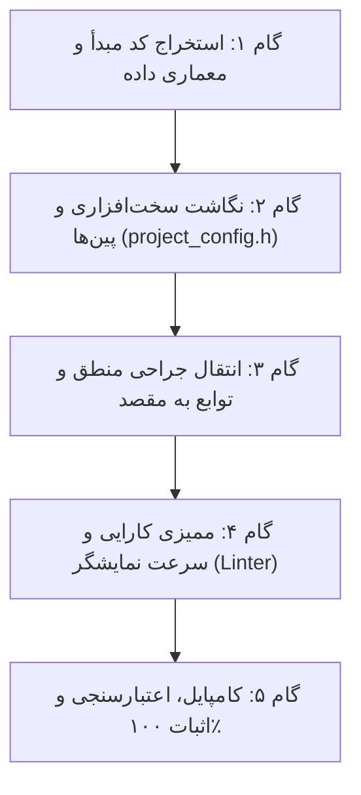

# نظام‌نامه مهندسی معکوس و انتقال خودکار ویژگی‌ها بین ماشین‌آلات هافلر
# Haffler Autonomous Cross-Machine Feature Porting Playbook

> **دستور قطعی برای ایجنت‌های هوش مصنوعی (Autonomous Porting Directive):**
> زمانی که کاربر می‌گوید: *«فلان ویژگی را از پروژه X به پروژه Y منتقل کن»* یا *«این ویژگی را شبیه فلان پروژه پیاده کن»*:
> ۱. **هرگز از کاربر نپرسید چه کارهایی باید انجام شود یا مرحله به مرحله راهنمایی نخواهید.**
> ۲. کد مرجع را در پروژه مبدأ پیدا کرده، معماری سخت‌افزاری و وابستگی‌های آن را آنالیز کنید.
> ۳. ویژگی را با رعایت تفاوت پین‌ها، سایز ال‌سی‌دی و ماشین وضعیت پروژه مقصد **سفارشی‌سازی و پیاده‌سازی** کنید.
> ۴. تست‌های لایه نمایشگر (`haffler_display_performance_linter.py`) و کامپایل بیلد را اجرا کرده و خروجی بدون نقص تحویل دهید.

---

## ۱. نقشه ماژول‌های مرجع هافلر (Canonical Reference Subsystems)

پروژه **`ICE CREEAM` (بستنی‌ساز آستیاژ / هافلر)** طلایی‌ترین و بالغ‌ترین پروژه HMI هافلر است که بالاترین سطح استانداردهای مهندسی روی آن پیاده شده است. سایر پروژه‌ها نیز ماژول‌های تخصصی دارند:

| نام ماژول | پروژه مبدأ مرجع | مسیر فایل‌های مبدأ | نحوه اتصال به پروژه مقصد |
|:---|:---:|:---|:---|
| **۱. تاچ فیلترشده ضد نویز (GT911 DSP)** | `ICE CREEAM` | `main/gt911.c`, `gt911.h` | خواندن غیرمسدودکننده I2C + فیلتر EMA + رد پرش‌های بالای ۱۲۰px |
| **۲. موتور سه‌زبانه (Yekan FA/EN/TR)** | `ICE CREEAM` | `main/ui_lang.c`, `ui_lang.h` | جایگزینی رشته‌های محلی با کدهای `STR_*` در جداول سه‌زبانه |
| **۳. کیپد صنعتی و مودال‌های استپر** | `ICE CREEAM` | `main/ui_numpad.c`, `screens.c` | تنظیم پارامترها و کدهای عبور ۴ یا ۵ رقمی با کدهای ممیزی |
| **۴. لاگ آلارم استاندارد ISA-18.2** | `ICE CREEAM` | `main/fault_log.c`, `fault_log.h` | صف رویدادهای خطا در حافظه RTC/NVS با فیلتر ریست ناخواسته |
| **۵. پورتال وای‌فای و وب‌سرور داخلی** | `ICE CREEAM` | `main/wifi.c`, `webportal.c` | پورتال هات‌اسپات محلی جهت آپلود OTA فریمور و مانیتورینگ موبایل |
| **۶. ساختار قفل دوهسته‌ای و بازیابی RTC** | `ICE CREEAM` | `main/main.c`, `hardware.c` | محافظت رندرینگ هسته ۱ با `lvgl_lock()` و مقایسه مکمل بیتی |
| **۷. پل تله‌متری ابری به سایت (SCADA)** | `haffler_core` | `haffler_cloud_scada_bridge.c` | ارسال جیسون وضعیت به `haffler-ai.ir` روی هسته ۰ بدون افت فریم |
| **۸. کنترل دمای PID و المنت با SSR** | `Welding_single_head` | `main/temp_control.c` | خواندن ترموکوپل K با MAX6675 و کنترل مدولاسیون عرض پالس SSR |
| **۹. انکودر و خط‌کش دیجیتال صدم میلی‌متر** | `Cutter double_head` | `main/encoder.c` | شمارش پالس‌های فاز A/B با اینتراپت و جبران لقی دندانه (Backlash) |

---

## ۲. گام‌های ۵ مرحله‌ای انتقال خودکار ویژگی (The 5-Step Porting Harness)

### گام ۱: استخراج کد مبدأ (Deep Source Inspection)
- به فایل مقصد مراجعه نکنید تا ابتدا کد مبدأ را دقیق بشناسید.
- ساختار داده‌ها (`struct`)، توابع عمومی (`public API`) و وظایف تسک‌های FreeRTOS مرتبط با آن ویژگی را استخراج کنید.

### گام ۲: نگاشت پین‌ها و کانفیگ سخت‌افزاری (Pin & Config Adaptation)
- هرگز پین‌های سخت‌افزاری پروژه مبدأ را مستقیماً کپی نکنید!
- فایل `project_config.h` یا `pinmap.txt` پروژه مقصد را بخوانید.
- اگر پین‌های ورودی/خروجی متفاوت است، متغیرها را بر اساس پین‌های پروژه مقصد آداپته کنید.

### گام ۳: انتقال جراحی منطق (Surgical Logic Integration)
- توابع عمومی را در فایل‌های ماژولار جداگانه قرار دهید (نه اینکه هزار خط کد را در `main.c` یا `screens.c` کپی و شلوغ کنید).
- هوک‌های دوره‌ای (مانند بروزرسانی هر ثانیه یا هر ۷۰ میلی‌ثانیه) را به حلقه اصلی `plc_poll_inputs()` یا تسک مانیتور وصل کنید.

### گام ۴: ممیزی کارایی و پیشگیری از افت فریم (Performance Shield)
- اجرای اسکریپت ممیزی:
  `python tools/haffler_display_performance_linter.py <project_path>`
- بررسی عدم نقض ۷ قانون طلایی سرعت نمایشگر هافلر:
  1. هیچ لیبلی بدون شرط تغییر نکرده باشد.
  2. سایه تمام آبجکت‌ها ۰ باشد.
  3. تسک شبکه و اینترنت به هسته ۰ پین شده باشد.
  4. هیچ `vTaskDelay` مسدودکننده‌ای در تسک منطق PLC نباشد.

### گام ۵: کامپایل، تست و تحویل نهایی (Verification Before Completion)
- کامپایل با Ninja یا PlatformIO:
  `ninja -C build` یا `pio run`
- اجرای سوئیت تست فریمور:
  `python tools/verify_firmware.py`
- تایید اجرای موفق بیلد و عدم افزایش حجم پارتیشن بیش از حد مجاز.
