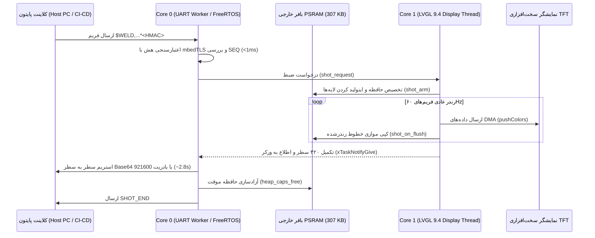

# پروتکل امن سریال جهت کنترل HMI و دریافت اسکرین‌شات (Secure Serial HMI & Snapshot Protocol)
# دستگاه جوش تک‌سر UPVC هافلر (Welding Single-Head HMI)

این مستند، معماری، پروتکل امنیتی، بسته دستوری و روش پیاده‌سازی سیستم کنترل صفحه، تغییر پارامترها و اسکرین‌شات فوق‌سریع دستگاه جوش تک‌سر را با استاندارد مهندسی زیمنس تشریح می‌کند تا در آینده توسعه‌دهندگان بتوانند بدون ابهام سیستم را نگهداری و گسترش دهند.

---

## ۱. اهداف و مشخصات کلیدی (Key Specifications)

| پارامتر | مقدار | توضیح فنی |
|---|---|---|
| **نرخ تبادل (Baud Rate)** | `921600 bps` | انتقال هر فریم کامل ($480 \times 320$ پیکسل RGB565) در **کمتر از ۳ ثانیه** |
| **تأخیر در اجرای HMI و تاچ** | **صفر (Zero-Lag / 60 FPS)** | کپی داده در کالبک Flush لایبرری LVGL بدون مسدود کردن ترد UI انجام شده و استریم در Core 0 صورت می‌گیرد |
| **مکانیسم امنیت و اصالت‌سنجی** | **HMAC-SHA256 Token** | احراز هویت بسته‌ها، جلوگیری از نفوذ، تزریق کد و حملات بازپخش (Anti-Replay) |
| **واسط فیزیکی** | `UART0` (پورت CP210x روی COM8/COM17) | پورت پیش‌فرض صنعتی با محافظت خط نویز |
| **مدیریت حافظه** | **PSRAM خارجی (۳۰۷,۲۰۰ بایت)** | تخصیص بافر در `MALLOC_CAP_SPIRAM` و آزادسازی فوری پس از ارسال |

---

## ۲. ساختار فریم پروتکل امنیتی (Secure Frame Structure)

تمامی بسته‌های دستوری ارسالی از کلاینت به دستگاه از قالب متنی زیر پیروی می‌کنند:

```text
$WELD,<SEQ>,<NONCE>,<CMD>,<PAYLOAD>*<HMAC_SIGNATURE>\r\n
```

### اجزای بسته:
1. **پیشوند فریم:** `$WELD,` (شناسه دستگاه جوش تک‌سر هافلر)
2. **شماره ترتیب (`SEQ`):** شمارنده صعودی ۴ رقمی هگزادسیمال (مانند `0001`, `0002`) جهت محافظت قطعی در برابر ارسال مجدد بسته‌های ضبط‌شده (Anti-Replay Protection). فریمور بسته‌های با شماره توالی مساوی یا کوچکتر را فوراً رد می‌کند.
3. **نانس تصادفی (`NONCE`):** رشته هگز تصادفی ۴ کاراکتری یکتا برای هر پکت.
4. **دستور (`CMD`):** نام دستور اجرایی (مانند `NAV`, `LANG`, `SHOT`, `STAT`, `TAP`, `SAFE`, `PING`).
5. **پارامترها (`PAYLOAD`):** مقادیر همراه با دستور (مانند شماره صفحه، زبان، مختصات تاچ).
6. **جداکننده:** کاراکتر ستاره `*`
7. **امضای دیجیتال HMAC-SHA256:** رشته ۶۴ کاراکتری هگزادسیمال که از هش ترکیب `<SEQ>,<NONCE>,<CMD>,<PAYLOAD>` با کلید مخفی مستر (`MASTER_SECRET_KEY`) تولید می‌شود.

> 🔒 **کلید محرمانه پیش‌فرض (Master Secret Key):**  
> `HAFFLER_WELDING_SEC_KEY_2026`  
> فریمور با استفاده از ماژول شتاب‌دهنده سخت‌افزاری mbedTLS در کمتر از ۱ میلی‌ثانیه صحت امضا را بررسی کرده و در صورت هرگونه عدم تطابق، با خطای `ERR SEC_AUTH_FAILED` دستور را بلافاصله ابطال می‌کند.  
> *حالت بای‌پس توسعه (`SERIAL_SEC_BYPASS = 1`):* در زمان دیباگ دستی در کنسول سریال، دستورات ساده (بدون `$WELD`) پذیرفته می‌شوند، اما هر بسته‌ای که با `$WELD` آغاز شود ملزم به داشتن امضای معتبر است.

---

## ۳. دیکشنری دستورات استاندارد (Command Set)

### ۱. دستور ناوبری و تغییر صفحه (`NAV` یا `GOTO`)
جهت انتقال دستگاه به هر یک از صفحات و پنجره‌های سیستم بدون نیاز به لمس فیزیکی تاچ:

- `$WELD,0001,A1B2,NAV,2*<HMAC>`: انتقال به صفحه اصلی جوشکاری (`SCREEN_ID_SCREEN_MENU`).
- `$WELD,0002,C3D4,NAV,3*<HMAC>`: انتقال به صفحه تنظیمات عمومی (`SCREEN_ID_SCREEN_SETTING_GENERAL`).
- `$WELD,0003,E5F6,NAV,4*<HMAC>`: انتقال به صفحه تنظیمات جک‌ها (`SCREEN_ID_SCREEN_SETTING_JACK_SETTING`).
- `$WELD,0004,G7H8,NAV,5*<HMAC>`: انتقال به صفحه مدیریت و بازنشانی IO (`SCREEN_ID_SCREEN_SETTING_ADMIN`).
- `$WELD,0005,I9J0,NAV,6*<HMAC>`: انتقال به صفحه ورود رمز ادمین (`SCREEN_ID_SCREEN_ADMIN_PASSWORD`).
- `$WELD,0006,K1L2,NAV,8*<HMAC>`: انتقال به صفحه اطلاعات، نسخه و عیب‌یابی (`SCREEN_ID_SCREEN_UPDATE`).
- `$WELD,0007,M3N4,NAV,9*<HMAC>`: انتقال به صفحه کارت‌های فریم‌ور و نصب (`SCREEN_ID_SCREEN_FRAMWARE`).
- `$WELD,0008,O5P6,NAV,11*<HMAC>`: انتقال به صفحه تنظیمات شبکه و وای‌فای (`SCREEN_ID_SCREEN_WIFI`).
- `$WELD,0009,Q7R8,NAV,111*<HMAC>`: باز کردن پنجره مودال ورود رمز وای‌فای (`wifi_password_panel_show`).

> **نکته:** دستورات متنی نام‌دار نیز پشتیبانی می‌شوند: `NAV MENU`, `NAV GENERAL`, `NAV JACK`, `NAV ADMIN`, `NAV UPDATE`, `NAV WIFI`, `NAV WIFI_PASS`.

### ۲. دستور تغییر زبان (`LANG` یا `SET_LANG`)
- `$WELD,0010,S9T0,LANG,1*<HMAC>` (یا `LANG,FA`): تغییر زبان سیستم به فارسی.
- `$WELD,0011,U1V2,LANG,2*<HMAC>` (یا `LANG,EN`): تغییر زبان سیستم به انگلیسی.
- `$WELD,0012,W3X4,LANG,3*<HMAC>` (یا `LANG,TR`): تغییر زبان سیستم به ترکی استانبولی.

### ۳. دستور اسکرین‌شات فوق‌سریع سخت‌افزاری (`SHOT`)
- `$WELD,0013,Y5Z6,SHOT,RGB565*<HMAC>`: فعال‌سازی فرآیند عکس‌برداری فوری.

**پاسخ فریم‌ور هنگام ارسال استریم تصویر:**
```text
SHOT_BEGIN 480 320 RGB565LE\n
<Base64_Encoded_Row_0>\n
<Base64_Encoded_Row_1>\n
...
<Base64_Encoded_Row_319>\n
SHOT_END\n
```

### ۴. شبیه‌سازی تاچ و رویدادهای کاربر (`TAP`, `PRESS`, `REL`)
- `$WELD,0014,A7B8,TAP,240 160 120*<HMAC>`: تزریق لمس در مختصات $x=240, y=160$ به مدت ۱۲۰ میلی‌ثانیه.
- `$WELD,0015,C9D0,PRESS,100 50*<HMAC>`: نگه‌داشتن ممتد تاچ روی مختصات دلخواه.
- `$WELD,0016,E1F2,REL*<HMAC>`: رها کردن انگشت از روی صفحه.

### ۵. مانیتورینگ وضعیت و ایست ایمنی (`STAT`, `TEMP`, `SAFE`, `PING`)
- `PING`: پاسخ با نسخه جاری فریم‌ور (`PONG welding_hmi_v1.5.195`).
- `STAT`: گزارش وضعیت زنده دمای المنت، رله SSR، جک‌های پنوماتیک و حافظه آزاد رم.
- `TEMP`: خواندن مستقیم مقدار واقعی و هدف ترموکوپل MAX6675.
- `SAFE`: قطع اضطراری و تضمین‌شده کلیه خروجی‌ها (SSR خاموش و کلیه جک‌ها غیرفعال).

---

## ۴. معماری پیاده‌سازی سخت‌افزاری (Sequence Diagram)



---

## ۵. راهنمای استفاده از ابزارهای پایتون (`tools/`)

### ابزار دریافت تصویر (`tools/hmi_screenshot.py`):
```powershell
python tools/hmi_screenshot.py --port COM8 --baud 921600 --out simulator/shots/screen_test.png
```

### ابزار کنترل و ناوبری صفحات (`tools/hmi_commander.py`):
```powershell
# بررسی اتصال
python tools/hmi_commander.py --cmd PING

# تغییر صفحه به منوی اصلی
python tools/hmi_commander.py --cmd "NAV 2"

# تغییر زبان به انگلیسی
python tools/hmi_commander.py --cmd "LANG EN"

# دریافت وضعیت زنده سنسورها
python tools/hmi_commander.py --cmd STAT
```
