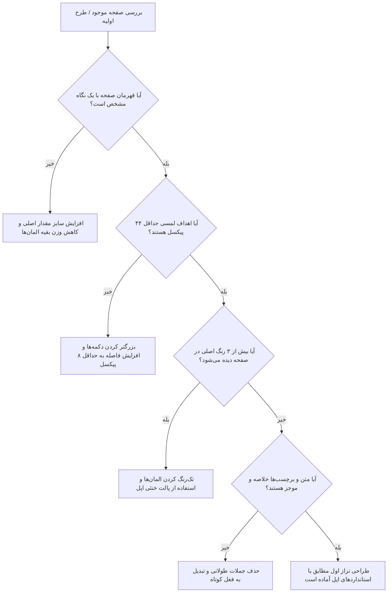

# استانداردهای طراحی HMI به سبک Apple HIG (Human Interface Guidelines)
## راهنمای جامع طراحی نمایشگرهای تعبیه‌شده صنعتی با کتابخانه LVGL (نسخه‌های ۸ و ۹)

> **هدف:** تبدیل رابط‌های کاربری سنتی، شلوغ و خسته‌کننده صنعتی به نمایشگرهایی فوق‌العاده زیبا، شفاف، کاربردی، سریع و با وقارِ اکوسیستم اپل (طراحی در سطح iPadOS/watchOS اما منطبق بر سخت‌افزارهای میکروکنترلری ESP32-S3 و نمایشگرهای ۴۸۰×۳۲۰).

---

## ۱. فلسفه طراحی بنیادین (The Apple Philosophy in Industry)

اپل طراحی را صرفاً «ظاهر» نمی‌داند، بلکه **«نحوه کارکردن»** سیستم تعریف می‌کند. در یک محیط صنعتی (کارگاه، کارخانه نانوایی، برش پروفیل، خط تولید شیشه یا دستگاه بستنی‌ساز)، اپراتور تحت فشار، خستگی، گرد و غبار، لرزش و نور شدید خورشید یا پرژکتور قرار دارد. طراحی به سبک اپل در این محیط یعنی:

### ۱.۱. شفافیت مطلق (Clarity)
- **محتوا پادشاه است (Content First):** مهم‌ترین پارامتر (مثلاً طول برش تیغه، دمای فک جوش، وزن چانه یا درصد گاز آرگون) باید قهرمان صفحه باشد؛ بسیار درشت، واضح و خوانا حتی از فاصله ۲ متری.
- **تایپوگرافی سلسله‌مراتبی:** هرگز چشم اپراتور نباید سردرگم شود. عنوان‌ها آرام، متغیرهای اصلی برجسته، و واحدها (مانند `mm`, `°C`, `bar`) با فونتی آرام‌تر در کنار عدد قرار می‌گیرند.
- **آیکون‌های هدفمند (SF Symbols Mindset):** آیکون‌ها برای تزیین نیستند؛ هر آیکون نمایندهٔ یک استعاره فیزیکی شناخته‌شده و همراه با برچسب متنیِ موجز است.

### ۱.۲. تواضع رابط کاربری (Deference)
- **حذف نویز بصری:** کادرهای ضخیم چندلایه، گرادیان‌های رنگین‌کمانی تند، سایه‌های کثیف و دکمه‌های پر زرق‌وبرق ۳D حذف می‌شوند.
- **پس‌زمینه آرام:** پس‌زمینه در خدمت محتواست؛ رنگ‌های تیرهٔ مات و یکدست (`#0D1117` یا `#161B22` یا خاکستری خنثی و شیک) باعث درخشش اطلاعات ضروری می‌شوند.
- **فضای تنفس (Generous Whitespace):** فضای خالی نشان‌دهندهٔ هدررفت نیست؛ بلکه نشان‌دهندهٔ نظم، تشخص و آرامش روانی اپراتور در خط تولید است.

### ۱.۳. عمق و لایه‌بندی ساختاری (Depth & Hierarchy)
- **معماری کارت‌ها (Card-based Layout):** المان‌های مرتبط داخل کارت‌های مجزا با گوشه‌های گرد نرم (Rounded Corners) قرار می‌گیرند.
- **سطوح ارتفاعی (Z-Elevation):**
  - سطح صفر (Base): پس‌زمینه مات تیره.
  - سطح یک (Cards / Panels): کارت‌های سفید یا خاکستری ملایم که اطلاعات را گروه‌بندی می‌کنند.
  - سطح دو (Dialogs / Keypads / Sheets): پنل‌های شناور معلق برای ورود داده، تنظیمات سریع یا پیام‌های تأیید.

---

## ۲. سیستم شبکه و فاصله‌گذاری (8-Point Grid System)

نمایشگرهای استاندارد ما **۴۸۰×۳۲۰ پیکسل** هستند. تمامی ابعاد، موقعیت‌ها، فواصل داخلی (Padding) و فواصل خارجی (Margin) باید بر مبنای مضارب **۸** (یا حداقل ۴ در مقیاس‌های بسیار فشرده) تنظیم شوند.

| نشانه فاصله | اندازه (پیکسل) | موارد کاربرد روی ۴۸۰×۳۲۰ |
|:---|:---:|:---|
| **Micro** | ۴px | فاصله بین آیکون و برچسب داخل دکمه فشرده، ضخامت خطوط جداکننده |
| **Small** | ۸px | فاصله بین آیتم‌های درون یک کارت، فاصله افقی دکمه‌های هم‌ردیف |
| **Medium** | ۱۲–۱۶px | فاصله داخلی کارت‌ها (Internal Padding)، حاشیه از لبه تصویر (Outer Margin) |
| **Large** | ۲۴px | فاصله بین بخش‌های کاملاً مجزا، فاصله هدر از محتوای کارت |
| **Hero** | ۳۲–۴۰px | حاشیه بالا یا تفکیک پنجره‌های مودال از حاشیه اصلی |

### قوانین چیدمان پیکسلی:
1. **تراز نوری (Optical Alignment) در برابر تراز ریاضی:** هنگام قرار دادن متن فارسی یا اعداد در کنار آیکون، ارتفاع بصری (Visual Center) ملاک است نه صرفاً Bounding Box هندسی.
2. **قرینگی و لنگرگاه چپ/راست:** در زبان فارسی (RTL)، اکشن‌های اصلی و هدایت‌کننده باید در جریان دید طبیعی قرار گیرند. هدر صفحه در سمت راست، ساعت و وضعیت شبکه در سمت چپ.

---

## ۳. سیستم رنگ صنعتی اپل (Industrial Apple Color System)

رنگ روی دستگاه صنعتی حامل بار مفهومی حیاتی است. رنگ هرگز برای قشنگی تصادفی به کار نمی‌رود.

```
+-------------------------------------------------------------------------+
|                              رنگ‌های سیستمی                             |
|  [ Primary Blue ]   [ Success Green ]   [ Warning Amber ]   [ Danger Red ]  |
|     #0A84FF             #30D158             #FF9F0A           #FF453A   |
+-------------------------------------------------------------------------+
|                           سطوح پس‌زمینه (Dark Mode)                      |
|  Base: #0A0C10  |  Card: #161B22  |  Border: #30363D  |  Text: #F0F6FC  |
+-------------------------------------------------------------------------+
```

### پالت رنگ استاندارد:

| نام رنگ | کد هگز (Hex) | کاربرد و رفتار در LVGL |
|:---|:---:|:---|
| **System Blue (Primary)** | `#0A84FF` | دکمه‌های اصلی هدایت، تب فعال، اسلایدرها و المان‌های تعاملی انتخابی |
| **System Green (Success)** | `#30D158` | استارت ایمن، وضعیت آنلاین، سنسور فعال و آماده‌به‌کار، تأیید موفق |
| **System Orange (Warning)**| `#FF9F0A` | هشدارهای احتیاطی، نزدیک شدن به محدوده ماکزیمم، سرویس دوره‌ای |
| **System Red (Destructive)**| `#FF453A` | استاپ اضطراری، حذف، خطای بحرانی، تریپ اورلود موتور، سطل زباله |
| **Card Background** | `#161B22` | بدنه کارت‌های محتوا روی تم تیره با کنتراست عمیق و آرام |
| **Card Border** | `#30363D` | خط دور کارت‌ها با ضخامت ۱ پیکسل برای تفکیک فوق‌العاده تمیز |
| **Text Primary** | `#FFFFFF` یا `#F0F6FC` | اعداد اصلی، عناوین، وضعیت فعال |
| **Text Secondary** | `#8B949E` | برچسب‌ها، واحد اندازه‌گیری (`mm`, `sec`, `kg`)، متون کمکی |
| **Disabled Surface** | `#21262D` | دکمه یا المان غیرفعال (متن با رنگ `#484F58`) |

> **قانون کنتراست شدید (High Glare Workshop Rule):**  
> هرگز متن خاکستری روشن را روی پس‌زمینه سفید یا متن خاکستری تیره را روی مشکی قرار ندهید. نسبت کنتراست متن اصلی به پس‌زمینه باید حداقل **۷:۱ (WCAG AAA)** باشد تا زیر نور شدید فلورسنت یا آفتاب خوانا بماند.

---

## ۴. ارگونومی و هندسه لمسی (Touch Ergonomics for Operators)

اپراتور کارگاهی غالباً انگشتان درشت دارد یا دستکش کار به دست کرده است. لمس خازنی GT911 زیر لرزش شاسی دستگاه نباید خطا بدهد.

1. **حداقل اندازه هدف لمسی (Hit Target Size):**
   - هر دکمه یا المان قابل لمس باید ابعادی **حداقل ۴۴×۴۴ پیکسل** (ترجیحاً ۴۸×۴۸ پیکسل یا بزرگتر) داشته باشد.
   - فاصله بین مراکز دو دکمه همجوار نباید از **۵۶ پیکسل** کمتر باشد تا از لمس همزمان و ناخواسته جلوگیری شود.
2. **شعاع انحنای گوشه‌ها (Border Radius):**
   - کارت‌های محتوا: `radius = 8px` الی `12px` (حس اصیل بدنه محصولات اپل).
   - دکمه‌ها و کلیدهای نامپد: `radius = 8px` الی `10px`.
   - دکمه‌های کپسولی (Capsule/Pill Buttons): `radius = LV_RADIUS_CIRCLE` (برای دکمه‌های سوئیچ دوحالته یا اکشن‌های سریع).
3. **بازخورد لمسی بصری (Visual Touch Feedback):**
   - در زمان فشردن (`LV_STATE_PRESSED`): دکمه باید بلافاصله (زیر ۳۰ میلی‌ثانیه) یا ۱۰٪ تیره‌تر شود یا به اندازه ۱ تا ۲ پیکسل به سمت پایین جابه‌جا گردد (`lv_obj_set_style_translate_y(btn, 2, LV_STATE_PRESSED)`).
   - انیمیشن‌های سنگین تغییر ابعاد (Scale) به دلیل افت فریم‌ریت پردازنده در LVGL مطلقا ممنوع است.

---

## ۵. تایپوگرافی دو زبانه و رفتار اعداد (Typography & Bidi Engine)

دستگاه‌های ما باید از زبان فارسی به عنوان زبان مادری و زبان انگلیسی به عنوان زبان مهندسی پشتیبانی کنند.

### ۵.۱. مقیاس سلسله‌مراتبی تایپ:
* **قهرمان (Hero Readout):** فونت‌های عددی درشت اختصاصی (`ui_font_digit40` / `digit80` / `digit120`). این اعداد مرکز ثقل صفحه هستند.
* **عناوین بخش‌ها (Headline):** فونت فارسی ضخیم خوانا در ابعاد ۲۰ تا ۲۴ پیکسل (`ui_font_naz24` یا تیتر مناسب).
* **متن‌های بدنه و مقادیر لیست‌ها (Body):** فونت فارسی/لاتین ۱۶ تا ۱۸ پیکسل.
* **برچسب‌ها و واحدها (Footnote / Caption):** فونت ۱۲ تا ۱۴ پیکسل با رنگ ثانویه (`#8B949E`).

### ۵.۲. قاعده طلایی ورود ارقام و جهت متن (RTL / Bidi Rules):
* **جداسازی متن از عدد:** هرگز متن فارسی و رقم لاتین را در یک رشته طولانی با فرمت‌های ترکیبی نریزید. یک لیبل برای عنوان فارسی («طول برش») و یک لیبل مجزا برای مقدار عددی («۲۴۵۰.۵») بسازید.
* **کاراکترهای عددی استاندارد:** ارقام در حالت فارسی باید از کدهای عربی-هندی (`U+0660` تا `U+0669`) استفاده کنند تا فونت‌های سفارشی بدون مشکل حروف گم‌شده نمایش دهند.

---

## ۶. عملکرد بدون لگ روی نمایشگر تعبیه‌شده (Zero-Lag LVGL 50-FPS Policy)

زیبایی بدون روان‌بودن و سرعت، بی‌ارزش است. برای اجرای بدون لکنت LVGL روی ESP32-S3:

1. **ممنوعیت کامل سایه‌های نرم‌افزاری بلادرنگ:**
   - هرگز دستور `lv_obj_set_style_shadow_width > 0` را روی المان‌های متحرک یا صفحات با رفرش مداوم اجرا نکنید. سایه نرم‌افزاری در پردازنده ESP32 زمان رندر را از ۶ میلی‌ثانیه به ۴۵ میلی‌ثانیه افزایش داده و فریم‌ریت را نابود می‌کند.
   - برای ایجاد عمق، به جای سایه از **خط دور ۱ پیکسلی با کنتراست مناسب (Border 1px)** و **کارت‌های با رنگ پس‌زمینه تفکیک‌شده** استفاده کنید.
2. **بروزرسانی مبتنی بر تغییر واقعی (Dirty Flags Pattern):**
   - هرگز توابع `lv_label_set_text` یا تغییر استایل را در هر چرخه ۲۰ میلی‌ثانیه‌ای لوپ تکرار نکنید.
   - قبل از ارسال متن جدید، بررسی کنید آیا متغیر واقعاً نسبت به مقدار قبلی تغییر کرده است یا خیر (`if (new_val != old_val) { ... }`).
3. **تخصیص حافظه صفر در لوپ (Zero Allocations):**
   - از `String` آردوینو، `malloc` یا `new` در چرخه‌های رندر یا رویدادهای لمسی استفاده نکنید. همواره از بافرهای ایستا (Static Char Buffers) با `snprintf` استفاده نمایید.

---

## ۷. موتور نقد و ارزیابی طراحی برای ایجنت‌ها (AI Design Critique Engine)

هر ایجنت هوش مصنوعی، قبل از اینکه کدی برای UI بنویسد یا وقتی کدی از قبل نوشته شده را می‌بیند، باید آن را از فیلتر زیر عبور داده و با این ۵ پرسش نقد کند:



### چک‌لیست امتیازدهی طراحی به سبک اپل (Apple Grade Scorecard):
1. **وزن بصری (Visual Hierarchy):** آیا مهم‌ترین المان صفحه حداقل ۲ برابر المان دوم برجسته است؟
2. **کاهش به‌هم‌ریختگی (De-cluttering):** اگر یک المان یا کادر اضافی را از صفحه پاک کنیم، آیا معنی از دست می‌رود؟ اگر خیر، حتماً حذف شود!
3. **تطابق ریتم و شبکه:** آیا تمام فواصل مضربی از ۸ (یا ۴) هستند؟ آیا لبه‌های کارت‌ها هم‌خط هستند؟
4. **خوانایی صنعتی:** آیا با نور کامل یا از فاصله یک‌ونیم متری عدد قابل خواندن است؟
5. **وضوح حالت‌های خطا:** آیا پیام خطا کوتاه، شفاف، قرمز مشخص و همراه با راهکار خروج است؟

---

## ۸. نمونه کد مرجع: ایجاد یک کارت پارامتر صنعتی به سبک اپل در LVGL v8 / v9

```c
/*
 * الگوی استاندارد ایجاد کارت وضعیت صنعتی با الهام از Apple HIG
 * رزولوشن هدف: 480x320 | بدون بار پردازشی سایه | پاسخگویی فوق سریع
 */
lv_obj_t* create_apple_metric_card(lv_obj_t* parent, lv_coord_t x, lv_coord_t y, 
                                   lv_coord_t w, lv_coord_t h,
                                   const char* title_fa, const char* unit_str) 
{
    // ۱. بدنه کارت شیک و آرام
    lv_obj_t* card = lv_obj_create(parent);
    lv_obj_set_pos(card, x, y);
    lv_obj_set_size(card, w, h);
    
    // استایل مدرن اپل: تیره مات، گوشه‌های نرم، کادر ظریف، بدون سایه سنگین
    lv_obj_set_style_bg_color(card, lv_color_hex(0x161B22), 0);
    lv_obj_set_style_bg_opa(card, LV_OPA_COVER, 0);
    lv_obj_set_style_radius(card, 12, 0);
    lv_obj_set_style_border_color(card, lv_color_hex(0x30363D), 0);
    lv_obj_set_style_border_width(card, 1, 0);
    lv_obj_set_style_pad_all(card, 12, 0);
    lv_obj_clear_flag(card, LV_OBJ_FLAG_SCROLLABLE);

    // ۲. عنوان فارسی کارت (آرام، خاکستری، بالا سمت راست)
    lv_obj_t* lbl_title = lv_label_create(card);
    lv_label_set_text(lbl_title, title_fa);
    lv_obj_set_style_text_color(lbl_title, lv_color_hex(0x8B949E), 0);
    lv_obj_set_style_text_font(lbl_title, &ui_font_naz18b, 0);
    lv_obj_align(lbl_title, LV_ALIGN_TOP_RIGHT, 0, 0);

    // ۳. مقدار عددی اصلی (قهرمان کارت - سفید درخشان، درشت)
    lv_obj_t* lbl_value = lv_label_create(card);
    lv_label_set_text(lbl_value, "--.-");
    lv_obj_set_style_text_color(lbl_value, lv_color_hex(0xFFFFFF), 0);
    lv_obj_set_style_text_font(lbl_value, &ui_font_digit40, 0);
    lv_obj_align(lbl_value, LV_ALIGN_LEFT_MID, 0, 6);

    // ۴. برچسب واحد اندازه‌گیری (کوچک در کنار عدد)
    if (unit_str && strlen(unit_str) > 0) {
        lv_obj_t* lbl_unit = lv_label_create(card);
        lv_label_set_text(lbl_unit, unit_str);
        lv_obj_set_style_text_color(lbl_unit, lv_color_hex(0x8B949E), 0);
        lv_obj_align_to(lbl_unit, lbl_value, LV_ALIGN_OUT_RIGHT_BOTTOM, 6, -4);
    }

    return card;
}
```

این سند راهنمای قطعی طراحی برای تمامی پروژه‌های هافلر است و کلیه کدهای گرافیکی بازتولید شده باید گام‌به‌گام با اصول آن مطابقت داشته باشند.
