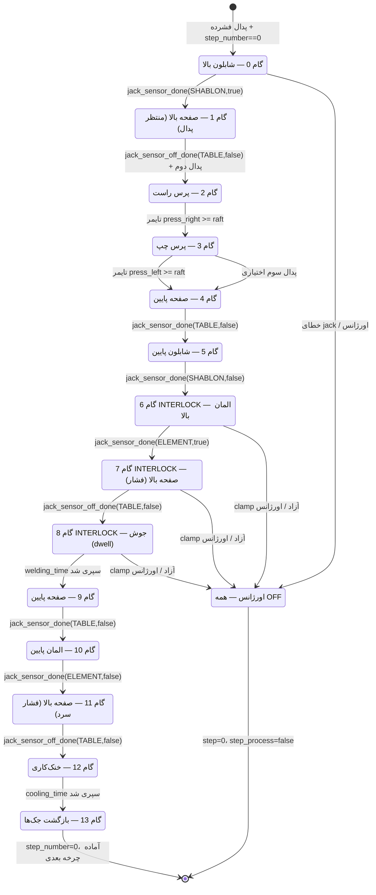

# ماشین حالت چرخه جوش — مرجع جامع (WELDING_CYCLE_FSM)

> **نسخه:** 1.0.0 — استخراج‌شده از `include/tasks.h`  
> **تاریخ:** ۱۴۰۵/۰۶/۰۹  
> **پروژه:** Welding Single-Head HMI — ESP32-S3 / LVGL 9.4  
> **مرجع سخت‌افزار:** `docs/REFERENCE.md` — **قرارداد ایجنت:** `docs/AGENTS.md`

---

## ۱. خلاصه اجرایی

چرخه جوش از طریق دو متغیر حالت کنترل می‌شود:

| متغیر | نوع | توضیح |
|---|---|---|
| `get_var_step_number()` | `int` (0–13) | شماره گام جاری |
| `get_var_step_process()` | `bool` | آیا گام در حال اجرا است؟ |

- چرخه روی **Core 0** اجرا می‌شود (Task: سیستم/پروسه).
- ماشین حالت در هر تیک `loop()` فراخوانی می‌شود.
- **هیچ blocking delay** در مسیر اصلی وجود ندارد؛ همه انتظارها بر اساس `millis()` هستند.
- در هر گامی که `step_process == false` بود، ماشین حالت منتظر رویداد خارجی (پدال / سنسور) می‌ماند.

---

## ۲. شرایط آغاز چرخه (Trigger)

چرخه **فقط** زمانی آغاز می‌شود که همه شرایط زیر برقرار باشد:

```
صفحه‌نمایش فعال == SCREEN_MENU
پدال فشرده شده (debounced, stable)
step_process == false
step_number == 0
دستگاه قفل نیست (device_locked == false)
```

---

## ۳. نقشه‌ی پین‌های GPIO درگیر

| نام منطقی | GPIO | جهت | فعال |
|---|---|---|---|
| `SHABLON` | 40 | خروجی | LOW (ON) |
| `TABLE` | 16 | خروجی | LOW (ON) |
| `PRESS_RIGHT` | 39 | خروجی | LOW (ON) |
| `PRESS_LEFT` | 42 | خروجی | LOW (ON) |
| `ELEMENT` | 48 | خروجی | LOW (ON) |
| `ZARBEH1` | 35 | خروجی | LOW (ON) |
| `ZARBEH2` | 36 | خروجی | LOW (ON) |
| `EMERGENCY` | 3 | ورودی | فعال = سیگنال اضطراری |

> **قانون ثابت:** `ON = LOW` ، `OFF = HIGH` — هرگز بدون مجوز مالک تغییر نکنید.

---

## ۴. دیاگرام ماشین حالت



---

## ۵. جدول کامل گام‌ها

| گام | نام فارسی | GPIO عمل | تابع انتظار / شرط پیشروی | تنظیم NVS | نکته ایمنی |
|---|---|---|---|---|---|
| **0** | شابلون بالا | SHABLON(40)→ON | `jack_sensor_done(MUX_FAM_SHABLON, true, shablon_time, raft, 1)` | `jack_shablon_raft` | `check_all_jacks_open_or_error()` — شکست → `emergency_operation()` |
| **1** | صفحه بالا | TABLE(16)→ON | `jack_sensor_off_done(MUX_FAM_TABLE, false, table_time, safhe_raft, 6)` | `jack_safhe_raft` | `step_process=false` — منتظر **پدال دوم** |
| **2** | پرس راست | PRESS_RIGHT(39)→ON | `millis()-press_right_time >= press_right_raft` | `jack_press_right_raft` | `step_process=false` بعد از رسیدن |
| **3** | پرس چپ | PRESS_LEFT(42)→ON | `millis()-press_left_time >= press_left_raft` | `jack_press_left_raft` | اگر `general_pedal_number3==true`: `step_process=false` — پدال سوم لازم |
| **4** | صفحه پایین | TABLE(16)→OFF | `jack_sensor_done(MUX_FAM_TABLE, false, table_time, safhe_bargasht, 3)` | `jack_safhe_bargasht` | — |
| **5** | شابلون پایین | SHABLON(40)→OFF | `jack_sensor_done(MUX_FAM_SHABLON, false, shablon_time, shablon_bargasht, 2)` | `jack_shablon_bargasht` | — |
| **6** ⚠️ | المان بالا | ELEMENT(48)→ON | `jack_sensor_done(MUX_FAM_ELEMENT, true, element_time, josh_raft, 4)` | `jack_josh_raft` | **اینترلاک سخت:** بررسی PRESS_LEFT و PRESS_RIGHT پیش از ON |
| **7** ⚠️ | صفحه بالا (جوش) | TABLE(16)→ON | `jack_sensor_off_done(MUX_FAM_TABLE, false, table_time, safhe_raft, 6)` | `jack_safhe_raft` | مانیتورینگ مداوم clamp. `josh_counter=get_var_welding_time()` |
| **8** ⚠️ | جوش (dwell) | — | `millis()-josh_time >= welding_time*1000` | `welding_time` | مانیتورینگ clamp + نمونه‌برداری دما (min/max/sum/count) |
| **9** | صفحه پایین | TABLE(16)→OFF | `jack_sensor_done(MUX_FAM_TABLE, false, table_time, safhe_bargasht, 3)` | `jack_safhe_bargasht` | — |
| **10** | المان پایین | ELEMENT(48)→OFF | `jack_sensor_done(MUX_FAM_ELEMENT, false, element_time, josh_bargasht, 5)` | `jack_josh_bargasht` | — |
| **11** | فشار (press cool) | TABLE(16)→ON | `jack_sensor_off_done(MUX_FAM_TABLE, false, table_time, safhe_raft, 6)` | `jack_safhe_raft` | `cooling_counter=get_var_cooling_time()` |
| **12** | خنک‌کاری | ZARBEH1(35)/ZARBEH2(36) | `millis()-cool_time >= cooling_counter*1000` | `cooling_time`, `profil_raft`, `profil_bargasht` | ZARBEH1 در raft ms، ZARBEH2 در bargasht ms، بیپ ۴ ثانیه آخر، `WeldQualityEngine::calculate()` |
| **13** | بازگشت جک‌ها | همه→OFF | `step_by_step_jack()` یا `fast_jack()` | `general_final_jack` | پایان چرخه → `step_number=0` |

---

## ۶. تفصیل گام‌های حساس

### گام ۶ — اینترلاک سخت پیش از روشن کردن المان

```cpp
// منطق دقیق از tasks.h:
if (press_left_is_free || press_right_is_free ||
    digitalRead(PRESS_LEFT) != ON ||
    digitalRead(PRESS_RIGHT) != ON) {
    emergency_operation();
    return;
}
// فقط پس از تأیید کامل:
digitalWrite(ELEMENT, ON);
```

> **قانون ایمنی مطلق (AGENTS.md):** المان (`ELEMENT`) هرگز نباید وارد ناحیه جوش شود
> مگر اینکه هر دو clamp چپ و راست در وضعیت تأییدشده engaged باشند.

---

### گام ۷ — مانیتورینگ مداوم clamp

همان چک گام ۶ در هر تیک تکرار می‌شود. اگر در هر لحظه clamp آزاد شد:

```cpp
// در هر تیک loop():
if (press_left_is_free || press_right_is_free ||
    digitalRead(PRESS_LEFT) != ON ||
    digitalRead(PRESS_RIGHT) != ON) {
    emergency_operation();
    return;
}
```

---

### گام ۸ — نمونه‌برداری دمایی حین جوش

در طول دوره dwell جوش، در هر تیک:

```cpp
float t = read_thermocouple(); // MAX6675
if (!isnan(t) && t < 1024.0f) {
    g_weld_sample_sum   += t;
    g_weld_sample_count += 1;
    if (t < g_weld_min_temp) g_weld_min_temp = t;
    if (t > g_weld_max_temp) g_weld_max_temp = t;
}
// در صورت NaN یا open-circuit (1024°C) → SSR_1 → OFF (اضطراری)
```

---

### گام ۱۲ — توالی ZARBEH و WeldQualityEngine

```
t = 0                      → cool_time شروع
t = profil_raft ms         → ZARBEH1 (GPIO35) → ON
t = profil_bargasht ms     → ZARBEH2 (GPIO36) → ON
t = (cooling_time - 4) s   → بیپ هشدار (آخرین ۴ ثانیه)
t = cooling_time s         → WeldQualityEngine::calculate()  [DVS 2207-1]
                           → g_teflon_cycles++
                           → اگر completed_weld_cycles_in_frame >= 4:
                               completed_weld_cycles_in_frame = 0
                               frame_counter++
                           → step_number = 13
```

---

### گام ۱۳ — حالت بازگشت

| مقدار `general_final_jack` | تابع فراخوانی‌شده |
|---|---|
| `true` (گام‌به‌گام) | `step_by_step_jack()` |
| `false` (سریع) | `fast_jack()` |

هر دو تابع همه خروجی‌های clamp را به HIGH (OFF) برمی‌گردانند و `step_number=0` تنظیم می‌کنند.

---

## ۷. رفتار اورژانس (E-Stop)

در **هر گامی**، اگر سیگنال `EMERGENCY` (GPIO3) فعال شود:

```
emergency_operation() فراخوانی می‌شود:
  SHABLON  (GPIO40) → HIGH (OFF)
  TABLE    (GPIO16) → HIGH (OFF)
  PRESS_RIGHT(GPIO39)→ HIGH (OFF)
  PRESS_LEFT (GPIO42)→ HIGH (OFF)
  ELEMENT  (GPIO48) → HIGH (OFF)
  ZARBEH1  (GPIO35) → HIGH (OFF)
  ZARBEH2  (GPIO36) → HIGH (OFF)
  SSR_1            → OFF (قطع حرارت)
  step_process     = false
  step_number      = 0
```

> **قانون مطلق:** `emergency_operation()` هیچ‌وقت نباید از ISR مستقیم فراخوانی شود.
> از `volatile` flag استفاده کرده و در `loop()` / `ui_process_isr_requests_fn$` پردازش نمایید.

---

## ۸. توابع کمکی کلیدی

| تابع | توضیح |
|---|---|
| `jack_sensor_done(mux, state, &timer, threshold_ms, id)` | انتظار برای رسیدن جک به وضعیت موردنظر و گذشت زمان حداقل |
| `jack_sensor_off_done(mux, state, &timer, threshold_ms, id)` | مشابه بالا، برای جک‌هایی که سنسور رسیدن ندارند |
| `check_all_jacks_open_or_error()` | بررسی می‌کند همه جک‌ها باز هستند، در غیر این صورت خطا |
| `emergency_operation()` | خاموش کردن فوری همه خروجی‌ها و ریست FSM |
| `WeldQualityEngine::calculate()` | محاسبه کیفیت جوش — استاندارد DVS 2207-1 |
| `step_by_step_jack()` | بازگشت ترتیبی جک‌ها |
| `fast_jack()` | بازگشت سریع همزمان جک‌ها |

---

## ۹. تنظیمات NVS مرتبط با چرخه

| گتر | واحد | گام(ها) |
|---|---|---|
| `get_var_setting_jack_shablon_raft()` | ms | 0 |
| `get_var_setting_jack_safhe_raft()` | ms | 1، 7، 11 |
| `get_var_setting_jack_press_right_raft()` | ms | 2 |
| `get_var_setting_jack_press_left_raft()` | ms | 3 |
| `get_var_setting_jack_safhe_bargasht()` | ms | 4، 9 |
| `get_var_setting_jack_shablon_bargasht()` | ms | 5 |
| `get_var_setting_jack_josh_raft()` | ms | 6 |
| `get_var_welding_time()` | s | 7، 8 |
| `get_var_setting_jack_josh_bargasht()` | ms | 10 |
| `get_var_cooling_time()` | s | 11، 12 |
| `get_var_setting_jack_profil_raft()` | ms | 12 (ZARBEH1) |
| `get_var_setting_jack_profil_bargasht()` | ms | 12 (ZARBEH2) |
| `get_var_setting_general_pedal_number3()` | bool | 3 |
| `get_var_setting_general_final_jack()` | bool | 13 |

---

## ۱۰. محدودیت‌های سخت برای ایجنت‌ها

> **[CAUTION] این قوانین مطلق هستند و هرگز نباید نقض شوند:**

1. **المان (GPIO48) فقط بعد از تأیید دوگانه clamp** (گام ۶ و پایش مداوم گام ۷/۸) می‌تواند ON شود.
2. **در صورت خواندن `NaN` یا `1024°C` از MAX6675** — SSR_1 فوراً OFF شود.
3. **هیچ فراخوانی LVGL** (`lv_*`) در داخل تابع ماشین حالت یا ISR مجاز نیست.
4. **ترتیب گام‌ها (0→13) قابل تغییر نیست** بدون تحلیل کامل safety interlock.
5. **`emergency_operation()` باید اتمیک و کامل باشد** — هیچ early return قبل از OFF کردن همه ۷ خروجی.
6. **شماره پین‌های GPIO** بدون تأیید صریح مالک قابل تغییر نیستند.
7. **گام ۱۲** باید `WeldQualityEngine::calculate()` را فراخوانی کند — حذف یا bypass آن ممنوع است.
8. **هیچ تخصیص حافظه پویا** (`new`, `malloc`, `String` concat) در مسیر FSM مجاز نیست.

---

## ۱۱. وابستگی‌های کامپایل

```
include/tasks.h          ← تعریف FSM اصلی
include/gpio_config.h    ← شماره پین‌ها و ON/OFF
include/mux_config.h     ← MUX_FAM_* constants
include/nvs_settings.h   ← get_var_setting_* getters
include/weld_quality.h   ← WeldQualityEngine::calculate
include/thermocouple.h   ← read_thermocouple + MAX6675
```

---

*این فایل توسط ایجنت از سورس‌کد `include/tasks.h` استخراج و مستند شده است.*  
*هرگونه تغییر در منطق FSM باید در این فایل منعکس شود — **ابتدا اینجا آپدیت کنید، سپس کد.***
