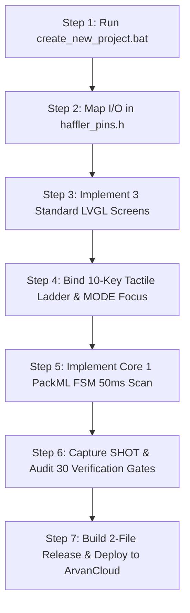

# 19. Zero to Production: Turnkey 30-Minute Master Tutorial

## Executive Summary
This document is the definitive, step-by-step engineering walkthrough for any AI agent or embedded engineer building a brand-new industrial controller on the Haffler ESP32-S3 platform. Following these 7 standardized steps takes a project from an empty folder to a factory-ready, zero-defect production release in under 30 minutes.

---

## 7-Stage Engineering Roadmap



---

## Step 1: Scaffold the Project
Double-click `create_new_project.bat` and enter the machine name (e.g., `Edge_Bander` or `Glass_Drill`):
- Creates project directory under `C:\Users\Haffler\Documents\Haffler\PLC\PLC HMI\Software\[Machine_Name]`.
- Deploys turnkey PlatformIO configuration, 7MB OTA partition table, pin mappings, and authoritative `AGENTS.md`.

---

## Step 2: Configure Hardware Signals in `haffler_pins.h`
Open `firmware/include/haffler_pins.h` and assign application-specific aliases to the optocoupled inputs and industrial relays:

```cpp
// Machine Digital Inputs (Opto I0..I7)
#define PIN_IN_ESTOP           PIN_OPTO_I0  // Emergency Stop Mushroom NC
#define PIN_IN_HOOD_GUARD      PIN_OPTO_I1  // Acrylic Hood Safety Switch
#define PIN_IN_CLAMP_DOWN      PIN_OPTO_I2  // Pneumatic Clamp Reed Switch
#define PIN_IN_FEED_FORWARD    PIN_OPTO_I3  // Material Feeder Front Limit
#define PIN_IN_START_PEDAL     PIN_OPTO_I4  // Operator Foot Pedal NO
#define PIN_IN_AIR_PRESSURE    PIN_OPTO_I7  // 6.0 Bar Line Pressure Switch

// Machine Relay Outputs (Q0..Q9)
#define RELAY_SPINDLE_MOTOR    0  // Q0: Main Cutter / Drill Spindle
#define RELAY_CLAMP_SOLENOID   1  // Q1: Profile Clamp Cylinder
#define RELAY_FEEDER_ADVANCE   2  // Q2: Feeder Push Cylinder
#define RELAY_COOLANT_MIST     3  // Q3: Lubrication Solenoid
#define RELAY_ALARM_RED        9  // Q9: Tower Light Red / Siren
```

---

## Step 3: Implement 3 Standard Apple HIG Screens
1. **Startup Splash (`ui_screen_splash.cpp`):**
   - Haffler brand emblem centered on deep matte background `#0B0F17`.
   - Firmware version string (`V.1.0.0`) and hardware self-test progress bar ($1500\text{ ms}$).
2. **Main Dashboard (`ui_screen_main.cpp`):**
   - **Hero Metric in mathematical center:** Large typography (`ui_font_digit80`) in dedicated container with `pad_all = 0` and `lv_obj_center()`.
   - **Header Bar:** RTC clock, day-lock status pill, PackML state badge (`READY`, `RUNNING`, `HELD`).
   - **Footer Bar:** 5 action labels matching tactile keys `F1` through `F5`.
3. **Settings Screen (`ui_screen_settings.cpp`):**
   - Stepper parameter controls with guaranteed minimum 16px separation between `+` button and label.

---

## Step 4: Hook Front Tactile Keys & MODE Traversal
Initialize the touchless navigation engine:
- `MODE`: Cycles through `FOCUS_NORMAL`, `FOCUS_STEPPER_PARAM`, and `FOCUS_ACTIVE_EDIT`.
- Navigation Keys (`UP`, `DOWN`, `LEFT`, `RIGHT`): Moves Apple HIG focus ring (`#007AFF`).
- `SET`: Enters parameter edit mode or commits numeric value to NVS.
- `START` / `STOP`: Dual-personality keys controlling process state in main dashboard or aborting edit in settings.

---

## Step 5: Implement Deterministic Core 1 FSM (50ms Scan Loop)
In `firmware/src/tasks/control_task.cpp`, instantiate the control loop:

```cpp
void control_task_core1(void* pvParameters) {
    TickType_t xLastWakeTime = xTaskGetTickCount();
    const TickType_t xFrequency = pdMS_TO_TICKS(50); // Deterministic 50ms cycle

    while (1) {
        // 1. Scan digital inputs with 50ms debounce
        bool inputs[8];
        plc_inputs_scan(inputs);

        // 2. Hardware safety interlock check
        if (inputs[PIN_IN_ESTOP] == false) {
            g_machine_state = STATE_ESTOP;
        }

        // 3. Evaluate state machine
        switch (g_machine_state) {
            case STATE_IDLE:
                if (inputs[PIN_IN_START_PEDAL] && safety_interlocks_ok()) {
                    cyl_clamp.advance();
                    g_machine_state = STATE_CLAMPING;
                }
                break;

            case STATE_CLAMPING:
                if (cyl_clamp.update(inputs) == CYL_ADVANCED) {
                    plc_relay_set(RELAY_SPINDLE_MOTOR, true);
                    g_machine_state = STATE_WORKING;
                }
                break;

            case STATE_ESTOP:
                plc_all_relays_off();
                break;
        }

        // 4. Deterministic sleep
        vTaskDelayUntil(&xLastWakeTime, xFrequency);
    }
}
```

---

## Step 6: Verify Live Framebuffer & Audit 30 Gates
1. Run `python tools/capture_screen.py COM3` to pull the active screen buffer over USB.
2. Inspect for visual alignment: zero tofu missing glyphs, mathematical centering of digits, 16px margins.
3. Complete the 30-gate audit in `11_PRE_FLIGHT_VERIFICATION_CHECKLIST.md`.

---

## Step 7: Zero-Desktop Release (release/ folder) & ArvanCloud Deployment
1. Increment patch version in `VERSION` and `version.h`.
2. Run `python tools/gen_lastfile.py`.
3. Confirm that ONLY two files reside on the Desktop:
   - `release/lastfile (روی سرور ابری ota-plc)`
   - `release/firmware.bin (روی سرور ابری ota-plc)`
4. Run `python tools/verify_ota.py` to confirm HTTP 200, Content-Length, and SHA-256 integrity on ArvanCloud.
