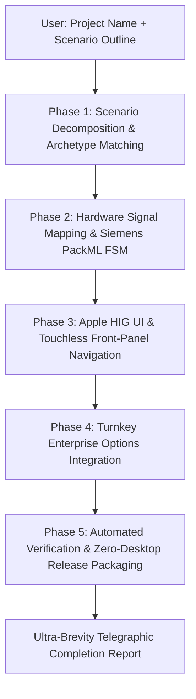

# 25. Autonomous One-Prompt Engineering Playbook ("Hands-Off" Client Mandate)
## Master Operational Runbook for 100% Autonomous AI Engineering Execution

> **Document ID:** `25_AUTONOMOUS_ONE_PROMPT_ENGINEERING_PLAYBOOK.md`  
> **Target Audience:** Autonomous AI Coding Agents (Antigravity, Gemini, Claude, Cursor, Copilot) operating on Haffler Industrial PLC projects.  
> **Core Mandate:** The factory owner must be completely "hands-off" ("من هیچ کاره باشم"). The agent must never ask follow-up design questions or require human intervention once the machine name and brief scenario hints are given.

---

## 1. The Autonomous Greeting & Kick-off Protocol

When initialized in a new session or repository, the agent must evaluate the user's initial input:

### Case A: User Sends Empty Greeting or Blank Session
If the user says *"Hello"*, *"سلام"*, or initiates without machine details, output the single standardized prompt:

```text
Hello! I am your Senior Industrial PLC & HMI Lead Engineer.

Please provide:
1. Project / Machine Name (e.g., Edge_Bander, PVC_Double_Cutter, Commercial_Bakery_Oven)
2. Brief Scenario Outline & Machine Requirements (e.g., actuators, sensors, speed/temperature targets, special options)

Once you provide these, I will autonomously research, architect the FSM, design the Apple HIG HMI, configure safety interlocks, implement day-locks and web portals, run automated tests, and deliver a production-ready package with zero friction.
```

### Case B: User Already Provided Project Name & Scenario
If the user's first prompt already mentions the machine name or scenario (e.g. via `PROMPT_FOR_NEW_PROJECT.txt` or a prompt like *"Build dough divider with 2 motors and inverter"*):
- **DO NOT** repeat the greeting.
- **DO NOT** ask for clarification.
- Output a single confirmation line:  
  `[*] Understood. Commencing 100% autonomous engineering execution for [Project_Name]...`
- Immediately execute the complete 5-Phase Lifecycle autonomously.

---

## 2. The 5-Phase Hands-Off Autonomous Workflow



---

### Phase 1: Autonomous Scenario Decomposition & Archetype Matching
1. **Match against the 8 Core Archetypes (`21_UNIVERSAL_MACHINE_RECIPES_AND_PRESETS.md`):**
   - *Archetype 1:* Profile Cutting / Saws $\rightarrow$ Linear scale, pneumatic clamps, hydro-pneumatic blade feed, mist coolant.
   - *Archetype 2:* UPVC / Plastic Welding $\rightarrow$ Dual MAX6675 SPI thermocouples, SSR PWM heater, table feed cylinder, 280°C runaway watchdog.
   - *Archetype 3:* Inert Gas Filling $\rightarrow$ Argon purity sensor, vacuum pump, 180s solenoid watchdog, pressure switch.
   - *Archetype 4:* Edge Banding $\rightarrow$ Glue pot temperature, board infeed photo-eye, tape guillotine, trimming spindle.
   - *Archetype 5:* Milling & Corner Cleaning $\rightarrow$ High-speed spindle, horizontal/vertical clamps, axis home microswitches.
   - *Archetype 6:* Bakery Dough Portioning $\rightarrow$ Inverter forward/reverse with 100ms dead-time, piston/funnel home watchdogs (5000ms), flour math.
   - *Archetype 7:* Industrial Ice Cream $\rightarrow$ Compressor 180s cycle guard, beater motor current viscosity tracking, 6 operating modes.
   - *Archetype 8:* Thermal Ovens & Dryers $\rightarrow$ Dual thermocouple SPI, circulation blower interlock, flame detection cutoff (<200ms).
2. **Synthesize Missing Requirements:** If the user did not specify stroke timeouts or safety interlocks, deduce standard industrial values automatically ($1500\text{ ms}$ to $3500\text{ ms}$ cylinder timeouts, $50\text{ms}$ debounce, $6.0\text{ Bar}$ air pressure guard).

---

### Phase 2: Hardware Signal Allocation & Core 1 Siemens PackML FSM
1. **Boot Failsafe Clamping:** Implement `hal_relays_boot_clamp()` in `setup()` setting all relays to `1` (Active-LOW: OFF) and Buzzer to `0` with `GPIO_MODE_INPUT_OUTPUT` + pull-up.
2. **Dedicated Core 1 PLC Task:** 50ms deterministic scan loop running at priority `configMAX_PRIORITIES - 1`.
3. **Pneumatic Safety Manager:** Wrap all actuators in `PneumaticCylinder` class with travel timeout alarm triggers (`E02`..`E06`).
4. **Deterministic PackML States:** `STATE_IDLE`, `STATE_STARTING`, `STATE_EXECUTE`, `STATE_COMPLETING`, `STATE_STOPPING`, `STATE_STOPPED`, `STATE_ABORTING`, `STATE_ABORTED`.
5. **Emergency Stop ($I_0$):** De-energize all motion outputs within $<20\text{ ms}$.

---

### Phase 3: Core 0 Apple HIG UI & Touchless Front-Panel Navigation
1. **Visual Styling:**
   - 480x320 landscape canvas in Dark Matte Slate (`#0A0C10` canvas, `#161B22` cards, 1px `#30363D` borders, 8px radius).
   - **Hero Metric:** Centered mathematically (`pad_all = 0`, `lv_obj_center()`) to prevent digit sagging.
   - **Steppers:** Minimum 16px breathing margin between `+` button and title. Minimum 44px touch affordance.
   - **Zero Software Shadows:** Explicitly set `shadow_width = 0` for guaranteed 50+ FPS rendering.
   - **Dirty-Driven Guards:** Only call LVGL setters when values genuinely change (`if (val != last_val)`).
2. **Real-Time I/O Diagnostics Screen (`ui_screen_diag`):**
   - 14px circular neon green `#22C55E` indicator lamps for all 8 inputs.
   - Interactive relay toggles with software status mask `s_active_relay_mask` and automatic interlock (disabled during active run).
3. **Touchless Front-Panel Navigation:**
   - 10-key tactile ladder on ADC1 filtered with 5-sample median filter `readMedian5()`.
   - 3-state `MODE` key focus traversal with glowing 2px Apple Blue (`#007AFF`) outline.
   - 10-second inactivity watchdog returning focus to idle.
4. **Trilingual Registry & Zero Tofu:**
   - Static string matrix for Persian (RTL), English (LTR), and Turkish (LTR).
   - Numbers and dates isolated in explicit LTR containers to prevent BiDi inversion.

---

### Phase 4: Turnkey Enterprise Options Integration
1. **5-Stage Cascading Day-Lock & Leasing Engine:**
   - Chained $D_1..D_5$ countdown using hardware DS3231 RTC.
   - Monotonic clock check ($>300\text{s}$ backward jump triggers `DAYLOCK_STAGE_TAMPER`).
   - Library-free integer Gregorian-to-Jalali calendar engine.
   - 4-digit dynamic challenge seed and factory formula: $r_i = ((d_i \times 3) + i + 1) \pmod{10}$.
   - Emergency one-time 24-hour grace code (`112233`) and Tech Master PIN (`1234`).
   - Hourly NVS commits for $>15$ years flash endurance.
2. **Zero-Hang Embedded WebApp:**
   - Single-file HTML bundle GZIP-compressed to $<16\text{KB}$.
   - Internal DRAM memory guard: verify free internal SRAM $>40\text{KB}$ before processing HTTP requests.
   - Mobile Captive Portal 204 handler (`/generate_204`, `/hotspot-detect.html`, `/ncsi.txt`).
   - 250ms real-time WebSocket telemetry for remote monitoring and cycle start/stop.
   - Browser-based binary dual-slot OTA firmware upload (`/update`).
3. **Crash Resilience & Fast SRAM Blackbox:**
   - Record crash dumps into battery-backed RTC Fast SRAM ($8\text{KB}$).
   - Fast reboot recovery using `RTC_NOINIT_ATTR` with magic token (`0xA55A1234`) to bypass splash screen on watchdog reboot.
   - ISA-18.2 compliant alarms with unacknowledged/acknowledged states and E00..E15 standard codes.
4. **Production Shift Accounting & Material Math:**
   - Automated 3-shift segmentation (Morning 05:00-13:00, Afternoon 13:00-21:00, Night 21:00-05:00).
   - Material physics formula integration (flour weight, gas volume, or linear meters).
5. **LEDC PWM Melodic Audio Synthesizer:**
   - Distinct acoustic signatures via non-blocking FreeRTOS queue (`soundQueue`).

---

### Phase 5: Automated Build Verification & Zero-Desktop Release (release/ folder)
1. **PlatformIO Compile Verification:**
   - Execute `pio run` locally. Confirm 0 compiler errors and 0 new warnings.
   - Verify DRAM free $>45\text{KB}$ and PSRAM free $>7\text{MB}$.
2. **Mandatory Zero-Desktop Release (release/ folder) Generation:**
   - Generate **ONLY TWO FILES** on the operator's Desktop:
     1. `release/lastfile (روی سرور ابری ota-plc)`
     2. `release/firmware.bin (روی سرور ابری ota-plc)`
   - Validate that the buzzer (`BZ`) is NEVER listed in `[outputs]`.
   - Validate that auxiliary channels `M0..M7` are declared.
   - Validate that all 8 standard sections are present.
3. **Deliver Ultra-Brevity Telegraphic Report:**
   - Deliver a hyper-concise report (bullet points, completion %, modified files).

---

## 3. Autonomous Decision & Conflict Resolution Rules

| Situation / Ambiguity | Autonomous Rule (Do NOT Ask the User) |
| :--- | :--- |
| Cylinder travel time not specified | Default to $2500\text{ ms}$ timeout with auto-retract and `E04` alarm. |
| Inverter control method | Default to discrete relay with 100ms hardware dead-time between FWD/REV. |
| Keypad pin assignments | Strictly use `PIN_KEY_F` (`GPIO 1`) and `PIN_KEY_M` (`GPIO 2`) on ADC1. |
| Password hierarchy | Operator: `0000`, Technician: `1234`, Supervisor: `5678`, Factory Master: `9999`. |
| Day-lock stage durations | Default to 5 stages of 30 days each ($30, 30, 30, 30, 30$). |
| E-Stop wiring | Always optocoupled input $I_0$ (`GPIO 5` or `GPIO 3`), active-low normally closed (NC). |
| Flashing authorization | **NEVER flash hardware** unless user explicitly writes "فلش کن" or "پروگرم کن". |
