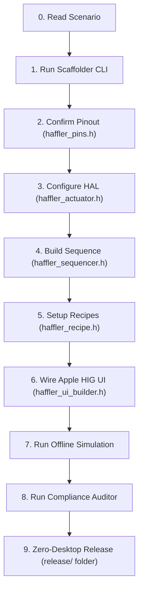

# 29: Step-by-Step Machine Development Walkthrough (Zero-Friction Guide)

> **Audience:** Autonomous AI Agents (Claude, Gemini, Antigravity, Cursor) and Senior Industrial Embedded Engineers.  
> **Mission:** Transform a brief machine scenario into a 100% compliant, certified, production-ready Haffler ESP32-S3 PLC + Apple HIG HMI firmware with zero guesswork and zero user friction.

---

## 1. Overview & The Autonomous Contract

When assigned a new project with a brief prompt (e.g. from `PROMPT_FOR_NEW_PROJECT.txt`):
```text
Hello! Ready to build new industrial project: [PROJECT_NAME]
Machine Scenario: [Brief description of cylinders, motors, sensors, or cycle steps]
Please take 100% autonomous ownership.
```

Your goal as the autonomous project lead is to complete all 9 stages without requiring user clarification. If an engineering detail is omitted in the prompt, consult `28_AUTONOMOUS_SCENARIO_EXPANSION_AND_PIN_RESOLVER.md` and standard Haffler ETV3A hardware archetypes to infer the optimal industrial implementation.

---

## 2. The 9 Development Steps



---

### Step 1: Scaffold the Project

Run the scaffolding CLI to create the target project structure with all tools, configuration files, and standard headers:

```powershell
python tools/scaffold_new_machine.py --name "UPVC_Corner_Cleaner" --type "milling" --dir "C:\Users\Haffler\Documents\Haffler\PLC\PLC HMI\Software\UPVC_Corner_Cleaner"
```

This instantly creates:
- `include/haffler_pins.h`, `include/haffler_actuator.h`, `include/haffler_sequencer.h`
- `include/haffler_recipe.h`, `include/haffler_ui_builder.h`, `include/haffler_day_lock.h`
- `src/main.cpp`, `src/machine_fsm.cpp`, `src/haffler_ui_builder.cpp`
- `platformio.ini`, `partitions_16mb_ota7m.csv`, `AGENTS.md`, `VERSION`
- `tools/` with compliance, verification, and packaging scripts.

---

### Step 2: Confirm Pinout (`include/haffler_pins.h`)

Verify all physical connections against the HAFFLER ETV3A Standard Hardware Pinout:

1. **Relays (Q0..Q9):**
   - Active-LOW (`0 = ON`, `1 = OFF`).
   - Motion dual-role: `Q0 = STEP_PUL`, `Q1 = STEP_DIR`, `Q2 = STEP_EN` if stepper/servo used.
   - Boot clamping in first nanoseconds of boot (`hal_relays_boot_clamp()`).
2. **Dual-Sensor Analog Inputs:**
   - Analog pins `GPIO 6`, `GPIO 5`, `GPIO 4` use calibrated voltage divider bands:
     - Retracted: `1300..1800 mV`
     - Moving: `1850..2240 mV`
     - Both: `2350..2750 mV`
     - Extended: `> 3500 mV`
3. **ADC1 Front-Panel Keypad:**
   - Single-wire ADC on `GPIO 9` with calibrated centers: `{4050, 3350, 2700, 1950, 1250}` mV.
   - Always guard with `xSemaphoreTake(adcMutex, ...)` across Core 0 and Core 1.

---

### Step 3: Configure Actuators (`include/haffler_actuator.h`)

Instantiate pneumatic cylinders and electric actuators using the universal HAL:

```cpp
#include "haffler_actuator.h"

// Horizontal Clamps on Relay Q1, Retracted Switch I2, Extended Switch I3, 2500ms Watchdog
HafflerActuator g_clamp_horiz("Horiz Clamp", 1, 2, 3, 2500);

// Saw Feed Cylinder on Relay Q2, Home Switch I4, End Switch I5, 4000ms Watchdog
HafflerActuator g_saw_feed("Saw Feed", 2, 4, 5, 4000);
```

---

### Step 4: Build Sequence Engine (`include/haffler_sequencer.h`)

Define deterministic PackML steps with explicit timeouts and completion criteria:

```cpp
#include "haffler_sequencer.h"

HafflerSequencer g_seq;

void setup_sequence() {
    g_seq.add_step(1, "ENGAGE_CLAMPS", 2500, []() {
        g_clamp_horiz.extend();
    }, []() {
        return g_clamp_horiz.is_extended();
    });

    g_seq.add_step(2, "START_MOTOR", 1500, []() {
        relay_set(0, true); // Q0 Motor Spindle
    }, []() {
        return true; // Immediate transition after start command
    });

    g_seq.add_step(3, "SAW_BLADE_FEED", 4000, []() {
        g_saw_feed.extend();
    }, []() {
        return g_saw_feed.is_extended();
    });

    g_seq.add_step(4, "SAW_BLADE_RETRACT", 3000, []() {
        g_saw_feed.retract();
    }, []() {
        return g_saw_feed.is_retracted();
    });

    g_seq.add_step(5, "STOP_MOTOR_AND_UNCLAMP", 2000, []() {
        relay_set(0, false);
        g_clamp_horiz.retract();
    }, []() {
        return g_clamp_horiz.is_retracted();
    });
}
```

---

### Step 5: Setup Recipes & Parameters (`include/haffler_recipe.h`)

Register parameters in NVS with safe bounds and default values:

```cpp
#include "haffler_recipe.h"

HafflerRecipeManager g_recipes;

void setup_parameters() {
    g_recipes.register_param(0, "cut_len", "Target Cut Length", "mm", 250.0f, 4500.0f, 1250.0f, 10.0f);
    g_recipes.register_param(1, "feed_spd", "Saw Feed Speed", "%", 10.0f, 100.0f, 75.0f, 5.0f);
    g_recipes.register_param(2, "clamp_dwell", "Clamp Hold Delay", "s", 0.5f, 5.0f, 1.2f, 0.1f);
    g_recipes.init_defaults("Standard Profile");
}
```

---

### Step 6: Construct Apple HIG UI (`include/haffler_ui_builder.h`)

Initialize the complete Apple HIG HMI in Core 0:

```cpp
#include "haffler_ui_builder.h"

void init_ui() {
    haffler_ui_builder_init(
        "HAFFLER CUT-01",              // Machine Title
        "Target Cut Length",           // Hero Metric Title
        "mm",                          // Hero Unit
        g_recipes.get_param(0)         // Default Value
    );
}

// In Core 0 UI Loop (20ms)
void ui_tick() {
    // Dirty-driven updates only
    haffler_ui_set_hero_value(g_recipes.get_param(0), 1);
    haffler_ui_set_machine_state(g_seq.get_active_step_name(), 0x16A34A);
}
```

---

### Step 7: Run Offline Simulation (`tools/simulate_machine.py`)

Validate deterministic timing, sensor travel timeouts, and E-Stop safety clamping without physical hardware:

```powershell
python tools/simulate_machine.py --archetype cutting --test-all
```

**Expected Result:**
```text
[PASS] Cycle completed successfully in 2950 ms. Parts: 1
[PASS] E-Stop immediately clamped all 10 relays to 0 in <50ms.
[PASS] Watchdog caught sensor timeout! Alarm: 101, Relays safely de-energized.
ALL TESTS PASSED: 3/3 GATES CERTIFIED
```

---

### Step 8: Run Industrial Compliance Auditor

Run the 10-gate strict compliance auditor:

```powershell
python tools/verify_project_compliance.py .
```

Ensure all 10 gates receive green `[PASS]` status (100.0% score).

---

### Step 9: Package Release & Await Upload Command

1. Build firmware:
   ```powershell
   & "$env:USERPROFILE\.platformio\penv\Scripts\pio.exe" run
   ```
2. Generate Zero-Desktop release in release/:
   ```powershell
   python tools/gen_lastfile.py --version "V.1.0.0" --bin .pio/build/esp32-s3-devkitc-1/firmware.bin
   ```
3. **Flashing Prohibition Rule:**  
   Notify the user with a concise telegraphic summary and file links. Never execute `pio run -t upload` or `esptool.py` unless the user explicitly commands: **«فلش کن»** or **«پروگرم کن»**.
