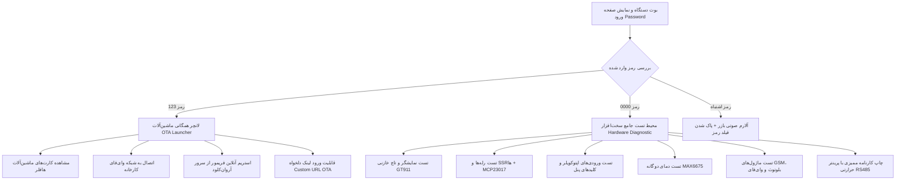

# دستور کار جامع و مستند مرجع مهندسی سامانه لانچر و ایستگاه آزمون کیفی سخت‌افزار HAFFLER HT-V3A
## Master Engineering Specification & Control Directive — Config Launcher & QC Audit Station

**نسخه مستند:** ۱.۰.۰  
**تاریخ تدوین:** شهریور ۱۴۰۵ (سپتامبر ۲۰۲۶)  
**سخت‌افزار هدف:** برد صنعتی اختصاصی **HAFFLER HT-V3A (ESP32-S3 DevKitC-1 N16R2)**  
**مرجع مهندسی:** استانداردهای اتوماسیون صنعتی زیمنس (Siemens Determinism) و اصول ظرافت و تجربه کاربری اپل (Apple HIG Craftsmanship)

---

## ۱. هویت، ماموریت کلان و مزیت رقابتی سامانه (System Vision & Value Addition)

سامانه **HAFFLER Config Launcher** به عنوان هسته مرکزی زنجیره تولید، آزمون کیفی و استقرار نرم‌افزار در کارخانجات هافلر عمل می‌کند. این فریمور جامع بر روی برد مادر **HT-V3A** نصب شده و دو وظیفه استراتژیک را به انجام می‌رساند:

1. **ایستگاه تست جامع سخت‌افزار و صدور شناسنامه کیفی (Factory QC & Acceptance Station):**
   - پیش از خروج هر دستگاه از خط تولید، برد کنترلر و کلیه اتصالات الکترومکانیکی تابلو تحت تست استرس قرار گرفته و کارنامه آزمون کیفی (با نمره ۰ تا ۱۰۰٪) توسط پرینتر حرارتی چاپ می‌شود.
2. **لانچر همگانی و پروویژنر ابری ماشین‌آلات (Multi-Machine OTA Provisioning Launcher):**
   - تکنسین با یک بار اتصال به وای‌فای، می‌تواند فریمور نهایی هر یک از ماشین‌آلات شرکت (جوش تک‌سر/دوسر، برش تک‌سر/دوسر، گاز پرکن، بستنی‌ساز، چانه‌گیر و...) را مستقیماً از بستر ابری آروان‌کلود روی فلش دستگاه پروگرم کند.

### جدول مقایسه متدولوژی سنتی در برابر سامانه مدرن HT-V3A هافلر

| ردیف | شاخص فنی | روش سنتی در خطوط تولید | سامانه هوشمند HT-V3A هافلر | ارزش افزوده مهندسی |
|:---:|:---|:---|:---|:---|
| **۱** | **پروگرم فریمور ماشین‌ها** | حمل لپ‌تاپ به کف کارگاه، اتصال کابل‌های متعدد پروگرمر، باز کردن IDE و بیلد دستی | **انتخاب تک‌لمسی کارت ماشین** در لانچر گرافیکی و دانلود/فلش خودکار از کلود آروان در کمتر از ۲۰ ثانیه | کاهش زمان استقرار نرم‌افزار از ۳۰ دقیقه به ۳۰ ثانیه؛ حذف کامل خطای انسانی در انتخاب باینری اشتباه |
| **۲** | **تست رله‌ها و ورودی‌ها** | تست دستی با مولتی‌متر و اتصال سیم‌ها روی ترمینال‌ها توسط تکنسین | **پنل گرافیکی تعاملی تست** رله‌های Q1..Q10، ورودی‌های I0..I7 و توسعه‌دهنده MCP23017 | پوشش ۱۰۰٪ تست در کمتر از ۲ دقیقه بدون نیاز به باز کردن تجهیزات |
| **۳** | **مستندسازی و ردگیری کیفیت** | چک‌لیست‌های کاغذی دستی که اغلب مفقود یا ناقص پر می‌شدند | **صدور برگه چاپی رسمی QC** با پرینتر حرارتی RS485 مجهز به لوگو، لاگ تک‌تک کلیدها و نمره کیفی | ایجاد شناسنامه فنی ضد جعل برای هر تابلو با قابلیت الصاق مستقیم داخل درب تابلو |
| **۴** | **کالیبراسیون و داده‌های NVS** | با هر بار پروگرم باینری جدید، تنظیمات و رمزهای وای‌فای پاک می‌شد | **معماری پایدار حافظه NVS مشترک** (`"chone"` / `"haffler_net"`) در آدرس ثابت `0x9000` | حفظ دائمی کالیبراسیون انکودرها، آفست‌ها و تنظیمات شبکه هنگام جابجایی بین نرم‌افزارهای مختلف |
| **۵** | **ایمنی سخت‌افزار و پورت‌ها** | ریسک بالای آسیب به پورت‌های مادربرد و اختلال با پورت‌های سروری | **جداسازی سخت‌گیرانه پورت‌ها**، ایزولاسیون کامل پورت COM3 اینتل و الزام استفاده از پورت امن CP210x | حفاظت مطلق از پورت‌های ارتباطی و جلوگیری از بریک شدن بردها |

---

## ۲. معماری دوگانه دسترسی و امنیت سیستم (Dual-Mode Access Architecture)

صفحه اصلی دستگاه با طراحی تمیز دارک‌مود و کیپد عددی لمسی از اپراتور درخواست رمز می‌کند:

### ۲.۱. محیط لانچر و به‌روزرسانی ماشین‌آلات (PIN: 123)
- نمایش کارت‌های اختصاصی ماشین‌آلات هافلر به صورت شبکه‌ای:
  - دستگاه جوش تک‌سر (`welding-single-head`)
  - دستگاه جوش دوسر (`welding-double-head`)
  - دستگاه برش تک‌سر دیجیتال (`digital-cutter-single-head`)
  - دستگاه برش دوسر (`digital-cutter-double-head`)
  - دستگاه تزریق گاز آرگون شیشه دوجداره (`gas-filling`)
  - دستگاه بستنی‌ساز صنعتی (`ice-cream`)
  - دستگاه چانه‌گیر و گردکن خمیر (`dough-divider`)
- اتصال زنده به کلود و مقایسه نسخه فعلی با مقدار ثبت‌شده در `lastfile`.
- امکان وارد کردن لینک سفارشی (Custom URL) از طریق مودال کیبورد کامل جهت دانلود نسخه‌های آزمایشی بتا.

### ۲.۲. محیط عیب‌یابی و آزمون کیفی سخت‌افزار (PIN: 0000)
- ورود به محیط تخصصی تست پریفرال‌ها بر پایه کدهای تثبیت‌شده `hwtest.cpp`.
- پایش بلادرنگ و بدون وقفه وضعیت تمام ورودی‌ها و خروجی‌ها در صفحات تعاملی.

---

## ۳. تحلیل و مشخصات زیرسیستم‌های آزمون کیفی (Hardware Diagnostic Subsystems)

### ۳.۱. تست نمایشگر و تاچ خازنی (Display & Touch Diagnostics)
- **آزمون سلامت پیکسل‌ها:** نمایش تمام‌صفحه رنگ‌های پایه قرمز، سبز، آبی، سفید و مشکی برای کشف هرگونه پیکسل سوخته یا خطوط نویز SPI.
- **تست رسم لمسی (Touch Drawing Canvas):** ترسیم زنده نقاط لمس با قلم مجازی برای ارزیابی کالیبراسیون و خطی بودن سنسور خازنی GT911 در گوشه‌ها.
- **ثبت امتیاز:** محاسبه تعداد نقاط ثبت‌شده در ماتریس لمسی جهت اطمینان از سلامت کنترلر I2C.

### ۳.۲. تست خروجی‌های دیجیتال (Relays & SSRs)
- **خروجی‌های مستقیم برد:** رله‌های صنعتی ۱۰ آمپر با تحریک Active-LOW یا Active-HIGH.
- **خروجی‌های افزاینده I2C (MCP23017 روی آدرس 0x20):**
  - ۶ خروجی اضافه: `GPA0` الی `GPA5` جهت راه‌اندازی بوبین‌های کمکی تابلو برق.
- **بازر صنعتی (GPIO 45):** تولید فرکانس‌های صوتی آلارم و پالس‌های بیپ با درایور LEDC.

### ۳.۳. تست ورودی‌های دیجیتال و کلیدها (Optocoupled Inputs & Keypads)
- **ورودی‌های اپتوکوپلر ایزوله (I0 الی I7):** تحریک با اتصال به GND (Active-LOW)؛ نمایش وضعیت با نشانگرهای سبز و قرمز در صفحه HMI.
- **ورودی‌های کمکی افزاینده MCP23017:** پایه‌های `GPA6` و `GPA7` با مقاومت‌های پول‌آپ داخلی ۱۰۰k.
- **کلیدهای ۱۰ گانه آنالوگ پنل:** تفکیک نردبان مقاومتی ADC در پین‌های GPIO 1 (کلیدهای F1..F5) و GPIO 2 (کلیدهای F6..F10 / کنترل).
- **فوت‌سوییچ‌های پدال پایی:** پایش سلامت ورودی پدال اپراتور.

### ۳.۴. سنسورهای دمای ترموکوپل صنعتی (Dual MAX6675 SPI)
- قرائت دیجیتال از طریق باس SPI اختصاصی:
  - **کانال ۱ (T1 - چیپ سلکت GPIO 21):** دمای مخزن بالا یا فک حرارتی
  - **کانال ۲ (T2 - چیپ سلکت GPIO 0):** دمای سیلندر یا اتوی تفلونی
- **تشخیص هوشمند قطعی سنسور:** بررسی بیت D2 در دیتای برگشتی MAX6675؛ در صورت قطع بودن پراب ترموکوپل تیپ K، فوراً پیام `Thermocouple Open / Disconnected` روی صفحه درج شده و خطای مربوطه در کارنامه چاپی ثبت می‌گردد.

### ۳.۵. پرینتر حرارتی صنعتی و صدور کارنامه QC (RS485 ESC/POS Protocol)
- **پورت ارتباطی:** درگاه سریال صنعتی `Serial2` روی پین‌های `GPIO 18` (RX) و `GPIO 17` (TX) با پایه کنترل جهت `GPIO 46` (DE/RE).
- **باودریت پایدار:** **19200 baud** (استاندارد پرینترهای حرارتی پنلی ۵۸ میلی‌متری).
- **درایور متنی:** پشتیبانی کامل از زبان فارسی و عربی با چسباندن صحیح حروف و تنظیم جهت متن.
- **چاپ گرافیکی لوگو:** ارسال بیت‌مپ لوگوی رسمی هافلر در ابتدای برگه با دستورات باینری ESC/POS.
- **الگوریتم محاسبه نمره آزمون کیفی ($QC\_Score$):**
  $$QC\_Score = \left(\frac{\sum \text{Passed Subsystems}}{\text{Total Required Subsystems}}\right) \times 100\%$$
- **اطلاعات ثبت‌شده در کارنامه چاپی:**
  - تاریخ و ساعت تست بر اساس ساعت سخت‌افزاری DS3231.
  - مدت زمان دقیق حضور در صفحه آزمون.
  - لیست تمام کلیدهای فشرده‌شده و رله‌های تحریک‌شده.
  - دمای ثبت‌شده سنسورها.
  - وضعیت پایداری وای‌فای، بلوتوث و ماژول مخابراتی.
  - محل امضا و تأیید اپراتور و بازرس ارشد کنترل کیفیت.

---

## ۴. ساختار چندنخی سیستم و زمان‌بندی صلب (FreeRTOS Multi-Core Topology)

سامانه بر پایه مدیریت توزیع‌شده تسک‌ها میان دو هسته ESP32-S3 طراحی شده است تا بار پردازش شبکه و محاسبات سنگین باعث افت فریم رابط گرافیکی نشود:

| هسته پردازنده | تسک اجرایی | اولویت (Priority) | حجم استک | شرح وظایف |
|:---:|:---|:---:|:---:|:---|
| **Core 1** | `lvgl_task` | ۲ | **8 KB** | اجرای `lv_timer_handler()`، حلقه تیک UI و رویدادهای تعاملی صفحه تست |
| **Core 1** | `LVGL Tick` | ۳ | **2 KB** | تولید پالس‌های ۱ میلی‌ثانیه‌ای تایمر داخلی کتابخانه گرافیکی |
| **Core 0** | `app_task` | ۱ | **12 KB** | اسکن شبکه‌های وای‌فای، برقراری اتصال امن و مدیریت دانلود استریم OTA |
| **Core 0** | `buzzer_task` | ۱ | **2 KB** | تولید پترن‌های صوتی بدون معطلی و بدون بلوکه کردن پردازش‌های اصلی |

> 🔒 **قانون حیاتی میوتکس `g_lvgl_mutex`:**  
> دسترسی به متغیرهای مشترک بین `app_task` و `lvgl_task` منحصراً با حفاظت `g_lvgl_mutex` صورت می‌پذیرد. فراخوانی این میوتکس از داخل اکشن‌های UI ممنوع است تا از قفل متقابل (Deadlock) جلوگیری شود.

---

## ۵. مشخصات فنی سرور و پروتکل به‌روزرسانی ابری (Cloud OTA Architecture)

- **بستر هاستینگ:** باکت منطبق با استاندارد Amazon S3 با نام `ota-plc` مستقر بر روی ابر آروان (ArvanCloud دیتاسنتر تهران `ir-thr-at1`).
- **دامنه پایه:** `https://ota.haffler-infi.ir`
- **فرمت ساختار کلیدهای آبجکت (URL-Encoded Format):**
  `https://ota.haffler-infi.ir/upvc%2F<machine-name>%2F<target-file>`
- **نام‌گذاری استاندارد آبجکت‌ها:**
  - فایل فریمور: `firmware` (بدون هرگونه پسوند `.bin`).
  - فایل نسخه: `lastfile` (متن ساده حاوی شماره نسخه، لاگ تغییرات و هش امنیتی).
- **تطبیق هش SHA-256:** در زمان دانلود، دیتای ورودی بایت‌به‌بایت پردازش و هش محاسبه‌شده با مقدار `lastfile` تطبیق داده می‌شود؛ در صورت هرگونه عدم تطابق، فرآیند فوراً لغو و پیام هشدار صادر می‌شود.
- **حفاظت ضد بازگشت (Anti-Rollback):** در پایان دانلود موفق، دستور `esp_ota_mark_app_valid_cancel_rollback()` اجرا می‌شود تا سلامت باینری جدید در سطح بوت‌لودر تضمین گردد.

---

## ۶. معماری پایدار حافظه NVS مشترک (Shared NVS Persistence)

جهت تسهیل عملیات کارگاهی و جلوگیری از وارد کردن مکرر پسورد وای‌فای یا تنظیمات بومی:
1. **فضای نام یکپارچه (`"chone"` / `"haffler_net"`):**
   - ذخیره تا ۱۶ شبکه وای‌فای شناخته‌شده با کلیدهای `ws0..ws15` و رمزهای `wp0..wp15`.
   - ذخیره زبان برگزیده سیستم (`language`: ۰=انگلیسی، ۱=ترکی، ۲=فارسی، ۳=آلمانی، ۴=روسی).
2. **پایداری داده‌ها در طول فلش OTA:**
   - پارتیشن `nvs` در جدول پارتیشن‌ها در سکتور ثابت `0x9000` قرار دارد. هنگام فلش فریمور ماشین‌های دیگر، ناحیه NVS دست‌نخورده باقی می‌ماند و کالیبراسیون سخت‌افزار از بین نمی‌رود.
