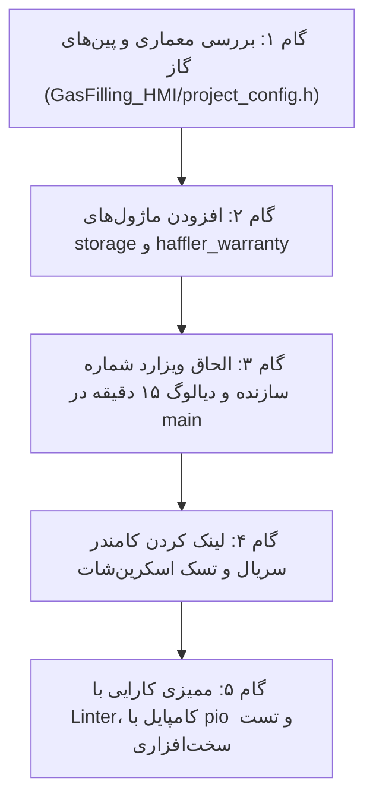

# نظام‌نامه مهندسی معکوس و انتقال خودکار ویژگی‌ها بین ماشین‌آلات هافلر
# Haffler Autonomous Cross-Machine Feature Porting Playbook

> **دستور قطعی برای ایجنت‌های هوش مصنوعی (Autonomous Porting Directive):**
> زمانی که کاربر می‌گوید: *«فلان ویژگی را از پروژه X به پروژه Y منتقل کن»* یا *«همه آپشن‌ها را بگذار روی پروژه گاز یا هر پروژه دیگری»*:
> ۱. **هرگز از کاربر نپرسید چه کارهایی باید انجام شود یا مرحله به مرحله راهنمایی نخواهید.**
> ۲. ماتریس فریم‌ورک پروژه مقصد (ESP-IDF یا Arduino PlatformIO) را استخراج کنید.
> ۳. ویژگی‌ها را از پکیج‌های استاندارد هافلر (Universal Option Packs) با رعایت تفاوت پین‌ها و کدهای ذخیره‌سازی پیاده‌سازی کنید.
> ۴. تست‌های لایه نمایشگر (`haffler_display_performance_linter.py`) و کامپایل بیلد را اجرا کرده و با تست سخت‌افزاری/اسکرین‌شات ۱۰۰٪ تحویل دهید.

---

## ۱. ماتریس ۱۱ گانه ماشین‌آلات هافلر و بستر نرم‌افزاری

| ردیف | نام پروژه / ماشین | بستر نرم‌افزاری | کنترلر / چیپ | نمایشگر و رزولوشن | سنسورها و محرک‌های اصلی |
|:---:|:---|:---:|:---:|:---:|:---|
| **۱** | `ICE CREEAM` (بستنی‌ساز) | **ESP-IDF** (C خالص) | ESP32-S3 | 480x320 ILI9488 + GT911 | کمپرسور تبرید، موتور همزن، سنسورهای دما NTC |
| **۲** | `Welding_single_head` (جوش تکسر) | **Arduino PlatformIO** | ESP32-S3 | 480x320 ST7796 + GT911 | المنت حرارتی SSR، جک‌های پنوماتیک، MAX6675 |
| **۳** | `Welding_double_head` (جوش دوسر) | **Arduino PlatformIO** | ESP32-S3 | 480x320 ST7796 + GT911 | المنت دوگانه، جک‌های کلمپ دوگانه، کنترل همزمان |
| **۴** | `Gas-filling` (تزریق گاز دو جداره) | **Arduino PlatformIO** | ESP32-S3 | 480x320 ST7796 + GT911 | سنسور درصد گاز زیرکونیا، شیرهای برقی، فلومتر |
| **۵** | `Cutter_single_head(Digital_metr)` | **Arduino PlatformIO** | ESP32-S3 | 480x320 ST7796 + GT911 | خط‌کش دیجیتال پالس، کلمپ، تیغه برش هیدرولیک |
| **۶** | `Cutter double_head(Digital_metr)` | **Arduino PlatformIO** | ESP32-S3 | 480x320 ST7796 + GT911 | دو انکودر نوری، استپر کنترل زاویه، تیغه‌های دوگانه |
| **۷** | `Corner_cleaning` (تمیزکن گوشه) | **Arduino PlatformIO** | ESP32-S3 | 480x320 ST7796 + GT911 | تیغه‌های شیارزن، مته لایه بردار، جک‌های فیکساتور |
| **۸** | `Copy_router` (کپی‌فرز و شیارزن) | **Arduino PlatformIO** | ESP32-S3 | 480x320 ST7796 + GT911 | اسپیندل آب‌خنک، جک‌های پنوماتیک، شابلون دستی |
| **۹** | `Aluminum-punching` (پانچ آلومینیوم) | **Arduino PlatformIO** | ESP32-S3 | 480x320 ST7796 + GT911 | سیلندر تناژ بالا، پدال ایمنی دو دستی، سنسور فشار |
| **۱۰** | `Bakery` (نانوایی صنعتی) | **Arduino PlatformIO** | ESP32-S3 | 480x320 ST7796 + GT911 | مشعل گازی، اینورتر کانوایر، کنترل دمای چندنقطه‌ای |
| **۱۱** | `bakery-mixer` (خمیرگیر پیوسته) | **ESP-IDF / Arduino** | ESP32-S3 | 480x320 ST7796 + GT911 | اینورتر Modbus RS485، لودسل وزن‌کشی، پمپ آب |

---

## ۲. پل انطباق فریم‌ورک‌ها (ESP-IDF ↔ Arduino Framework Translation Bridge)

علت اصلی باگ‌های گذشته، کپی خام توابع ESP-IDF در پروژه‌های آردوینو یا برعکس بود. جدول زیر مرجع قطعی معادل‌سازی است:

| عملکرد سیستم | در پروژه مبدأ ESP-IDF (`ICE CREEAM`) | در پروژه مقصد Arduino (`Gas-filling` و سایرین) | نکته ایمنی حیاتی |
|:---|:---|:---|:---|
| **نوشتن خروجی رله** | `gpio_set_level(PIN, 1);` | `digitalWrite(PIN, HIGH);` | اول مقدار ۱ (خاموش)، سپس `OUTPUT` |
| **خواندن ورودی** | `gpio_get_level(PIN);` | `digitalRead(PIN);` | فعال‌سازی `INPUT_PULLUP` در صورت نیاز |
| **تولید تاخیر غیرمسدودکننده** | `vTaskDelay(pdMS_TO_TICKS(ms));` | `vTaskDelay(pdMS_TO_TICKS(ms));` | هرگز از `delay()` مسدودکننده استفاده نشود |
| **خوانش زمان سیستم** | `esp_timer_get_time() / 1000ULL` | `millis()` | جلوگیری از سرریز ۳۲ بیتی |
| **حافظه ماندگار NVS** | `nvs_get_str()`, `nvs_set_str()` | کلاس `storage.get...()`, `storage.set...()` | طول کلید کمتر از ۱۵ کاراکتر (HWL-15) |
| **تسک پس‌زمینه** | `xTaskCreatePinnedToCore(...)` | `xTaskCreatePinnedToCore(...)` | حداقل حجم استک ۴۰۹۶ بایت (HWL-11) |
| **وای‌فای و سوکت** | `esp_wifi_...`, `esp_http_client_...` | شیء `WiFi`, `HTTPClient`, `WiFiClient` | غیرفعال‌سازی ذخیره انرژی با `WIFI_PS_NONE` |
| **قفل نمایشگر** | `lvgl_lock(ticks)` / `lvgl_unlock()` | `lvgl_lock()` یا فراخوانی در تایمر LVGL | زمان نگه‌داشت قفل کمتر از ۲ میلی‌ثانیه |

---

## ۳. پکیج‌های ۵ گانه آپشن‌های مشترک هافلر (Universal Option Packs)

هنگامی که کاربر دستور می‌دهد آپشن‌های استاندارد را به هر ماشینی (مانند پروژه گاز `Gas-filling`) اضافه کنید، این ۵ بسته به ترتیب اضافه می‌شوند:

### بسته ۱: راه‌اندازی و ثبت نام سازنده در اولین بوت (Manufacturer Onboarding Wizard)
* **عملکرد:** در نخستین روشن شدن دستگاه پس از فلش، به جای رفتن مستقیم به منو، ویزارد دو مرحله‌ای با استایل تیره `#0f172a` و کلیدهای عددی ۴×۳ باز می‌شود:
  1. مرحله ۱: وارد کردن شماره همراه ۱۱ رقمی سازنده (`09xxxxxxxxx`).
  2. مرحله ۲: تولید کد یکبار مصرف OTP ۵ رقمی تصادفی و ارسال پیامک خودکار (با پشتیبانی از کد مستر آفلاین `74125` برای شرایط عدم دسترسی به اینترنت).
  3. ذخیره در NVS با فلگ `mfg_phone_asked = true` و اتصال خودکار پیامک‌های گارانتی به این شماره.
* **فایل‌های مرجع:** `include/storage.h`, `src/haffler_warranty.cpp`, `src/main.cpp` (توابع `mfg_phone_setup_build`).

### بسته ۲: معماری ۵ مرحله‌ای گارانتی و قفل اجاره‌ای (Warranty & Day-Lock Lease)
* **عملکرد:**
  1. مهلت ۱۵ دقیقه‌ای تست آزاد در اولین بوت (با نمایش ساعت معکوس).
  2. پس از اتمام ۱۵ دقیقه، قفل شدن فرآیند تولید/تزریق تا زمان ثبت گارانتی.
  3. تولید کد مشتری ۱۱ رقمی استاندارد مبتنی بر مک آدرس سخت‌افزار با الگوریتم Luhn.
  4. فرم ثبت مشخصات خریدار (نام، شهر، تلفن) با کیبورد کامل فارسی.
  5. ارسال پیامک فعال‌سازی به سازنده و سرور هافلر، و قابلیت بازگشایی آفلاین با پین روزانه (Day-Lock).
* **فایل‌های مرجع:** `include/haffler_warranty.h`, `src/haffler_warranty.cpp`.

### بسته ۳: موتور آپدیت خودکار پرسرعت بدون لگ (Zero-Lag High-Speed Background OTA)
* **عملکرد:**
  1. پاک‌سازی زودهنگام پارتیشن غیرفعال در پس‌زمینه (Early Pre-Erase در ۵ ثانیگی بوت با بلوک‌های ۶۴KB و تاخیر ۱۵ms جهت حفظ ۶۰fps).
  2. تضمین عدم باز شدن سوکت شبکه در زمان پاک‌سازی فلش (`Clean Flash Guarantee`).
  3. تنظیم `WIFI_PS_NONE` و رایت بافرهای تجمعی ۸KB.
  4. محاسبه بلادرنگ هش سخت‌افزاری SHA-256 و سوییچ به URL جایگزین در صورت خطای سرور.
* **فایل‌های مرجع:** `include/ota_pre_erase.h`, `src/ota_pre_erase.cpp`, `include/tasks.h` (`execute_ota_stream`).

### بسته ۴: ارگونومی کیبورد و پیشگیری از وارونگی متن فارسی (BiDi & Apple HIG 4x3 Numpad)
* **عملکرد:**
  1. کیبورد ۴×۳ عددی به ابعاد ۴۸۰×۱۶۰ با کلید قرمز پاک کردن و کلید سبز تایید.
  2. حذف دونقطه بعد از کلمات فارسی در لیبل‌های ترکیبی (HWL-13).
  3. استفاده از کانتینر افقی با دو لیبل مستقل برای ترکیب متن فارسی و ارقام انگلیسی.
* **فایل‌های مرجع:** `src/main.cpp` (`get_pass_keyboard_map`, `keyboard_color_draw_task_cb`).

### بسته ۵: اتوماسیون تست و دریافت تصویر سخت‌افزاری (Remote HMI Commander & Screenshot)
* **عملکرد:**
  1. پروتکل فریم امن HMAC-SHA256 (`$WELD`) یا حالت تست مستقیم (`SERIAL_SEC_BYPASS = 1`).
  2. دستور `SHOT` برای دریافت زنده فریم‌بافر ال‌سی‌دی (۴۸۰×۳۲۰ با فرمت Base64) در کمتر از ۳ ثانیه.
  3. تزریق فرامین لمس مجازی (`TAP x y hold_ms`)، تغییر زبان (`LANG`), و ناوبری صفحات (`NAV id`).
  4. کانفیگ امن پورت سریال با `dtr=False, rts=False` برای جلوگیری از ریست برد حین اتصال (HWL-14).
* **فایل‌های مرجع:** `include/agent_hmi.h`, `include/screenshot.h`, `tools/hmi_commander.py`.

---

## ۴. راهنمای گام‌به‌گام پیاده‌سازی روی یک پروژه نمونه (مثال: پروژه گاز `Gas-filling`)

اگر کاربر بگوید: *«تمامی این آپشن‌ها را به پروژه گاز اضافه کن»*، این ۵ گام دقیقاً اجرا می‌شود:

1. **گام ۱ - بررسی سخت‌افزاری پروژه گاز:**
   - پین‌های ورودی و خروجی در `GasFilling_HMI` بررسی می‌شود (شیرهای تزریق گاز، سنسور درصد گاز).
   - پین‌های I2C تاچ (`TOUCH_SDA`, `TOUCH_SCL`) و LCD مطابقت داده می‌شوند.
2. **گام ۲ - یکپارچه‌سازی لایه ذخیره‌سازی و گارانتی:**
   - فیلدهای `ManufacturerPhone` و `MfgPhoneAsked` به ساختار NVS پروژه گاز افزوده می‌شوند.
   - ماژول‌های `haffler_warranty.h` و `haffler_warranty.cpp` اضافه شده و نام دستگاه روی `"تزریق گاز دو جداره"` تنظیم می‌گردد.
3. **گام ۳ - تزریق رابط کاربری بوت اول و کیبورد ۴×۳:**
   - تابع `mfg_phone_setup_build()` به زنجیره بوت اضافه می‌شود.
   - منطق تایمر ۱۵ دقیقه‌ای تست و دیالوگ قفل با متون فارسی تمیز بدون دونقطه فعال می‌گردد.
4. **گام ۴ - فعال‌سازی ابزار تست و پایش سریال:**
   - ماژول `screenshot.h` با استک ۴۰۹۶ بایت به تسک رندرینگ اضافه می‌شود.
   - اسکریپت `hmi_commander.py` با پورت پروژه گاز تست شده و تصویر فریم‌بافر استخراج می‌گردد.
5. **گام ۵ - اعتبارسنجی نهایی:**
   - اجرای `python tools/haffler_display_performance_linter.py Gas-filling`
   - اجرای `pio run` و اثبات خروجی بیلد با کدهای صفر خطا.

---

## ۵. چک‌لیست طلایی ۵ گانه قبل از پایان هر انتقال (Zero-Regression Gate)
- [ ] هیچ پین سخت‌افزاری یا رله‌ای از پروژه دیگر کپی نشده باشد؛ همه پین‌ها از فایل کانفیگ مقصد خوانده شوند.
- [ ] همه تسک‌های جدید دارای استک حداقل ۴۰۹۶ بایت باشند (HWL-11).
- [ ] در متون فارسی هیچ علامت دونقطه در مجاورت عدد نباشد (HWL-13).
- [ ] اسکریپت‌های پایتون با `dtr=False, rts=False` باز شوند (HWL-14).
- [ ] بیلد با کد خروجی ۰ کامپایل شده و حداقل یک اسکرین‌شات سخت‌افزاری زنده ثبت شود.

