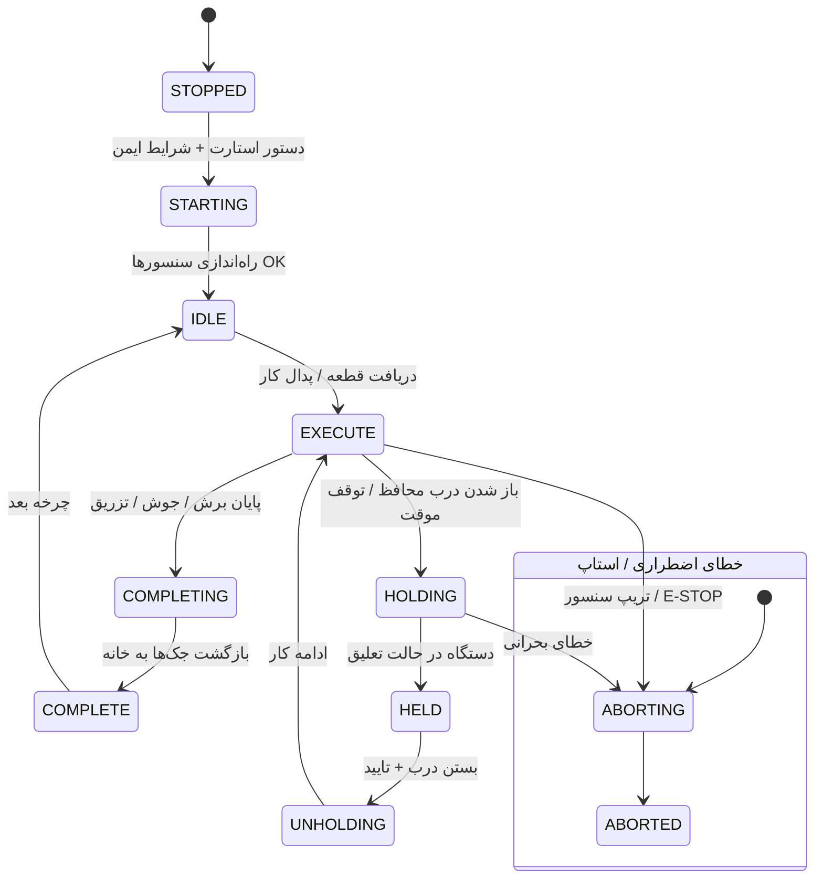

# استانداردهای برنامه‌نویسی صنعتی زیمنس (Siemens Industrial PLC Standards)
## راهنمای جامع معماری نرم‌افزار، ماشین وضعیت PackML، برنامه‌نویسی تدافعی، مدیریت آلارم و تست کنترلرهای صنعتی بر پایه C/C++ و FreeRTOS

> **هدف:** انتقال نظم، صلابت و قابلیت اطمینان فوق‌العاده استاندارد زیمنس (SIMATIC S7-1200/1500 Styleguide و استانداردهای IEC 61131-3) به فریمورهای بر پایه میکروکنترلرهای مدرن تعبیه‌شده (ESP32-S3)، به طوری که کد ماشین در سخت‌ترین شرایط محیطی (نویز شدید، شوک ولتاژ، خطای اپراتور و قطع ناگهانی سنسور) هرگز رفتار نامشخص یا خطرناک از خود بروز ندهد.

---

## ۱. ارکان برنامه‌نویسی صنعتی زیمنس در محیط C/C++ (Core Architectural Principles)

در استانداردهای اتوماسیون زیمنس، تفکیک وظایف و تعینی بودن (Determinism) قانون اول است. در فریمور C/C++ این مفاهیم مستقیماً نگاشت می‌شوند:

```
+-------------------------------------------------------------------------------+
|                       نگاشت مفاهیم زیمنس به معماری C / FreeRTOS                |
+------------------------------------+------------------------------------------+
| مفهوم در PLC زیمنس (TIA Portal)    | معادل در معماری صنعتی C/C++ / FreeRTOS   |
+------------------------------------+------------------------------------------+
| OB1 (Cyclic Organization Block)    | حلقه تسک بلادرنگ با دوره ثابت (مثلاً 50ms) |
| OB100 (Startup Organization Block) | مرحله System Boot & Power-On Self Test   |
| FB (Function Block با Instance DB) | ماژول‌های دارای حافظه و استیت اختصاصی     |
| FC (Function بدون حافظه)           | توابع خالص Pure Functions (بدون Side-Eff)|
| Global DB (Shared Data Block)      | ساختار پیکربندی حفاظت‌شده با Mutex/Atomic|
| Diagnostic Buffer (لاگ تشخیصی)     | بافر چرخشی خطا در NVS یا DS3231 NVRAM    |
+------------------------------------+------------------------------------------+
```

### ۱.۱. قانون تفکیک لایه‌ها (Layered Architecture)
1. **لایه انتزاع سخت‌افزار (HAL - Hardware Abstraction Layer):** هیچ کد کنترلی نباید مستقیماً دستوراتی مثل `digitalWrite` یا خواندن پین‌های GPIO را صدا بزند. توابع HAL نظیر `hal_relay_set()`, `hal_sensor_read_filtered()`, `hal_temp_read()` تنها رابط با پین‌ها هستند.
2. **لایه منطق فرآیند (Process Logic & FSM):** بر اساس مقادیر پالایش‌شده ورودی، وضعیت ماشین را تغییر داده و فرمان‌های انتزاعی تولید می‌کند.
3. **لایه ناظر ایمنی مستقل (Safety Supervisor):** یک لایه نظارتی که حتی در صورت بروز خطای نرم‌افزاری در لاجیک، خروجی‌های پرخطر (شیر برش، فک جوش، پاروی گردان یا هیتر) را قطع می‌کند.
4. **لایه رابط کاربر و ارتباطات (HMI & Telemetry):** کاملاً مجزا در هسته ۰ (Core 0) و فاقد هرگونه تداخل با چرخه بلادرنگ هسته ۱.

---

## ۲. تعینی بودن زمان و چرخه اسکن (Deterministic Scan Cycle)

برنامه‌های PLC زیمنس در یک لوپ بسته با زمان تناوب تضمین‌شده اجرا می‌شوند.

```c
// اجرای چرخه اسکن صلب صنعتی در FreeRTOS (Core 1)
void plc_cyclic_task(void *pvParameters) 
{
    TickType_t xLastWakeTime = xTaskGetTickCount();
    const TickType_t xFrequency = pdMS_TO_TICKS(50); // دقیقاً 50 میلی‌ثانیه

    for(;;) 
    {
        // ۱. خواندن تصویر ورودی‌ها (Process Image Inputs - PII)
        plc_scan_inputs_and_filter();

        // ۲. اعتبارسنجی ایمنی سراسری (Global Safety & E-Stop Guard)
        plc_verify_safety_interlocks();

        // ۳. اجرای ماشین وضعیت اصلی فرآیند (FSM Execution)
        plc_fsm_execute();

        // ۴. ارزیابی آلارم‌ها و عیب‌یابی (ISA-18.2 Diagnostics)
        plc_alarms_evaluate();

        // ۵. به‌روزرسانی تصویر خروجی‌ها (Process Image Outputs - PIO)
        plc_write_outputs_safe();

        // ۶. ارسال هارت‌بیت به واچ‌داگ سخت‌افزاری
        esp_task_wdt_reset();

        // انتظار دقیق تا سررسید سیکل بعدی بدون جابه‌جایی زمانی
        vTaskDelayUntil(&xLastWakeTime, xFrequency);
    }
}
```

### خطوط قرمز سیکل اسکن:
* **ممنوعیت استفاده از `delay()` یا حلقه‌های معطل‌کننده (Busy-wait):** هرگونه `vTaskDelay` یا `delay()` در بدنه منطق کنترل ماشین ممنوع است. تاخیرها صرفاً با استفاده از تایمرهای تیک (Tick-based Timers مانند TON زیمنس) پیاده‌سازی می‌شوند.
* **ممنوعیت تخصیص حافظه پویا (`malloc` / `new`):** تخصیص حافظه باید هنگام بوت ماشین یک‌بار انجام شود. در سیکل کاری، هیچ فضایی نباید allocate یا free گردد تا خطای fragmentation به صفر برسد.

---

## ۳. ماشین وضعیت استاندارد بین‌المللی صنعتی (PackML / ISA-TR88.00.02)

کدهای آماتور وضعیت را با متغیرهای بولین متفرقه (`is_running`, `flag1`, `step2`) کنترل می‌کنند که منجر به حالت‌های پیش‌بینی‌نشده (Undefined States) می‌شود. استاندارد زیمنس ماشین‌های بسته‌بندی و صنعتی را با الگوی استاندارد PackML کنترل می‌کند:



### الزامات پیاده‌سازی ماشین وضعیت:
1. **تایم‌اوت اجباری برای تمام استیت‌های گذرا (State Timeouts):**  
   اگر ماشین وارد استیت `STARTING`، `CLAMPING` یا `CUTTING` شد، باید یک تایم‌اوت سخت‌گیرانه (مثلاً ۳۰۰۰ میلی‌ثانیه) داشته باشد. اگر میکروسوئیچ تایید نرسید، استیت نباید تا ابد معلق بماند، بلکه باید فوراً وارد `FAULT_TIMEOUT` شده و جک‌ها را رها سازد.
2. **بررسی شرایط پیش‌نیاز (Interlock Conditions):**  
   هیچ خروجی حرکتی نباید فعال شود مگر اینکه وضعیت‌های متضاد آن با شرط صلب فیزیکی و نرم‌افزاری نفی شده باشند (مثلاً تا زمانی که فک نگهدارنده کاملاً بسته نشده، تیغه اره هرگز نباید حرکت کند).

---

## ۴. برنامه‌نویسی تدافعی و منطق ذاتا ایمن (Defensive & Fail-Safe Programming)

1. **منطق تحریک منفی (Active-LOW Architecture):**
   - تمامی رله‌های صنعتی در این پروژه‌ها Active-LOW هستند:
     - مقدار `۰` پین GPIO = برق‌دار شدن سیم‌پیچ رله (روشن).
     - مقدار `۱` پین GPIO = قطع بوبین رله (خاموش / ایمن).
   - در زمان استارت یا ریست ناگهانی MCU، تمامی پین‌ها باید پیش از فعال‌شدن لاجیک، روی حالت خروجی `HIGH` تنظیم شوند تا هیچ شیر یا حرکتی در لحظه بوت برق‌دار نشود.
2. **فیلتر نویز و دیبانس (Debouncing) ورودی‌ها:**
   - نویز موتورهای الکتریکی، کنتاکتورها و اینورترها نباید ورودی دیجیتال را به اشتباه تحریک کند.
   - هر ورودی دیجیتال باید حداقل طی **۳ الی ۵ چرخه متوالی اسکن (۱۵۰ تا ۲۵۰ میلی‌ثانیه)** پایدار باشد تا به عنوان تغییر حالت پذیرفته شود.
3. **اعتبارسنجی مقادیر حسگرها (Plausibility Checks):**
   - قبل از مصرف دیتای آنالوگ یا ترموکوپل MAX6675، بررسی بازه معقول صورت گیرد (مثلاً اگر دمای فک جوش زیر ۰°C یا بالای ۴۰۰°C خوانده شد، سیم ترموکوپل قطع یا اتصالی است و باید خطای `SENSOR_OPEN` صادر شده و المنت قطع گردد).
4. **سوپروایزر استاپ اضطراری (E-STOP Hardware & Software Priority):**
   - خط استاپ اضطراری بالاترین اولویت کل سیستم است. به محض فعال شدن، بدون معطلی و بدون عبور از استیت‌های تدریجی، تمام بوبین‌های خروجی قطع می‌شوند.

---

## ۵. مدیریت آلارم و تشخیص خطا بر اساس استاندارد ISA-18.2

زیمنس مدیریت آلارم را هسته حیاتی عملکرد پایدار می‌داند. در سیستم ما آلارم‌ها به سه طبقه تقسیم می‌شوند:

```
+-------------------------------------------------------------------------------+
|                       ماتریس اولویت آلارم‌ها (ISA-18.2)                       |
+----------+-----------------------+---------------------+----------------------+
| اولویت   | توصیف                 | رفتار سیستم         | رفتار HMI و بازر     |
+----------+-----------------------+---------------------+----------------------+
| CRITICAL | خطر جانی، تریپ حرارتی | توقف فوری (Hard Kill) | پاپ‌آپ قرمز، بازر    |
| (بحرانی) | یا عدم عملکرد سنسور   | قطع کل رله‌های حرکت | ممتد، قفل تا ریست    |
+----------+-----------------------+---------------------+----------------------+
| WARNING  | نزدیک شدن به آستانه   | ادامه کار مشروط به  | کادر نارنجی، آیکون  |
| (هشدار)  | نیاز به روانکاری یا باد | رفع علت هشدار       | احتیاط، بوق مقطع     |
+----------+-----------------------+---------------------+----------------------+
| ADVISORY | تعویض تیغه، گزارش کار | بدون اختلال در تولید| نوتیفیکیشن ملایم     |
| (اطلاع)  | یا پر شدن ظرفیت شیفت  |                     | در گوشه هدر          |
+----------+-----------------------+---------------------+----------------------+
```

### الزامات مهندسی آلارم:
* **ثبت اولین خطا (First-Out Latching):** اگر چند سنسور همزمان خطا دادند، سیستمی پیاده‌سازی شده که مشخص می‌کند دقیقاً کدام خطا ابتدا رخ داده است تا تیم فنی زمان خود را برای ریشه‌یابی هدر ندهد.
* **لاگ تشخیصی پایدار (Non-Volatile Event Log):** ۱۰ خطای آخر همراه با تاریخ، ساعت، دقیقه و ثانیه دریافتی از DS3231 در حافظه دائمی (NVS) ضبط می‌شوند.

---

## ۶. چک‌لیست عیب‌یابی و صنعتی‌سازی کد (Industrial Code Hardening Checklist)

هنگامی که یک ایجنت هوش مصنوعی کدهای پروژه‌ها را بررسی می‌کند، باید این چک‌لیست را گام‌به‌گام اعمال کند:

| ردیف | سوال ممیزی کد | وضعیت خطرناک (غیرصنعتی) | راهکار صنعتی زیمنس |
|:---:|:---|:---|:---|
| **۱** | آیا `delay()` در تسک کنترل وجود دارد؟ | بله (بلاک‌کننده کل چرخه‌ها) | تبدیل به تایمرهای مبتنی بر `millis()` یا شمارنده تیک |
| **۲** | وضعیت اولیه پین‌های خروجی در بوت چیست؟ | پین‌ها تا مدتی شناورند | مقداردهی `HIGH` قبل از فعال‌سازی پول‌آپ/خروجی |
| **۳** | آیا برای جک‌ها تایم‌اوت تعریف شده است؟ | خیر (اگر سنسور خراب شود جک گیر می‌کند)| افزودن تایمر خطا و هشدار `ACTUATOR_JAMMED` |
| **۴** | آیا متغیرهای بین دو هسته امن هستند؟ | متغیر سراسری ساده بدون لاک | استفاده از `volatile`، متغیرهای `atomic` یا `Queue` |
| **۵** | آیا ترموکوپل و ورودی آنالوگ اعتبارسنجی می‌شود؟| مقدار خام ورودی مستقیماً مصرف می‌شود| بررسی بازه معتبر + فیلتر میانگین متحرک (EMA) |
| **۶** | آیا دیتای دریافتی از سریال/وای‌فای معتبر است؟ | بدون بررسی طول بافر مستقیماً پارس می‌شود| محافظت در برابر سرریز بافر (Buffer Overflow) |
| **۷** | رفتار سیستم در زمان قطع تغذیه چیست؟ | دیتای شیفت کاری از دست می‌رود | ذخیره دوره‌ای استاتیستیک در EEPROM/NVS و باتری RTC |

---

## ۷. فرآیند تست و صحه‌گذاری (Testing & Validation - FAT / SAT)

یک کد تنها زمانی آماده است که آزمون‌های زیر را با موفقیت پاس کرده باشد:
1. **آزمون شبیه‌سازی منطق بدون سخت‌افزار (Software-in-the-Loop - SIL):**  
   تست درایور و FSM در محیط تست نرم‌افزاری یا کامپیوتر با ورودی‌های شبیه‌سازی‌شده.
2. **آزمون قطع ناگهانی سنسور (Fault Injection Test):**  
   قطع عمدی فیش ترموکوپل یا میکروسوئیچ موقعیت در زمان کارکرد ماشین و بررسی توقف امن دستگاه.
3. **آزمون تست پذیرش کارخانه (FAT - Factory Acceptance Test):**  
   اجرای مداوم ۱۰۰ چرخه کاری بدون خطای منطقی، بدون ریست تصادفی واچ‌داگ و با حفظ فریم‌ریت بالای ۵۰ در HMI.
