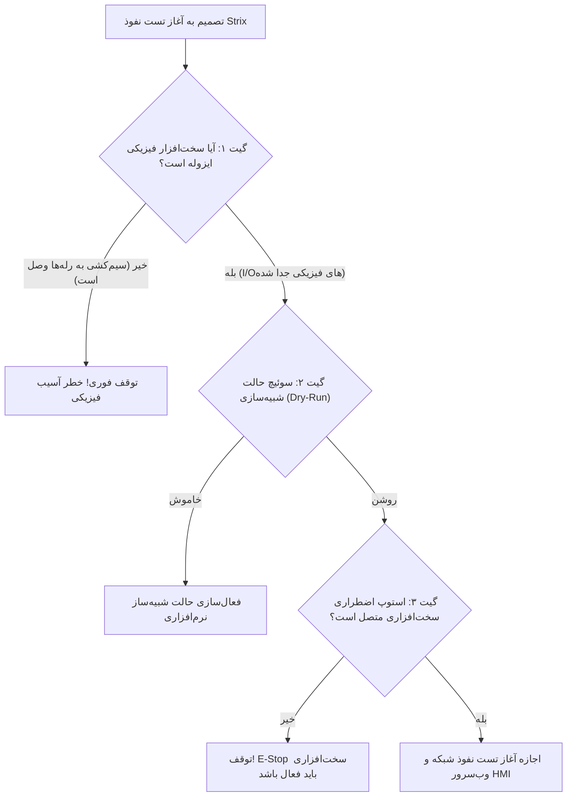

# 🏭 استاندارد تست نفوذ خودکار در سیستم‌های کنترل صنعتی (OT/ICS) با Strix AI
**Industrial OT/ICS Cybersecurity, Autonomous AI Pentesting & IEC 62443 Standards**

---

## ۱. مقدمه و تفاوت بنیادین امنیت IT با امنیت OT

در سامانه‌های اداری و وب (IT)، اولویت اول **محرمانگی (Confidentiality)** و سپس **یکپارچگی (Integrity)** و **در دسترس بودن (Availability)** است (مثلث CIA). اما در سیستم‌های اتوماسیون صنعتی هافلر (OT / Industrial Control Systems):

> ⚠️ **اصل طلایی ایمنی فیزیکی (Safety First):**  
> در محیط‌های صنعتی کارگاهی و خطوط تولید (شامل دستگاه‌های برش، جوش، خم و پانچینگ هافلر)، بالاترین اولویت **حفظ جان اپراتور و سلامت فیزیکی ماشین‌آلات (Safety)** است. یک بسته داده معیوب در وب ممکن است به خطای HTTP 500 ختم شود، اما ارسال یک بسته فازینگ (Fuzzing) نامعتبر به پورت شبکه یک PLC یا HMI فعال، می‌تواند باعث باز شدن ناگهانی جک پنوماتیک، حرکت خارج از کنترل تیغه اره الماسه یا روشن ماندن بی‌وقفه المنت‌های حرارتی گردد!

این مستند نحوه بهره‌برداری ایمن از پلتفرم هوش مصنوعی **Strix AI** را برای کشف و رفع رخنه‌های امنیتی در نرم‌افزارهای HMI، درگاه‌های اینترنت اشیاء (Edge Gateways) و پایپ‌لاین به‌روزرسانی OTA هافلر طبق استاندارد بین‌المللی **IEC 62443** تبیین می‌کند.

---

## ۲. چارچوب انطباق با استاندارد بین‌المللی IEC 62443

پلتفرم Strix AI در اکوسیستم اتوماسیون صنعتی هافلر با بخش‌های زیر از استاندارد IEC 62443 همگام‌سازی می‌شود:

| بخش استاندارد | عنوان استاندارد | نقش Strix AI در هافلر |
|:---|:---|:---|
| **IEC 62443-4-1** | چرخه حیات توسعه امن محصول (Secure SDLC) | ارزیابی خودکار سورس‌کدهای C/C++ و فریمورهای پایتون قبل از انتشار |
| **IEC 62443-4-2 (FR 1)** | شناسایی و احراز هویت (Identification & Auth) | تست نفوذ صفحه لاگین HMI، سشن‌های تکنسین و توکن‌های اتصال به کلود |
| **IEC 62443-4-2 (FR 3)** | یکپارچگی داده‌ها (System Integrity) | اعتبارسنجی امضای دیجیتال فریمورها و جلوگیری از دستکاری پکت‌های تله‌متری |
| **IEC 62443-4-2 (FR 5)** | جداسازی جریان داده (Network Segmentation) | بررسی ایزوله بودن شبکه فیلدباس (RS485/Modbus) از شبکه بیرونی اینترنت |

---

## ۳. پروتکل الزامی گاردریل‌های ایمنی سخت‌افزار (OT Safety Guardrails)

پیش از اجرای هرگونه اسکن یا تست نفوذ خودکار توسط Strix بر روی تجهیزات HMI یا بردهای شبکه، رعایت **۳ گیت سخت‌گیرانه ایمنی** الزامی است:

### الزامات فنی گیت‌های ایمنی:
1. **ایزوله‌سازی خروجی‌ها (Hardware Interlock Isolation):** تغذیه ۲۴ ولت بوبین شیرهای برقی و راه‌انداز اینورترها باید پیش از تست فازینگ شبکه قطع باشد.
2. **استفاده از شبیه‌ساز دوقلوی دیجیتال (Digital Twin):** برای تست‌های آسیب‌پذیری DoS و بافر اورفلو، فریمور باید در شبیه‌ساز (مانند QEMU یا تست‌بِدهای ایزوله) اجرا شود.
3. **تاییدیه پیش‌پرواز با اسکریپت ایمنی:**
   اجرای اسکریپت `tools/verify_ot_pentest_safety.py` پیش از استارت الزامی است.

---

## ۴. اهداف کلیدی تست نفوذ خودکار در اکوسیستم صنعتی هافلر

### ۴.۱. وب‌سرورها و داشبوردهای محلی HMI (Embedded Web Dashboards)
- **بررسی سرریز بافر (Buffer Overflow) در پارسرهای HTTP:** بسیاری از وب‌سرورهای سبک امبدد در صورت دریافت هدرهای بیش از حد طولانی کرش می‌کنند.
- **کنترل دسترسی پارامترهای کالیبراسیون (Calibration Tampering):** اطمینان از اینکه تکنسین غیرمجاز یا کاربر شبکه محلی نمی‌تواند آفست‌های تیغه اره یا ضرایب جوشکاری را تغییر دهد.

### ۴.۲. درگاه تله‌متری ابری و پل اینترنت اشیاء (IoT Cloud Bridge)
- **جلوگیری از تزریق پیام (Command Injection):** بررسی اینکه دستورات ارسالی از پرتال وب به سمت PLC فیلتر شده و امکان اجرای دستور مخرب به سیستم‌عامل امبدد وجود ندارد.
- **جعل هویت دستگاه (Device Spoofing):** جلوگیری از ارسال تله‌متری دروغین توسط دستگاه‌های غیرمجاز با شناسه سایر کارخانه‌ها.

### ۴.۳. امنیت پایپ‌لاین انتشار فریمور OTA (`haffler_ota_publisher.py`)
- **اعتبارسنجی امضای دیجیتال (HMAC / SHA256):** Strix به صورت خودکار پکیج‌های فریمور دستکاری شده تولید می‌کند تا اطمینان حاصل کند بوت‌لودر یا اسکریپت به‌روزرسانی HMI، پکیج نامعتبر را ریجکت می‌کند.
- **جلوگیری از Downgrade Attack:** بررسی اینکه هکر نتواند فریمورهای قدیمی با آسیب‌پذیری‌های شناخته‌شده را مجدداً روی دستگاه فلش کند.

---

## ۵. ابزارهای تکمیلی تعبیه‌شده در پوشه `tools`

1. **فایل ماتریس ایمنی (`tools/strix_ot_safety_guardrails.json`):**
   تعریف صریح پورت‌ها، توابع مجاز Modbus و آدرس‌های حافظه حفاظت‌شده در برابر فازینگ شبکه.
2. **اسکریپت اعتبارسنجی ایمنی پیش‌پرواز (`tools/verify_ot_pentest_safety.py`):**
   تست محیط، پایش وضعیت E-Stop و اطمینان از غیرفعال بودن عملگرهای مکانیکی قبل از تست شبکه.
